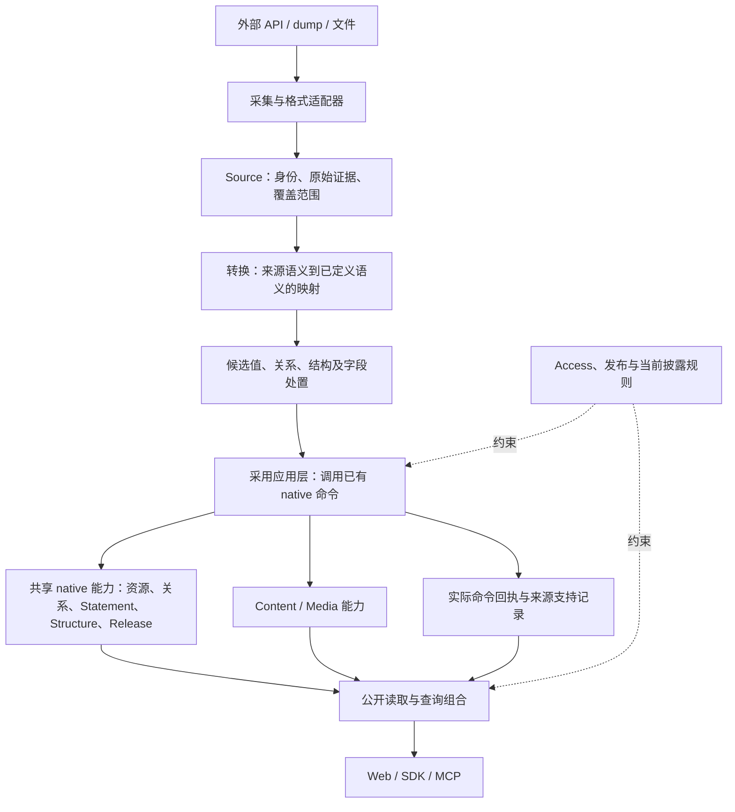

# 审计修复：模块抽象设计审阅稿

日期：2026-10-19。状态：供 maintainer review；本稿整合既有设计与当前代码，并标出建议调整，不代表这些调整已实现或审计已通过。

> Maintainer 已纠正转换边界：转换属于独立 lib，服务器仅可通过单独接口显式调用，主要接口不做自动转换；来源标注与转换完全独立。下文关于“转换内置 Source”及“标注依赖转换”的建议已失效，按[最新指示](../goals/audit-remediation-20261019/conversion-citation-direction.md)修订。来源标注的学术与 Wikipedia 工程调研已交给独立研究员；本文将汇总其结果。

核对基点：main `820e302816fcada42fd8bbfa360934be3d81d3da`；修复分支 `wave/audit-20261019` 的 `f14fae6aa6ab96344a444f73ff0f104204540371`。另核对了来源字段扩展工作区中的实现；未发布部分单独标注。

本稿覆盖两份审计涉及的共同模块，重点是 Source、转换与 REZICS native 的边界。既有总体设计见[目标架构](target-architecture.md)、[已选架构](overview.md)和[来源生命周期](../contracts/source-lifecycle.md)。它们已经定义了主要方向，本次需要核对的是实现是否遵守这些边界、实际数据是否贯通。

## 1. 建议采用的整体设计

**来源保存证据，转换解释外部语义，native 能力维护正式状态；应用层把这些步骤组成可重试的用户任务。**

Book、Recipe、Game、Character 等类型复用同一组能力。来源之间的差异放在适配器，描述领域之间的差异放在已接纳的模型定义，权限始终由 Access 决定。

这些方框表示责任边界。当前可以在 Main 内以模块和函数实现，共享现有存储与命令设施。

## 2. 最需要 review 的五个选择

| 选择 | 建议 | 取舍理由 |
| --- | --- | --- |
| 转换放在哪里 | Source 边界内的纯适配器；输入是可验证的观察，输出是有类型的映射结果 | 外部字段格式可变化，native 的语义与权限保持稳定 |
| 正式采用怎样实现 | 小型应用层调用既有 native 命令，并保留回执和支持关系 | 复用已有权威写入，允许跨存储步骤恢复 |
| native 怎样扩展领域 | 以资源、属性、关系、Statement、结构、版本、内容等共享能力承载；领域通过模型定义和能力绑定配置 | 同一修复能覆盖多个领域，同时保留领域所需的精度与关系语境 |
| 导入器负责多少 | 采集调度、分页、限流、调用 API、记录检查点与恢复；业务判断归服务端 owner | 导入器是 API 客户端，其他客户端能得到相同结果 |
| 需要多大的通用框架 | 复用现有模块，增加必要的纯映射函数和少量明确的 owner 接口 | 当前问题有明确实例，暂没有证据需要新的 DSL、工作流引擎或微服务 |

以上是推荐组合。“最佳”应由后文的跨来源、跨类型和失败恢复反例检验，不能由接口数量或概念数量证明。

## 3. 各模块的责任与依赖

| 模块 | 负责的正式结果 | 输入与输出边界 | 状态归属 |
| --- | --- | --- | --- |
| 采集适配器 | 从特定 API、dump 或文件获取资料 | 外部格式 → 原始字节、外部身份、采集时间与覆盖说明 | 采集过程与游标 |
| Source | 保留观察及其证据；维护来源身份、映射依据与支持关系 | 带出处的观察 → 可精确引用的证据 | 来源记录、观察、转换记录、支持和撤回 |
| 转换适配器 | 按明确规则解释字段、粒度、值和关系 | 精确观察 + 映射版本 → 候选及未映射项 | 结果可以留存；自身不拥有 native 状态 |
| 采用应用层 | 完成一次有权限、可重试的资料采用 | 候选 + 目标 + 当前版本条件 → native 回执、支持结果或具体失败 | 采用意图和阶段结果 |
| native 能力 owner | 校验并写入正式资源、关系、Statement、结构及版本 | 有类型的业务命令 → 权威状态和真实回执 | 各能力唯一的正式状态 |
| Content / Media | 正文、草稿、二进制对象、变体及交付 | 明确内容或媒体命令 → 精确版本、可用引用与交付结果 | 各自内容与媒体状态 |
| Access / 发布 | 当前操作权限、发布与披露判定 | 主体、操作、目标和范围 → 准入或拒绝 | 权限与发布决定 |
| 查询与读取组合 | 在一个有界读取中返回用户需要的语义、关系和证据 | 已授权范围、筛选、游标 → 可遍历结果与真实完整性 | 读取结果；索引为派生状态 |
| 用户状态 | 阅读进度、收藏、评分、关注、通知与会话状态 | 已准入主体对精确目标的操作 → 私有或明确公开的状态 | 对应已有能力 owner |
| Web / SDK / MCP | 让用户完成任务并保留任务语义 | 同一公开能力 → 交互与反馈 | 界面临时状态，不复制业务权威 |

推荐依赖方向是“客户端 → 应用层 → 能力 owner”。来源适配器可以依赖共享的值编解码和模型定义；native owner 的实现不识别 VNDB、Bangumi 等来源名。

导入脚本调用 Main 的公开命令。服务端转换代码的生产依赖应归属于服务模块或已经存在的共享纯代码位置。

## 4. Source：稳定身份与精确观察

### 4.1 三种身份分别存在

- **来源记录**：`provider + namespace + externalId` 表示来源中的同一对象。重新采集或换快照不会自动创建另一身份。
- **来源观察**：某时刻取得的具体版本、字节、覆盖范围和采集依据。相同记录可以有多次观察。
- **native 对象**：由 REZICS 分配和维护的正式身份。来源与 native 的对应需要显式记录；同名不构成合并依据。

本次保留的两组 113 身份关联按各自数据时期验证，不能拼成同一时期的证据。

### 4.2 分片是证据的传输方式

完整记录较大时，可以由多个有界 intake 组成。重组必须验证每片的实际接收回执、顺序、字节摘要、总长度和整份内容摘要。某片观察的身份不能冒充完整来源记录的身份。

原始字节摘要、解析后记录摘要和转换结果摘要各有含义。重新序列化 JSON 得到的摘要不能替代原始字节摘要。

数据集快照、文件摘要、归档坐标属于对应采集格式的证据。普通在线来源接入不应被强制转换成开发数据集的格式。

### 4.3 支持关系的粒度

支持记录连接“哪次观察中的哪项资料”与“哪个 native 对象的哪个值、关系或 occurrence、哪个版本”。同一值可以有多个独立支持。

撤回一项来源支持，应保留其他支持和人工控制。来源更新缺少某字段时，先检查覆盖说明，再决定是否构成删除；局部观察缺项不能触发全量删除。

## 5. 转换：纯规则与有限的共享值体系

转换器应当可以离线运行、重复运行，并由服务端用保留证据重新验证。相同证据与相同映射版本应产生相同语义结果。

复用现有语义值编解码，保留语言、时间精度、数量单位、顺序与重复 occurrence。`omitted`、`null`、空字符串、空列表和未知值保持可区分。客户端语言不能补成来源语言。

每个来源字段都有处置：形成候选、仅保留为来源、交给另一已有能力处理，或明确未映射并说明原因。候选的存在不自动表示采用、发布或搜索已经完成。

可复用的共同部分包括值编码、证据坐标、存在性、顺序和摘要。来源字段名称及其真实含义属于适配器。例如 Bangumi 章目信息与音乐录音的排列，都可以映射到有序关系能力，但不能仅因两者都是数组而采用相同业务含义。

**建议保持有界的显式适配器。** 当前已有注册映射的方式；只有出现多个实际使用者都需要的稳定机制，才抽取共同部分。模型约束、转换规则和运行时业务权限分别由现有 owner 维护。

## 6. Native：共享能力承载不同类型

native 是正式语义与行为的集合，现有实现分布在各能力 owner 中。设计中不需要另建一个包含所有业务规则的 `native` 大模块。

| 要表达的意思 | 使用的共同能力 | 需要保留的区别 |
| --- | --- | --- |
| 作品、人物、组织、角色、概念 | 资源身份、已接纳类型、命名与属性能力 | 角色、人物、作品保持各自身份；无需把它们全部变成 Work |
| 简介、别名、日期、数量、领域事实 | 已接纳属性和值；需要独立主张和接受依据时使用 Statement | 语言、精度、单位、适用范围与来源 |
| 制作人员、声优、人物在作品中的角色 | 有语境与限定条件的关系或 occurrence | 参与者、角色、作品范围、顺序及重复出现 |
| 季／集／章节／曲目及其他组成 | Structure、组成和有序 occurrence | 实体本身与它在某结构中的一次出现 |
| 发行、版本与具体实现 | Release / realization 等已有版本能力 | 一个选择条件对应同一个具体版本 |
| 正文与图片 | Content、Media 及其精确版本和用途关系 | 原文与摘要、原图与变体、封面与其他用途 |

描述性新领域通过定义类型、属性、关系及能力绑定加入。新增行为若现有能力不能表达，应扩展真正拥有该行为的共享 owner，并用第二个适用类型验证复用。

Recipe 的精确份量运算、Book 的章节阅读等实际行为仍需要可执行规则。语义配置负责描述含义，已有能力负责执行相应规则；不能以任意 JSON 替代约束或行为。

## 7. 正式采用、回执与恢复

采用流程复用已有命令、Access 准入、版本条件、回执和恢复设施：

1. 验证保留证据、映射版本与目标对应。
2. 根据当前主体和用途取得 native 操作准入。
3. 调用拥有目标值或关系的 native 命令；目标 owner 校验类型、约束与当前版本。
4. 保存该命令的真实回执，再建立相应来源支持。
5. 返回实际阶段结果；重试根据相同意图和既有回执继续。

native owner 提供一个窄的校验边界：给定真实命令回执、目标及预期结果，确认该命令写入了什么、对应哪个版本，以及它是否仍适用于当前值。Source 保留证据与支持，避免自行复制各 native owner 的状态解释和权限规则。

PostgreSQL 与 TDB2 没有共同事务。单个 owner 内的变更用它已有的事务和版本比较保证；跨 owner 步骤通过可恢复意图、真实提交证据和幂等重试衔接。某步已提交、下一步未完成时，结果保留为待完成，并可恢复。

“提交前检查过目标版本”与“同一事务保护了目标版本”必须分别说明。字段后来被修改时，旧支持仍能说明历史采用，但当前读不能把它当作另一个新值的证据。

## 8. Media 与公开阅读

Media 导入沿用 Source 的证据、Media 的对象与变体、native 的用途关系和当前交付规则。来源图片 URL 本身只说明一个位置。完成的结果需要能交付实际图片，并绑定正确对象、用途和返回的变体。

原始图片与派生图片保留各自摘要。来源署名、许可说明与用途跟随相应对象。现有[来源政策](../contracts/source-lifecycle.md)已经区分资料文本和封面处理；实现沿用该政策。

公开读取由服务端组合已采用数据、当前可见性和可显示的来源信息。用户可从作品走到人物、角色、发行或章节，再通过反向关系返回。读取和来源支持集合都需要完整的遍历方式。

Book 的真实章节、前后章和进度恢复，Recipe 的原料 occurrence、步骤与份量结果，是上述能力组合的验收实例。它们分别使用已有内容、结构、计算和用户状态能力；目录记录完整与正文可阅读分别验证。

## 9. 查询、取消与前端状态

### 9.1 一个任务共享预算与取消

Web、BFF、Main 与底层读取传递同一个绝对截止时间和取消信号。预读取与重试消耗同一任务的剩余预算。客户离开后，所属读取及时停止；正常任务不能通过不断延长超时获得成功。

查询保留筛选条件的绑定范围。例如“某角色在同一作品中具有某 trait”需要验证同一个关系语境；不能从不同作品或不同角色拼出符合条件的结果。

### 9.2 结果边界与状态边界

游标绑定实际选定的范围与版本条件。请求预算决定一次能做多少工作，分页和继续扫描保证用户最终可遍历；预算耗尽时返回真实的部分结果或恢复入口。

未取得完整覆盖时，结果不能宣称精确为零。未知、读取失败、未发布、无权读取和确实为空由对应 API 表达；普通界面以可理解的反馈呈现。

多社群评分按所选社群及目标保持独立语境。一个目标或投影待修复时，只限制受影响的结果，同时保留当前撤权检查和其他可用结果。

### 9.3 前端共享交互与领域呈现

前端复用资源卡片、遍历、搜索、状态反馈、编辑保留和恢复机制；具体领域可有适合任务的布局。接口编辑必须保留当前表单无法表达的既有字段。草稿恢复包含完整作者输入和目标上下文；恢复快照在新编辑之后不能覆盖用户的新输入。

前端能力目录引用服务端能力和权限结果。界面可以定制呈现，业务准入与持久化仍通过同一 API 完成。

## 10. 核对到的现有实现与具体差距

| 项目 | 已核对的事实 | 需要的工作或证据 |
| --- | --- | --- |
| Source 接收 | 已有 [intake](../../services/main/src/modules/source/intake.ts)，包含来源身份、原始字节、覆盖说明和权利依据 | 核对真实导入调用和大记录处理，不应把这一模块当作空白重建 |
| 来源映射 | 已有[适配器注册](../../services/main/src/modules/source/provider-adapters.ts)、[共同映射结果](../../services/main/src/modules/source/mapped-values.ts)和具体来源转换器 | 扩展实际未覆盖的来源语义，并验证字段保真 |
| native 采用 | 已有[候选提案](../../services/main/src/modules/source/native-work-proposal.ts)、[Work 正式采用](../../services/main/src/modules/source/native-work-adoption.ts)、字段应用、子项和署名流程 | 其中 Work 采用的声明范围包括标题及语义类型；不能据此认定其他事实与关系已经完整采用 |
| 来源支持 | 已有[字段挂接](../../services/main/src/modules/source/support-attach.ts)、控制与撤回 | 本轮扩展需要覆盖更多 native owner，并验证精确值、目标、版本和回执 |
| 导入编排 | 已有[导入器](../../scripts/datasets/import.ts)，修复分支增加了字段、关系、署名、版本与媒体映射 | 映射代码、实际采用结果与公开读取分别取证 |
| 新增保留记录转换 | 本轮工作区新增完整记录与分片证据核验 | 这属于既有 Source 的扩展；需通过真实数据与服务组合验收 |
| 模块依赖方向 | 来源字段扩展工作区的 `source/retained-record.ts` 动态导入 `scripts/datasets/native/fields.ts`，并使用工具脚本的 `DatasetRecord` 类型 | 建议把服务所需的纯映射和证据契约放回 Source 适配器边界；导入工具消费相同契约或 API |
| 端到端证明 | 已有不少组件、映射和局部测试结果 | 需要真实导入、普通用户读取与原审计任务在同一固定版本上通过；局部测试不能替代 |

最后一项依赖调整是本稿的明确建议，尚未宣称已完成。最小做法是迁移实际被服务消费的纯逻辑并保留行为等价测试；暂不引入新包体系或重新组织全部数据集工具。

## 11. 比较过的替代方案与调研依据

调研日期：2026-10-19。下列标准和工程资料用于核对边界，产品选择仍需由本项目的反例与实现验证。

| 方案或依据 | 可取之处 | 本项目的选择与限制 |
| --- | --- | --- |
| 每来源各自写 native 并维护专用读取 | 单一来源接通快 | 来源、领域与正式能力交叉增长，权限和恢复容易复制；仅保留格式与语义解释的来源适配器 |
| 通用任意图转换 DSL | 表面上可描述很多映射 | 还需定义类型、语境、权限、回执、更新与恢复，当前投入和语义风险过大；使用显式映射及现有模型体系 |
| [Microsoft：语义适配边界](https://learn.microsoft.com/en-us/azure/architecture/patterns/anti-corruption-layer) | 将外部系统的语义转换隔离在边界，且可实现为应用内组件 | 采用薄适配器；其工程开销提醒我们按实际需要限定范围，不由此增加独立服务 |
| [Google AIP-121](https://google.aip.dev/121) | 从资源及关系设计 API，支持适合任务的命令，要求可读取变更结果 | 沿用正式资源与已有领域命令；本文没有采用其全部 API 风格，也不把图关系限制为其资源层级约束 |
| [W3C PROV-O](https://www.w3.org/TR/prov-o/) | 区分实体、活动、主体与派生依据，支持限定关系 | 复用现有来源与派生表达；该标准本身不证明资料正确、已获准采用或可公开 |
| [Schema.org Role](https://schema.org/Role) | 关系自身可以带角色和其他限定信息 | 用于核对署名及参与关系的粒度；本项目的精确 occurrence、权限和版本由已有 owner 定义 |
| [JSON-LD 1.1](https://www.w3.org/TR/json-ld11/) | 区分语言值、类型值与列表等表示 | 核对转换和导出是否保留语义；普通读取仍使用固定已知上下文，协议支持不代表所有来源已通过验证 |

现有类型、模型编解码、命令与存储设施已能承载该方案。此次核对没有发现为了这些模块边界必须增加的新依赖。

## 12. 用什么证明抽象恰当

1. **新增来源**：在第二个来源上复用同一 native 采用、支持、撤回和读取路径；native owner 无需增加来源分支。
2. **新增描述类型**：通过模型定义与能力绑定加入新类型，复用身份、关系、结构、媒体和公开读取；共同 owner 无需新增领域专用状态。
3. **相同参与者多次出现**：同一个人担任多个角色、同一原料出现多次，都保留各次 occurrence 与来源。
4. **不完整与未知**：局部记录缺项、未知日期或语言、读取失败时，保留真实状态，不制造删除、零值或确定结果。
5. **人工编辑与来源刷新并发**：版本不一致得到明确冲突；已由人控制的字段不会被自动刷新覆盖。
6. **中断与撤回**：native 已提交但来源支持未提交时能够恢复；重复执行不重复创建对象；撤回一个支持不损坏其他支持。
7. **媒体与具体版本**：图片交付对应真实目标和用途；两个版本的属性不会拼成第三个可选择版本。
8. **完整用户任务**：真实资料可导入、搜索、打开、关联跳转和返回；阅读进度可恢复；取消释放所属工作。

这些是语义与模块边界的验收。吞吐、延迟和世界一流的使用体验仍需要各自的实际测量与用户任务证据。

## 13. 待 maintainer review 的具体内容

请重点审阅第 2 节的五项选择，以及以下三处边界：

- 转换器输出候选和字段处置，正式采用仍调用已有 native 能力。
- Source 支持通过 native owner 的窄接口验证，避免复制 owner 规则。
- 服务所需的映射逻辑归服务的 Source 适配器边界，数据集脚本保持 API 客户端职责。

上述方向内的已有能力接通、缺陷修复和真实验收继续推进。需要引入新抽象或改变这些模块责任的调整，在本稿中明确标为建议，供本次 review 决定。
