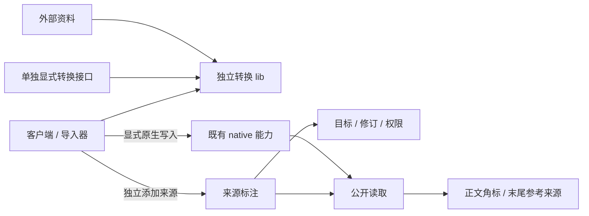

# 审计修复：模块抽象设计审阅稿

日期：2026-10-19。状态：供 maintainer review；本稿整合既有设计与当前代码，并标出建议调整，不代表这些调整已实现或审计已通过。

> 第二版：转换独立 lib、显式单独转换接口、普通原生接口不自动转换、来源标注独立，均已按 maintainer 指示修正。学术、Wikipedia/Cite 与仓库研究已由独立研究员完成；具体引用建议见[调研汇总](source-citations-review-20261019.md)。

核对基点：main `820e302816fcada42fd8bbfa360934be3d81d3da`；修复分支 `wave/audit-20261019` 的 `f14fae6aa6ab96344a444f73ff0f104204540371`。另核对了来源字段扩展工作区中的实现；未发布部分单独标注。

本稿覆盖两份审计涉及的共同模块，重点是 Source、转换与 REZICS native 的边界。既有总体设计见[目标架构](target-architecture.md)、[已选架构](overview.md)和[来源生命周期](../contracts/source-lifecycle.md)。它们已经定义了主要方向，本次需要核对的是实现是否遵守这些边界、实际数据是否贯通。

## 1. 已确认的整体边界

转换在独立 lib 中完成；客户端和导入器显式提交转换所得原生数据。服务器可以通过单独的转换接口调用同一 lib，普通原生接口不自动转换。

来源标注是一项独立能力。原生数据可先手工创建、以后补引文；转换可只生成草稿。引用 API 校验其目标、修订、权限和参考资料，不要求 converter、conversion ID、mapper 或字节相等。

Book、Recipe、Game 等复用共同 native 能力；权限由 Access 决定。上述 lib 与主要接口的分离是已确认要求，引用的具体字段和呈现细节按调研建议 review。

## 2. 最需要 review 的五个选择

| 选择 | 当前结论 | 状态 |
| --- | --- | --- |
| 转换放在哪里 | 独立 lib；显式服务端转换接口可调用；普通接口不自动运行 | Maintainer 已确认 |
| 来源标注依赖什么 | 原生目标、修订、准入与参考资料；独立于转换及其证明 | Maintainer 已确认 |
| 最小引用模型 | 可复用参考资料描述 + 独立引文关联；标记使用现有内容结构 | 调研汇总建议 |
| 同源不同页如何显示 | 先分条列出；明确复用的条目共享脚注项并保留各回链 | 待 review 的显示取舍 |
| 新增多少框架或库 | 移动已有转换算法；基础引用沿用现有编辑/阅读设施 | 调研建议，不新增引擎或 DSL |

## 3. 各模块的责任与依赖

| 模块 | 负责 | 边界 |
| --- | --- | --- |
| 采集工具 | 获取外部字节、身份、覆盖说明 | 采集与转换显式调用 |
| 独立转换 lib | 外部格式到原生草稿、损失和不支持项 | 不连接业务数据库，不决定权限，不自动写入或标注 |
| 单独转换接口 | 显式调用同一 lib | 不成为主要接口的隐藏中间件 |
| 普通 native 能力 | 已准入类型、资源、值、关系、结构与版本 | 接收原生契约，执行原生约束和权限 |
| 独立来源标注 | 参考资料、精确目标关联、编辑与撤回 | 手工数据可引用；证据与派生均非必填前置 |
| 保留证据与派生记录 | 需要时保存观察、材料版本或真实处理历史 | 保持真实含义，按明确用途核验 |
| Content / Media | 内容、媒体与用途、精确版本和交付 | 引文不能替代发布或交付准入 |
| Access / 发布 | 当前权限、发布与披露 | 各主要能力复用，转换库不复刻 |
| 查询 / Web / SDK / MCP | 遍历与呈现同一业务能力 | 阅读引用不重新转换，不隐式抓外部网页 |

依赖中不能出现“普通 native API → converter”“普通引用 API → converter”或“lib → Main/数据集脚本”。具体库名由既有 workspace 的最小移动收敛。

## 4. Source：普通引用与可选强证据

普通引用至少需能够识别参考材料并准确关联原生目标。纸书可用书目和页码；网页可用说明、地址和已知检索/版本信息。不能强制先采集原始字节或生成转换记录。

资料描述、引文关联和实际出现位置分别保留身份与意义。同一个来源可以被复用，一个目标可以有多个引用。撤回一条引用保留其他引用和原生值；修改目标含义不会自动让旧引文支持新值。

原始观察、分片、摘要、托管材料和转换 lineage 属于请求相应更强声明时的可选能力。需要确切材料复核时仍验证真实字节和版本，不把普通引用降成“已验证”，也不将强证据要求反过来强加给手工引用。

目标粒度、版本、镜像、多源、修改与撤下的依据和反例，见[来源标注调研汇总](source-citations-review-20261019.md)。本次两组 113 身份关联仍按各自数据时期保留，不通过此调整重新分配身份。

## 5. 转换：独立库与原生契约

复用并提取现有转换算法，而不是在 Source owner 内继续构造转换系统。库可离线单独调用，输出已有原生契约的草稿、损失和不支持项。客户端与显式服务端外壳使用同一库。

语言、时间精度、数量单位、顺序、重复 occurrence 及 omitted/null/空值仍须保真。输入结构和原生值编解码可以校验；数据库身份分配、业务准入和正式写入由主要接口执行。

已有 Source 中与 SQL Store 混放的映射、数据集脚本中的纯算法与 I/O，需要按这些职责最小提取。Source 普通标注及读路径不运行转换；机器派生重放只在明确请求时调用 lib。

## 6. Native：共享能力承载不同类型

native 是正式语义与行为的集合，现有实现分布在各能力 owner 中。设计中不需要另建一个包含所有业务规则的 `native` 大模块。

| 要表达的意思 | 使用的共同能力 | 需要保留的区别 |
| --- | --- | --- |
| 作品、人物、组织、角色、概念 | 资源身份、已接纳类型、命名与属性能力 | 角色、人物、作品保持各自身份；无需把它们全部变成 Work |
| 简介、别名、日期、数量、领域事实 | 已接纳属性和值；需要独立主张和接受依据时使用 Statement | 语言、精度、单位、适用范围与来源 |
| 制作人员、声优、人物在作品中的角色 | 有语境与限定条件的关系或 occurrence | 参与者、角色、作品范围、顺序及重复出现 |
| 季／集／章节／曲目及其他组成 | Structure、组成和有序 occurrence | 实体本身与它在某结构中的一次出现 |
| 发行、版本与具体实现 | Release / realization 等已有版本能力 | 一个选择条件对应同一个具体版本 |
| 正文与图片 | Content、Media 及其精确版本和用途关系 | 原文与摘要、原图与变体、封面与其他用途 |

描述性新领域通过定义类型、属性、关系及能力绑定加入。新增行为若现有能力不能表达，应扩展真正拥有该行为的共享 owner，并用第二个适用类型验证复用。

Recipe 的精确份量运算、Book 的章节阅读等实际行为仍需要可执行规则。语义配置负责描述含义，已有能力负责执行相应规则；不能以任意 JSON 替代约束或行为。

## 7. 原生写入、独立引用与恢复

原生写入沿用既有 owner 的权限、版本条件、事务和真实回执。添加、编辑或撤回引文是独立操作；它校验精确目标和来源资料，不验证调用者是否运行过 converter。

导入器可显式完成“调用 lib → 原生写入 → 按需添加引文”。其中第二步已成功、第三步失败时，只重试引文，不换原生身份，不伪造转换证明，不新增通用跨存储流程引擎。

需要强保留证据或真实派生记录的流程继续维护其回执和恢复语义。旧强 support 可提供已存在资料的兼容读取，但不能靠将其 conversion 外键改为可空就取代普通引用。

精确 target 的版本和准入由现有 native owner 验证；Source 不复制各 owner 规则。提交前检查与同一事务保护的保证仍分别说明。

## 8. Media 与公开阅读

Media 导入沿用 Source 的证据、Media 的对象与变体、native 的用途关系和当前交付规则。来源图片 URL 本身只说明一个位置。完成的结果需要能交付实际图片，并绑定正确对象、用途和返回的变体。

原始图片与派生图片保留各自摘要。来源署名、许可说明与用途跟随相应对象。现有[来源政策](../contracts/source-lifecycle.md)已经区分资料文本和封面处理；实现沿用该政策。

公开读取由服务端组合已采用数据、当前可见性和可显示的来源信息。用户可从作品走到人物、角色、发行或章节，再通过反向关系返回。读取和来源支持集合都需要完整的遍历方式。

Book 的真实章节、前后章和进度恢复，Recipe 的原料 occurrence、步骤与份量结果，是上述能力组合的验收实例。它们分别使用已有内容、结构、计算和用户状态能力；目录记录完整与正文可阅读分别验证。

## 9. 查询、取消与前端状态

### 9.1 一个任务共享预算与取消

Web、BFF、Main 与底层读取传递同一个绝对截止时间和取消信号。预读取与重试消耗同一任务的剩余预算。客户离开后，所属读取及时停止；正常任务不能通过不断延长超时获得成功。

查询保留筛选条件的绑定范围。例如“某角色在同一作品中具有某 trait”需要验证同一个关系语境；不能从不同作品或不同角色拼出符合条件的结果。

### 9.2 结果边界与状态边界

游标绑定实际选定的范围与版本条件。请求预算决定一次能做多少工作，分页和继续扫描保证用户最终可遍历；预算耗尽时返回真实的部分结果或恢复入口。

未取得完整覆盖时，结果不能宣称精确为零。未知、读取失败、未发布、无权读取和确实为空由对应 API 表达；普通界面以可理解的反馈呈现。

多社群评分按所选社群及目标保持独立语境。一个目标或投影待修复时，只限制受影响的结果，同时保留当前撤权检查和其他可用结果。

### 9.3 前端共享交互与领域呈现

前端复用资源卡片、遍历、搜索、状态反馈、编辑保留和恢复机制；具体领域可有适合任务的布局。接口编辑必须保留当前表单无法表达的既有字段。草稿恢复包含完整作者输入和目标上下文；恢复快照在新编辑之后不能覆盖用户的新输入。

前端能力目录引用服务端能力和权限结果。界面可以定制呈现，业务准入与持久化仍通过同一 API 完成。

## 10. 核对到的现有实现与差距

| 项目 | 事实 | 调整方向 |
| --- | --- | --- |
| Source 接收 | 已有 intake 与身份、观察、覆盖、权利依据 | 复用可选证据保留，不作为普通引用前置 |
| 转换算法 | Open Library/Bangumi/VNDB 已有算法，部分与 Store/脚本混放 | 提取到独立 lib，显式入口调用 |
| 普通原生写入 | 研究员抽查的创建/元数据 handler 已收原生 DTO | 保持 native-only；尚非全仓调用图证明 |
| 旧字段支持 | 强制 conversion、mapping、保留字节和值相等 | 保留旧强证据含义，提供独立引用能力 |
| 已有来源输入 | proposal evidence 已有 resource/revision/locator 与手填 UI | 复用输入，补独立生命周期与读者呈现 |
| 正文结构 | Blocks 有稳定 ID 和 extensionInline；reader 暂为 fallback | 补角标、复用、回链、文末列表和保存/导出保真 |
| 未合入扩展 | 先前工作区曾见 Source 动态加载 scripts/datasets/native/fields.ts；研究员基线未含该扩展 | 按实际 diff 抽取 lib，普通标注彻底去掉该依赖 |
| 实际完成状态 | 局部代码、测试与调研不构成原审计验收 | Finding 状态单独由原始产品断言确认 |

具体文件、被遗漏的 Recipe/个人书库消费者、最小迁移与验证条件见[调研汇总](source-citations-review-20261019.md)。

## 11. 调研来源与备选方案

三项独立调研已完成：学术 citation/provenance、Wikipedia/Cite 与库选型、现有代码边界。manager 汇总其共同结论与不同取舍，不将任何论文或外部工程当作本产品已经完成的证明。

[调研汇总](source-citations-review-20261019.md)保留原始论文、W3C 固定规范、Cite 固定提交、实际代码事实、两种编号取舍及验证边界。基本引用建议不新增依赖；CSL 格式化、书目输入插件、通用 selector、完整论证图均非当前前置。

独立 lib 不等于独立微服务。当前选择是移动现有算法并复用 native 契约；普通引用保持手工可用。

## 12. 用什么验证抽象

1. 转换可单独使用，不发生业务数据库、原生写入或标注副作用；显式服务端外壳调用同一库。
2. 未配置 converter 时普通原生写入仍成功，外部格式不被普通 DTO 隐式转换。
3. 原生数据写入后独立添加网页或纸书引用，无 conversion/mapper/字节前置；改写文字不要求逐字相等。
4. 多来源、同源不同页和重复 occurrence 保留精确目标；撤回一条不影响其他引用与原生值。
5. 正文角标、复用、回链、末尾列表及导出往返保真；删除首次标记不损坏其他出现。
6. 修改后不错误续引，隐藏目标或来源元数据不泄露；强保留证据仍按其明确含义核验。
7. 既有导入身份和 journal 重放保持稳定；新增领域继续复用共同 native 能力。

这些是设计验证条件，本次调研没有执行产品或性能验证。确定性修复仍按各自原始断言交付，不等待额外领域完善。

## 13. 本次 review 的具体内容

转换库独立、普通接口不自动转换、来源标注独立是 maintainer 已确认要求。请 review 的是最小引用模型、目标粒度、同源不同页的默认显示，以及 Text/Blocks 的引用保真方案。

已有确定性修复和真实验收继续；新增引用细节不应阻塞无关的语言保存、草稿恢复、控件、导航和布局修复。
