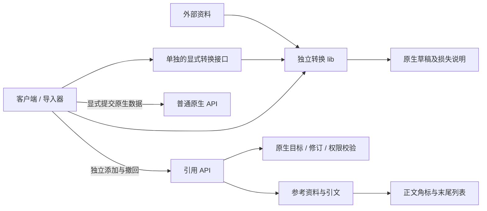

# 来源标注设计：调研汇总与建议

日期：2026-10-19。由三名独立研究员分别完成学术研究、Wikipedia/Cite 工程研究、仓库边界核对；manager 汇总、比较取舍。下列引用模型和显示策略供 maintainer review，不代表已实现或已验收。

## 1. 已确认的边界

转换由可单独使用的 lib 完成。客户端和导入工具调用它；服务器可以提供单独的显式转换接口，调用同一 lib。普通原生接口接收原生契约，不自动转换外部格式。

来源标注独立于转换。作者直接写入原生数据后，可以稍后引用网页、纸书或其他材料；不需要 conversion ID、mapper、原始字节托管或一次转换运行。转换也可以只产出原生草稿，不创建标注。

## 2. 三份研究共同支持的建议

用**可复用的参考资料描述 + 独立引文关联**承载普通引用；正文中的标记、显示编号和文末列表是其阅读呈现。

- 参考资料说明“引的是哪份材料”。URL、DOI、作者、出版信息、纸书版次等按实际资料填写；纸书不强制 URL。
- 引文关联说明“在什么原生内容上引用它”，包含精确目标、所用修订和必要的来源内部定位，例如页码。多值字段、限定关系和重复出现必须可区分。
- 来源作者、数据作者与添加引用的人是不同角色，复用已有身份和修订设施表达。
- 引用表达编者提供的参考关系。保留证据、机器派生和正确性验证各自表达自己的含义；不得由“有引用”自动推出其他结论。

引用可以支持改写或翻译后的正文；源文字和正文不同不构成拒绝普通引用的理由。逐字相等只能是一项明确请求的额外检查。

## 3. 学术依据及采用范围

| 原始研究或规范 | 调研得到的结论 | 本项目采用与限制 |
| --- | --- | --- |
| Buneman、Khanna、Tan，[Why and Where](https://www.pure.ed.ac.uk/ws/files/16509989/Why_and_Where_A_Characterization_of_Data_Provenance.pdf)，ICDT 2001 | 输出值来自哪里，与哪些输入使查询产生结果，是不同问题 | 借用精确位置和粒度的区分；普通引文无需提供数据库查询 witness |
| Buneman 等，[A Provenance Model for Manually Curated Data](https://homepages.inf.ed.ac.uk/opb/papers/ipaw2006.pdf)，IPAW 2006 | 人工录入、改写和就地更新不满足全部操作均在受控计算流水线中的假设 | 原生手工创作与后补引用必须成立；不强制记录全部编辑操作 |
| Green、Karvounarakis、Tannen，[Provenance Semirings](https://www.cs.ucdavis.edu/~green/papers/pods07.pdf)，PODS 2007 | 受限定的关系查询可以表达输入贡献的不同组合方式 | 真有自动推导需求时另评估；不为普通脚注引入全量依赖多项式 |
| Clark、Ciccarese、Goble，[Micropublications](https://link.springer.com/article/10.1186/2041-1480-5-28)，2014 | 归属、主张、支持、方法和质疑可以分别表达 | 普通引用不冒充验证结果；暂不建设完整论证图 |
| [W3C PROV-DM](https://www.w3.org/TR/2013/REC-prov-dm-20130430/)，2013 | 派生描述实体间的产生关系，具体 activity 等细节可选 | 仅在真实存在派生时记录；不将所有 citation 写成机器派生 |
| [W3C Web Annotation Data Model](https://www.w3.org/TR/2017/REC-annotation-model-20170223/)，2017 | 注释、body、target 分离；selector 与 state 分别限定片段和资源状态 | 采用目标及修订思想；不照搬完整 Annotation Protocol 或通用选择器平台 |
| [FORCE11 Data Citation Principles](https://force11.org/info/joint-declaration-of-data-citation-principles-final/)，2014 | 数据引用需要适合所作声明的识别、粒度、版本与可取回性 | 对需要复核确切材料的引用增加版本/存档；普通引文不强制自存全文 |

共同边界是：摘要可以核对所指字节，不能证明材料所述为真；可复现转换也可能复现错误。镜像数量和引用数量不等于独立证据数量。

## 4. Wikipedia/Cite 的实际工程启示

研究员检查了 Cite 提交 [f52ee14eff044202a5da62faf749ffe84d12ac99](https://github.com/wikimedia/mediawiki-extensions-Cite/commit/f52ee14eff044202a5da62faf749ffe84d12ac99)（2026-10-16）和固定版本的 [Help:Cite](https://www.mediawiki.org/w/index.php?title=Help:Cite&oldid=8659241)。检查的是固定源码，不宣称它就是所有 Wikipedia 的线上部署版本。

| 实际机制 | 对 REZICS 的建议 |
| --- | --- |
| ref 在正文产生标记，references 收集注释内容；注释内容也可以是普通文字 | 支持正文角标和文末集中来源，手填资料无需先有机器解析后的完整书目 |
| 命名引用按 group + name 复用；显示编号与锚点身份分离 | 使用稳定引用/出现身份；显示号由当前阅读范围派生 |
| 多个标记可指向同一个脚注项，脚注项提供多个回链 | 重复引用保留每个出现位置，并能返回原处 |
| Cite 的内容可能依附第一个定义，删掉它会令后续空引用失效 | 参考资料独立保存，删除第一个标记不损坏其余引用 |
| 分组、局部列表、错误恢复与子引用有额外复杂度 | 先交付正文角标、复用、回链和末尾列表；不复制整个 wiki 解析系统 |

[Cite 的记录](https://github.com/wikimedia/mediawiki-extensions-Cite/blob/f52ee14eff044202a5da62faf749ffe84d12ac99/src/ReferenceStackItem.php)、[命名复用](https://github.com/wikimedia/mediawiki-extensions-Cite/blob/f52ee14eff044202a5da62faf749ffe84d12ac99/src/ReferenceStack.php)、[标记格式](https://github.com/wikimedia/mediawiki-extensions-Cite/blob/f52ee14eff044202a5da62faf749ffe84d12ac99/src/FootnoteMarkFormatter.php)分别是这些结论的一手实现依据。引用渲染、书目格式化、从 URL 提取元数据是不同工作。

## 5. 推荐的最小模型与显示策略

| 逻辑内容 | 最小职责 |
| --- | --- |
| Reference | 稳定身份、可读资料描述，以及所选择的描述修订；版次/地址等按资料实际具有的信息记录 |
| Citation | 独立身份、原生目标及其修订、Reference、可选页码/章节等 locator、已有编辑与撤回信息 |
| 正文标记 | 使用现有内容结构保存稳定出现位置或引用 ID；编号不作为持久身份 |

前两项是两个逻辑领域记录，正文标记复用内容结构。这里没有提出第三个脚注服务、全局编号表或新的 provenance 引擎。具体字段及存储复用由既有 schema/owner 收敛。

精确目标优先复用现有资源修订、component/field、Statement/限定关系、Structure occurrence、正文块或行内节点身份。整资源引用明确表示总参考，不能自动解释为每个字段均有依据。任意字符范围可后续增加，固定版本和 Unicode 计数规则仍需明确。

**正文内角标是交付目标。** Blocks 已有行内扩展节点的入口，但通用 reader 当前只有 fallback。正文引用必须在编辑、保存、往返和阅读中完整保留；Text profile 尚无同样节点，不能静默丢失引用。文字选区注释可以分步实现，角标本身不能被“先支持块级”替代后便宣称全部完成。

两份工程建议对“同书不同页如何编号”提供了不同合法方案：一份建议共用书目编号、在各回链上显示页码；另一份建议按 locator 分条。**汇总建议：首版不同页码分条，明确复用的同一引用条目共用脚注项，保留每个回链。** 参考资料仍可共享，不复制整份书目信息。显示策略供本次 review，不把它写成转换或存储权威规则，也不按相同 URL/标题擅自合并身份。

例如阅读结果应能表达：

> 作品的这一项资料。［1］
> 另一段解释。［2］
> 再次引用同一条资料。［1］
>
> 参考来源
> 1. 某书，指定版次，第 12 页。〔返回第一个位置〕〔返回第三个位置〕
> 2. 另一篇文章，指定章节。〔返回第二个位置〕

列表按明确的文章/章节或详情阅读范围生成。过滤目标、引文和来源的可见性之后再编号；隐藏资料不能先进入浏览器载荷再靠 CSS 隐藏。角标是可操作链接，文末有返回具体出现位置的入口，hover 只作为补充。

## 6. 修改、撤回与可选证据

- 删除一条引用不删除原生值、共享资料和其他引用。
- 改正文含义或换来源版次不能静默让旧引文支持新内容。旧修订保留原关系；当前目标是否仍匹配由既有修订/编辑机制确认，歧义时明确要求重新定位。
- 引文撤下、论文撤稿、主张被纠正分别表示。被撤稿的材料仍可能用于批评或历史叙述。
- 普通引用不需要快照。若明确承诺恢复当时确切材料，则需不可变来源版本或可取回的保留材料；digest 本身不能代替材料。
- 自动派生另记录真实程序、输入输出与执行依据；请求重放时才显式调用转换库。

保留证据与旧强验证 support 的含义继续保持；不能仅把旧记录的 conversion 外键改成可空，就把它包装成普通引用。

## 7. 转换库、主要接口与引用接口

普通原生 API 和引用 API 均不调用 converter。转换库不分配持久身份、不连接业务数据库、不决定权限、不自动创建引用。显式转换接口调用同一库，原生写入仍另行准入；库不直接依赖 Main 或数据集脚本。

## 8. 现有代码怎样最小调整

仓库研究基线为 `5b80beb702`；该基线不包含其他工作区尚未合入的 retained-record 扩展，未将其误称为已验证。

| 核对到的实际代码 | 调整建议 |
| --- | --- |
| Open Library/Bangumi/VNDB 已有映射算法，部分与 Store、服务异常或 Node 设施混放 | 移动现有纯算法到独立可消费库；纯原生 codec 复用现有 model 包；不重写成 DSL |
| 已有显式转换路由；抽查的普通创建和元数据 handler 接收原生 DTO | 显式路由改调同一库，保持普通 API 的原生输入边界 |
| source/support-attach 及旧 SQL 要求 conversion、mapping、保留字节和值相等 | 复用目标和权限校验，新增最薄的独立引用路径；保留旧证据语义与既有身份 |
| proposal evidence 已有 resource/revision/locator 和手填来源 UI | 复用这些已有输入，而不把它误当作已经具备独立引用生命周期 |
| document 的 Blocks 已有稳定 ID 和 extensionInline；reader 暂无正式引用收集 | 在现有 schema、编辑器和 reader 内增加小型引用支持，覆盖保存、SSR、导出与回链 |
| Recipe 和个人书库也有显式来源导入消费者 | 一并迁移，避免只改目录导入而把转换/引用耦合留在其他入口 |

保留导入 journal、重放键和现有资源/来源身份。原生写成功、添加引用失败时重试引用，并清楚表示待补来源；无需重建对象或新增通用跨库事务平台。平台导入已有的署名义务由其明确流程完成。

## 9. 库选型与必要验证

基础角标和末尾列表建议**不新增依赖**：现有 Tiptap/ProseMirror 已有节点扩展机制，[官方 footnote 示例](https://prosemirror.net/examples/footnote/)可参考，但不原样复制把共享资料塞在第一个脚注中的结构。

完整 CSL 书目格式才需要评估 [citeproc-js](https://citeproc-js.readthedocs.io/en/latest/running.html)；书目格式导入可另评估 [Citation.js](https://citation.js.org/)。研究发现候选的额外依赖、版本/许可和 Bun/浏览器兼容性仍需核对；本稿不建议为简单引用引入它们，也未安装任何包。

实现需证明：手写原生数据后独立引纸书；改写文字无需逐字相等；同源不同页与多源并存；重复标记和删除首次标记；修改后不错误续引；私有来源不泄露；原生接口不间接运行 converter；转换单独使用不产生数据库或引用副作用。

三项研究均未执行产品或性能验证。本次交付是调研汇总与设计建议；它不增加原审计已完成数量。角标的手机、键盘和读屏效果，以及输入法、撤销、协作和导出的保真，由实现 owner 在实际界面验证。
