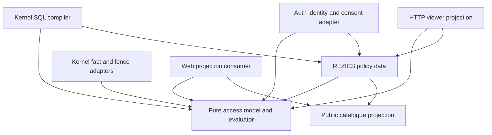

# Access as a bounded logical model

Research date: 2026-11-05. Repository revision inspected: `8180ff57d7bf6ecaec32b4a96eb53f2f89b8d4b4`.
This is an independent desk-research recommendation, not an adopted replacement for the owner contracts.
The implementation assessment combines a complete file/import census with targeted source and acceptance reading;
it is not a security audit of every file. No packages, spikes, services or product tests were run.

**Recommendation:** own a small, serializable, typed authorization algebra, with a pure reference evaluator and
partial evaluator under `packages/`. Keep authoritative fact acquisition, temporal storage, revocation fences and
command admission in Kernel adapters. Compile the same admitted policy into SQL predicates and viewer decisions.
Keep one REZICS policy catalogue independent of HTTP routing. Do not extract the entire current Access directory
as a library, and do not stop at extracting its permission strings.

Confidence is **medium-high for this narrow architecture**, **medium for owning its implementation instead of
adopting Cedar or a query-planning engine**, and **low for any performance claim before native qualification**.
Cedar is the strongest formal reference and serious alternative. Current OPA and Cerbos have more useful filtering
support than an older survey would suggest. The decisive constraint is the combination of exact SQL filtering,
bounded neighbourhoods, private authority evidence and existing transactional behavior, not TypeScript preference.

## 1. Logical model

### 1.1 Separate the question, the evidence and its acquisition

Authorization is a function of a request, a policy and a qualified world:

```text
evaluate(policy, request, facts) -> decision + explanation + obligations
specialize(policy, knownFacts, symbolicResource) -> residual predicate
```

Neither function authenticates a JWT, reads a clock, queries a database, catches an HTTP error or writes an audit
record. An adapter establishes which facts are authentic, complete and current. The pure functions reason about
those facts. Purity does not make facts trustworthy; accepting an arbitrary JSON object containing `active: true`
at an enforcement boundary would be a security defect.

Use three boundaries: **logical semantics**, **evidence/storage**, and **enforcement/presentation**. A database pool
is an evidence mechanism. An opaque command proof is an enforcement capability. Neither is an entity in the
authorization language. The model remains meaningful in TypeScript, Rust, SQL or a proof assistant.

### 1.2 Entities and relations

Identifiers are tagged opaque values, not UUID bit layouts or HTTP paths.

| Entity | Meaning |
| --- | --- |
| AuthPrincipal | Private human or workload authentication subject, with state and revocation generation. |
| Agent | Public person, organization or automated/service identity that can hold domain authority. An organization need not authenticate as a person. |
| AuthorityContext | Explicit choice of direct authority, represented Agent, or the current dual-authority delegation profile. Carries a selected path, never all possible personas. |
| Client, credential, consent, installation | Distinct identities and approved permission ceilings; possession or registration alone grants no resource rights. |
| Resource | Typed logical target, native owner and stable ID. Its routing locator is separate adapter data. |
| Permission | Independently grantable action on an applicable resource type. An operation may require several permissions. |
| RoleRevision | Immutable named permission set with explicit applicability. A new revision does not silently widen an existing approved ceiling. |
| Binding | Grantee, role revision or explicit permissions, scope, allow/deny effect, conditions, validity and generation. |
| MemberSet | A qualified relation such as current organization members. A recipient set is not a role or an authenticating principal. |

Core relations are `member(subject, group, admissionGeneration)`, `represents(principal, agent, limits)`,
`authorityParent(child, parent, edgeGeneration)`, `bound(grantee, scope, roleRevision)`, and explicit denial facts.
Each fact has a stable reference, owner, validity interval and generation. Proven absence has meaning only for a
complete, anchored lookup. An unavailable owner or incomplete roster is not an empty set.

The resource graph is broader than the authority graph. A Subject appearing in two Collections does **not** inherit
both Collections' mutation rights merely because both contain it. Define which named parent edge carries which
permissions. Start with one authority parent per declared inheritance dimension and a fixed maximum depth; permit
multiple parents only with a separately bounded, explicitly combined schema. Realm and Zone are not automatically
successive authority parents. Configuration must name the intended path.

Roles collect permissions; groups collect recipients; bindings attach those two at a scope. A permission implication
is an explicit, acyclic catalogue relation. Compute its closure when publishing the catalogue, not by walking a
permission graph on every request. Store approved ceilings as explicit permission closures. An empty ceiling permits
nothing; a missing mandatory ceiling is unavailable, not unrestricted.

### 1.3 Requests and the important compatibility distinction

```text
q = (authenticatedPrincipal | anonymous,
     selectedAuthorityContext, client, credential, action, resource,
     trustedTime, authenticationAssurance, policyVersion)
```

The old [identity contract](/home/edge/projects/rezics/rezics/docs/contracts/identity-and-access.md) says that
representation exercises the selected Agent's rights without requiring the actor's unrelated personal target
rights. Current [permission acceptance](../../specs/permission-outcomes.test.ts) instead requires, for its delegated
fixture, **actor grant AND consented scope AND principal grant**. These are different semantics. Preserve the current
profile during extraction; introduce selected representation through an explicit new authority mode and acceptance.
Do not silently reinterpret `requestedBy` or rename current account IDs into the new conceptual entities.

For a direct or represented request, define:

```text
Domain(q) = some applicable allow binding for selectedAuthority(q)
            AND no applicable domain denial

RepresentedAuthority(q) = valid selected representation path
                         AND Domain(q)
                         AND every representation limit admits q

CurrentDelegatedAuthority(q) = valid current assignment
                              AND actorGrant(q)
                              AND principalGrant(q)

Authenticated(q) = callerLive(q)
                   AND credentialCeiling(q)
                   AND consentCeiling(q)
                   AND installationCeiling(q), when applicable
                   AND assuranceSatisfied(q)
                   AND selected authority profile permits q
```

The distinction is data in an admitted policy profile, not a separate evaluation engine. A representation grant
cannot pool the actor's direct rights with the Agent's rights. A workload can hold direct private authority without
creating a public persona. A worker resuming an action must name its authority mode and original basis; it does not
become an omnipotent system principal.

### 1.4 Policy forms and combining semantics

Use a deliberately restricted AST, not arbitrary JavaScript callbacks or an unrestricted rule language:

```text
Term      := typed literal | request field | resource field | bounded fact field
Condition := true | false | equal(Term, Term) | ordered(Term, Term)
           | present(Term) | memberOf(Term, finiteSet)
           | validAt(interval, time) | under(scope, authorityPath)
           | fact(namedRelation, anchoredArguments)
           | all(Condition...) | any(Condition...) | not(Condition)

Rule      := permit(id, target, condition)
           | forbid(id, target, condition)
Requirement := require(id, condition, safeRemedy?)
Ceiling   := intersect(id, allowedPermissionScopeSet)
```

`fact` is a reference to a declared, bounded fact signature, not a function to execute. Quantification is only over
supplied finite collections with declared cardinality. No recursive search, network built-ins, arbitrary regex,
user code, dynamic SQL or open-ended object traversal is in the initial fragment. New fact signatures require one
generic owner adapter, interpreter semantics and a SQL mapping; new verticals using existing signatures need data.

For a policy domain, applicable forbids override permits, and absence of a permit denies. Requirements and ceilings
are intersections: they can only remove authority. Within that domain, policy order is irrelevant. This is not
`last matching rule wins`, and a ceiling is not merely a set of vetoes.

Keep the outer request formula explicit:

```text
Allow(q) = wellFormedAndComplete(q)
           AND hardCallerAndResourceConstraints(q)
           AND exposure(q)
           AND [ PublicRead(q) OR Authenticated(q) OR RegisteredOverride(q) ]
```

Each alternative has its own declared requirements. In particular:

- Public reads are explicit permissions, with resource eligibility and applicable denials. The current public floor
  is independent of an authenticated credential's scopes. Preserve that behavior in the compatibility profile;
  do not accidentally place the scope intersection outside its alternative.
- Exposure is `publiclyOpen(group, T) OR admittedGateGrant(group, selected authority)`. Opening a feature removes
  this prerequisite; it does not grant ordinary resource operations. Gate actions use the same binding model.
- Current Global governance reach is a registered alternative for an enumerated action set. It deliberately bypasses
  the target-local denial domain while retaining its own grant, caller, scope and assignment checks. A target-local
  forbid is therefore not a universal forbid. Represent the exception explicitly and return an audit obligation.
- A hard suspension, credential revocation, representation ceiling or mandatory assurance check cannot be bypassed
  by adding another ordinary permit. The exact treatment of a suspended authenticated request versus a genuinely
  anonymous public request remains the authentication/profile contract.

There must be no generic `isAdmin` escape. Product rules decide whether a ban is a hard resource barrier or a local
permission denial. The current capability manifest requires bans to defeat independent read grants, but marks that
fixture as missing; this needs reconciliation before changing the policy. See section 3.

Internal rule outcomes are `Permit`, `Deny`, `NotApplicable` and `Indeterminate`. At the boundary return
`allow`, `deny` or `unavailable`; only `allow` can execute. A conclusive hard denial may short-circuit unavailable
unrelated evidence. Otherwise an unresolved required input produces `unavailable`. Negation never converts unknown
evidence into permission. Symbolic inputs during specialization are different from unavailable runtime evidence.

More precisely, evaluate conditions in `{true, false, unknown}`: false dominates AND, true dominates OR, and NOT
preserves unknown. For one complete policy domain let `P` be the OR of applicable permit conditions, `D` the OR of
applicable forbid conditions and `C` the AND of requirements/ceilings. Its result is `C AND P AND NOT D`, with empty
`P=false` and empty `D=false`. A missing mandatory ceiling contributes unknown; an explicitly empty ceiling is false.
Only an intentionally absent optional requirement contributes true. A true result permits, false denies and unknown
is unavailable. Empty rule selection is internally NotApplicable and becomes denial at the enforcement boundary.
Malformed policy/request data is rejected before this evaluation. `wellFormedAndComplete` in the outer sketch is
that qualification boundary, not permission to coerce missing evidence to Boolean false.

Step-up is a named unsatisfied requirement with a remedy, not an allow plus a suggestion. A user may be offered a
step-up flow only when disclosure is permitted and satisfying that requirement could make the action available.
Mutable domain validity, such as stock availability or a stale edit revision, remains command validation unless it
is itself an authorization condition.

### 1.5 Explanation

Evaluate into a bounded explanation DAG whose nodes reference policy/rule IDs and fact references. Preserve:
selected authority path; satisfied permit; matching denials; failed requirements; ceiling intersections; policy and
fact generations; and any governance alternative. Do not attempt to find a globally minimal explanation: that is
a different, potentially expensive search problem.

An all-operands-positive fixture can be changed one operand at a time and produce a stable reason such as
`credential_scope_missing`, `principal_grant_missing`, `representation_expired` or `assurance_required`.
Keep the full trace private. The HTTP projection maps it to safe messages or remedies; undisclosed resources still
look absent, and group/controller identities do not leak through reasons. Audit an allow with the exact basis used,
not by recomputing later against changed policies. Denial traces can be capped with an explicit truncation marker.

The evaluator returns obligations such as `recordGovernanceReach`; the command adapter must fulfill mandatory
obligations atomically with the operation. A pure `allow` value is not a transferable command authorization token.

### 1.6 Partial evaluation and exact filters

Let `K` be known request facts and `x` the unknown resource. Specialization produces `R(x)` with this contract:

```text
For every admitted resource x and the same qualified fact snapshot S:
  evaluate(P, K + x, S).decision = allow
    iff evaluateResidual(R, x, S) = true
    iff compiledSQL(R, x, S) IS TRUE.
```

The SQL compiler receives an admitted residual and a trusted mapping of logical fields/relations to columns and
indexed probes. It returns parameterized SQL plus required anchors and static expansion bounds. Table and column
identifiers never come from user-authored policy strings. Unknown operators or missing mappings are compilation
errors, never `TRUE` fallbacks. No residual containing a host callback is filterable.

The adapter must detect unavailable required facts or malformed candidate rows before returning a successful list.
SQL dropping an unknown row from a WHERE clause does not justify reporting a complete empty result. The equivalence
law assumes the same admitted, complete facts on both sides; separate status projections carry qualification errors.

Specify null, absence, Unicode comparison, integer ranges, time precision and intervals once. Prefer tagged
optional values; distinguish known `null` from missing required data. For SQL equality on nullable values, use
explicit presence guards or `IS NOT DISTINCT FROM` as the language requires. Do not assume JavaScript `!==` and SQL
`<>` agree. Use canonical integer-microsecond time strings or equivalent lossless values, with `[start,end)` validity.
An adapter may accept a timestamp syntax but must normalize it without losing PostgreSQL precision.

A schematic read predicate is:

```text
caller/exposure constants
AND resource lifecycle predicate
AND (
  declared public eligibility
  OR (
    credential/consent/representation constants
    AND EXISTS exact scoped grant for selected grantees and permission
    AND NOT EXISTS exact applicable denial
  )
)
```

The actual compiler inserts denial domains in the correct branches. The schematic is not a replacement formula.
For cross-partition parents or memberships, resolve bounded full-key facts first; do not generate a join across
partitions. Consume their qualified generations in the target partition's predicate.

**A predicate is not a bound on a list query.** `WHERE can_read(row) ORDER BY id LIMIT 20` can inspect millions of
denied rows. Offer two explicitly different plans:

1. An indexed stream whose access constraints and ordering are supported by its keys. Give an examined-work bound
   for that concrete plan, including denial checks. An `EXISTS` predicate alone is not such a proof.
2. A bounded candidate window: seek at most `C` raw candidates under a native anchor and keyset cursor, then apply
   the compiled access predicate in SQL inside that window. Return only readable rows and a continuation over the
   examined window. Never repeatedly refill within the request until the visible page is full.

For the second plan, a materialized bounded candidate CTE is one possible implementation, subject to native plan
qualification. An empty visible window is not end-of-list. Its opaque cursor must not expose hidden IDs or counts;
the owner must also assess whether revealing progress through hidden candidates is allowed. Where that disclosure
is unacceptable, require an access-qualified index/prepared view rather than exposing the raw-window interface.
If the product requires a full page through arbitrarily sparse matches, that requires a prepared index or resumable
job; it cannot be guaranteed by a bounded generic filter alone.

### 1.7 Complexity and consistency contracts

Use these parameters explicitly: `N` resources; `A` candidate actions per type; `H` authority ancestors;
`J` admitted membership/representation facts; `R` role revisions relevant to an action; `L` policy AST nodes;
`C` raw list candidates; and `G` stored grant/history rows. Each is independently capped or selected by a full key.

| Work | Bound and required structure |
| --- | --- |
| Catalogue publication | Linear in the published definitions and implication graph, with cycle checks. Large releases use bounded build steps. Not a per-request scan of all verticals. |
| Fact preparation | `O(J + N H)` admitted facts, with indexed seeks costing `O((J + N H) log G)` plus each owner's separately stated constant. No unrestricted membership, descendant or history enumeration. |
| Point and viewer evaluation | Conservative `O(N A [L + H J (R + 1)])` logical/probe work; indexed storage adds a `log G` factor to probes. Shared role/identity facts and memoized AST nodes reduce repeated work without changing semantics. |
| Specialization | `O(L + size of substituted bounded facts)` when retaining a DAG and finite-set nodes. Do not distribute to DNF, which can expand exponentially. Enforce residual node/byte limits. |
| Bounded list window | `O(log M + C)` candidate traversal plus at most `C` point-equivalent authorization evaluations; `M` is the anchored candidate index. No total count or global sort. |
| Grant/revoke | Fixed binding/fence keys and bounded role closure. A large dependent cleanup is resumable; it must not be needed for effective revocation. |

Existing useful starting limits are viewer `N <= 100`, `A <= 64` per type, at most 256 operation bindings per type,
read-decision batches of 200, and membership preparation of at most 2,000 actor/principal pairs. Retain those during
extraction. Proposed additions are an admitted authority depth, representation depth, AST depth, AST size and bytes;
for an initial qualification, test `H <= 8`, representation depth `<= 4`, and `L <= 256` per applicable profile.
Those are proposed limits, not established product capacities. The full Cartesian worst case of today's membership
and action caps is already large: mathematical boundedness is necessary but does not establish acceptable latency.
Measure the maximum admitted composition before choosing final numbers; share exact-key probes and action bitsets
where their semantics permit. Do not introduce runtime price ledgers to compensate for an unbounded plan.

Consistency is a separate contract with semantic consequences. A logical timestamp is not a database snapshot or
a revocation proof. Reads use the repository's repeatable-read snapshot per database and full-key batching rules.
Cross-database facts have an explicit vector of owner generations, not a fictional global transaction. Relevant
fences must be checked at a defined admission/disclosure linearization point. Writes bind those facts to the actual
command attempt and reauthorize on retries. A transaction that needs stronger protection must use the owning fence/
drain protocol; a check followed by an unrelated write has a time-of-check/time-of-use gap.

For the Goal's immediate protection requirement, define: admissions after a committed revocation fence cannot use
the old generation; already admitted work has an explicit finite policy for completion, draining or cancellation.
If "immediate" means no disclosure after revocation returns, revocation must also drain or fence prior readers.
A one-second evidence TTL alone cannot prove either ordering guarantee. Role changes, membership re-admission and
scope reparenting need generation checks, including negative evidence; background cleanup alone is insufficient.

## 2. Requirements fit

| REZICS requirement | Placement in the model | Decisive acceptance |
| --- | --- | --- |
| Private AuthPrincipals and public Agents | Distinct tagged entities and private mapping facts; public attribution is not authority. | A public Agent lookup reveals no controller; selecting a different Agent does not borrow grants. |
| Automated callers and organizations | Workload AuthPrincipal and selected Agent/member-set authority; organization is a grantee, not a human credential. | Active workload succeeds only within its basis; operator rights alone do not grant workload rights. |
| Representation within limits | Explicit selected path, mode and intersected action/resource/time ceilings. | Agent-only target grant can succeed under the new representation profile; unrelated actor rights cannot enlarge it. Preserve current dual-grant tests separately. |
| Suspended, revoked and anonymous callers | Caller-liveness/fence requirements and a declared public-read alternative. | Independently revoke credential, principal, assignment and membership; public reads preserve their specified floor without accepting an invalid bearer as anonymous. |
| Roles and scope hierarchy | Immutable role revisions, bindings and named authority-parent relations. | Parent grant reaches only declared descendants/actions; Collection membership alone grants nothing on a Subject. |
| Explicit denials | Forbid within a named policy domain; mandatory hard barriers outside ordinary alternatives. | Denial defeats an independent allow; registered governance exception remains narrowly scoped and audited. |
| Credential and consent ceilings | Independent required intersections, including pending reductions and installation limits. | Empty or reduced consent denies despite valid JWT and grants; widening a role does not widen an approved ceiling. |
| Step-up | Assurance requirement plus safe remedy. | All grants present but stale authentication refuses execution; fresh proof changes only this operand. |
| Platform exposure | Ordinary Global bindings plus temporal public opening, conjunctive with resource authorization. | Gate grant without target grant denies; target grant without closed-gate admission denies; opening does not grant mutation. |
| N resources' viewer actions in one bounded batch | Point evaluation over selected resources and bounded candidate actions; one shared preparation. | Mixed-type batch has constant owner calls per selected type/database, no per-row transport waterfall, and exact action/operation pairs. |
| SQL filtering over a bounded neighbourhood | Exact residual compiler plus admitted candidate plan. | TS truth equals SQL membership, including NOT/NULL; long denied prefixes cannot make one request refill without bound. |
| User and audit explanations | Stable reason IDs and bounded private trace, with separate public projection. | Each isolated failure names the correct operand; hidden resources/groups remain undisclosed. |
| One formula across Kernel, Auth and web | One admitted policy catalogue/IR and conformance suite; adapters supply facts and projections. | The same input fixture yields equivalent scalar, batch, SQL and permitted frontend projections. No independently maintained browser allow rules. |
| New verticals are configuration | Resource descriptors, policy templates and trusted storage mappings. | A new semantic subtype with existing facts adds definitions/presentation only; no evaluator branch, new permission registry or route-name inference. |

"New resource type" has two costs. A new catalogue subtype on the existing generic graph should cost configuration.
A new storage owner or security primitive needs a bounded fact adapter and review. Calling that implementation
configuration would conceal the work. Neither a policy engine nor this proposal can turn an unknown business
relation into a trustworthy fact without an owner.

## 3. Current implementation measured against the model

### 3.1 What the approximately 380 files contain

The inspected `services/kernel/src/access/` contains **389 files**: 151 TypeScript, 232 SQL, four Markdown and two
JSON. Physical lines are 41,646 TS, 3,106 SQL, 5,599 Markdown and 167 JSON, excluding tests and database migrations
outside that directory. The main README alone is 4,982 lines. Counts are reproducible by enumerating regular files
under that directory and counting lines by suffix; they are not estimates of conceptual complexity.

Much of the file count is one named SQL operation per file: the SQL files average about 13 lines. Prefix groups
include 41 `lifecycle*`, 33 `agent-verification*`, 31 `account*`, 23 `operator*`, 21 `erasure*`, 19 `auth*`, and only
seven `permission*` files. These are filename groups, not a claim of exact responsibility boundaries. The module is
an accounts/control-plane subsystem containing an authorization engine, rather than 389 files implementing one
Boolean function.

The actual evaluator spine is [permission.ts](../../services/kernel/src/access/permission.ts) (1,593 lines),
[permission-check.sql](../../services/kernel/src/access/permission-check.sql) (150),
[request/access.ts](../../services/kernel/src/request/access.ts) (455), and
[access/index.ts](../../services/kernel/src/access/index.ts) (1,135). Large neighboring responsibilities include
[lifecycle.ts](../../services/kernel/src/access/lifecycle.ts) (1,908),
[routes.ts](../../services/kernel/src/access/routes.ts) (1,836),
[agent-verification.ts](../../services/kernel/src/access/agent-verification.ts) (1,442), and
[workflow-approvals.ts](../../services/kernel/src/access/workflow-approvals.ts) (1,104).

An import-specifier census of the 151 TS files finds 90 referencing `pg`, 73 importing SQL files, 42 importing Node
built-ins, nine importing Elysia, 101 referencing Kernel request modules, 80 command modules, 53 database modules,
26 Semantic modules and four Content modules. These overlapping counts include type-only imports. **Zero import
the Effect package.** The issue here is dependency direction and responsibility, not an existing commitment to the
Effect framework.

### 3.2 Concepts present, and where their boundaries fail

| Concept | Concrete evidence | Assessment |
| --- | --- | --- |
| Shared authenticated formula | `permission-check.sql`, `decisions` CTE: actor and optional principal must each have a grant; current denials and assignment validity participate. `permission.ts:preparedFormula` supplies scope/floor/roles. | Strong existing common enforcement path, but its complete semantics span TS and SQL. It is not an independently executable logical contract. |
| Bounded current facts | `permission-inverse.sql`, `permission-membership.sql`, `permission-assignment.sql`; `permission.ts:prepareReadDecisions`. | Real bounded preparation and temporal keys worth retaining. Source inspection does not establish every race or query-plan bound. |
| Roles as data | [resource-roles.json](../../services/kernel/src/access/resource-roles.json), [platform-governance.json](../../services/kernel/src/access/platform-governance.json), [resource-roles.ts](../../services/kernel/src/access/resource-roles.ts). | Roles and resource templates already exist. Compilation drops unresolved roles/types based on the mounted action catalogue; permission meaning and HTTP installation are unnecessarily entangled. No general revisioned custom-role model was found in this spine. |
| Typed grantees | [grant-subject.ts](../../services/kernel/src/access/grant-subject.ts): account, organization/Realm owner/member, active accounts. | Useful recipient distinction; storage conversion flattens several types to identity/role keys and knows routed UUIDs. It is not the older mixed AuthPrincipal/Agent model. |
| Identity and delegation | `request/access.ts:AccountActor` has account ID, client, scopes, `requestedBy`, epoch. [authenticate.ts](../../services/kernel/src/access/authenticate.ts) and assignment SQL establish evidence. | Authentication, selected authority and delegated principal are not yet cleanly independent public concepts. Preserve their actual semantics during migration. |
| Resource hierarchy | [parent-creation.ts](../../services/kernel/src/access/parent-creation.ts), [creation-manifest.ts](../../services/kernel/src/access/creation-manifest.ts), resource-local grant tables. | Parent creation and creator/standing grants are implemented. They do not establish a general inherited platform → Realm/Zone → Collection → Subject scope algebra. The final SQL probes target plus optional fixed Global, not an arbitrary ancestry path. |
| Domain eligibility | [eligibility.ts](../../services/kernel/src/access/eligibility.ts), `request/access.ts:Resource`, `ReadDecisionEligibility`. | Opaque server-only evidence is valuable. Promise callbacks accepting SQL clients/time and optional work receipts belong in adapters, not the pure resource model. |
| Product-specific benefit | [authenticated-benefit.ts](../../services/kernel/src/access/authenticated-benefit.ts), `permission.ts` buyer preparation; `permission-check.sql` special-cases `edition:read`. | Commerce entitlement is a valid fact, but a core evaluator branch for an edition purchase is a concrete extensibility failure. Express it as a named fact and policy configuration. |
| Public/explicit/governance alternatives | `permission.ts:checkPreparedPermission`; final SQL's ordinary, explicit and public branches; [governance-reach.ts](../../services/kernel/src/access/governance-reach.ts). | Semantics are richer than a universal three-term conjunction. Extraction must retain floor behavior, explicit disclosure checks and enumerated overrides. |
| Feature exposure | [gates/README.md](../../services/kernel/src/access/gates/README.md), [gates/admission.ts](../../services/kernel/src/access/gates/admission.ts). | Ordinary Global grants and temporal opening already meet the core idea. Preserve this instead of inventing flags. Move route binding out of its logical definition. |
| Explanation | `AccessDecision` is `{allowed, explicit}`; viewer result contains allowed action/operation pairs or `not_found`; resource-role compiler explains unresolved configuration. | Configuration diagnostics and transport errors exist, but no general per-operand decision trace is exposed by the evaluator contract. |
| Data filters | `prepareReadDecisions().decide` accepts known IDs and returns decisions. | It is bounded batch checking, not partial evaluation to an arbitrary owner's SQL predicate. No general authorization residual/compiler API was found. |

The strongest coupling is visible without tracing every import. In
[request/access.ts](../../services/kernel/src/request/access.ts), `AccessContext` requires a `pg.Pool`, deadline,
opaque command `AuthoritativeTime` and optional `AccessWorkAccounting`. `Resource` can carry a Content-edition
benefit. The same file imports History recording and route helpers. `permission.ts` imports those types back,
alongside SQL, Node crypto and `AsyncLocalStorage`.

The [Access README](../../services/kernel/src/access/README.md) documents root-associated registrations.
[deriveAccess](../../services/kernel/src/access/derived-access.ts) must maintain a private WeakMap ancestry so
command admission, clocks, roles and identity bridges remain discoverable. `resource-roles.ts` explicitly uses
function declarations to survive circular module composition. These mechanisms can correctly protect native
capabilities, but they are evidence of a large implicit runtime object, not a portable authorization abstraction.
An explicit adapter environment should own them; a pure evaluator needs none of them.

[work.ts](../../services/kernel/src/access/work.ts) adds asynchronous nested reservation/settlement accounting to
many authorization APIs. This is separate from permission semantics. Its runtime protocol also sits uneasily with
[architecture.md](../architecture.md)'s instruction to use structural bounds rather than runtime price protocols.
This report does not adjudicate every existing caller; it recommends keeping that compatibility machinery outside
the extracted model and resolving the owner-contract conflict before expanding it.

### 3.3 HTTP, Auth and frontend coupling

[http/request.ts:actionCatalogue](../../services/kernel/src/http/request.ts) derives actions from mounted route
metadata, merging trusted native declarations. [access/index.ts:INTERNAL_ACTIONS](../../services/kernel/src/access/index.ts)
adds operations that lack routes. This is a deliberate central composition, not proof of two independent registries.
The dependency direction is nevertheless reversed: non-HTTP authority should be expressible first, then routes and
workers should declare their use of it.

[viewer-actions.ts](../../services/kernel/src/access/viewer-actions.ts) is 446 lines combining Elysia/TypeBox schemas,
mounted-route compilation, validation, database transactions, gate checks and projection. It caps input at 100
resources and each type at 64 candidate actions/256 operation bindings. It prepares common evidence, batches owner
reads per type, then evaluates action batches. Thus **one bounded HTTP batch already exists**; it is not one SQL
statement for every action/type, nor is it a public pure batch evaluator. The resource readers are registered in
[http/kernel.ts](../../services/kernel/src/http/kernel.ts), including explicit Semantic, Content, Account, Collection,
Realm, Space and Zone entries. New storage owners still need a reader there or through its extension map.

Web generally consumes server decisions rather than guessing roles, which is the correct trust boundary.
[subject-terms-request.ts](../../apps/web/src/features/catalogue/subject-terms-request.ts) verifies exact type, Global
ID, action and operation. [managed-account-actions-read.ts](../../apps/web/src/settings/managed-account-actions-read.ts)
explicitly refuses to infer rename, membership, operator transfer or deletion from profile-update authority because
their exact viewer bindings are unavailable. That is a useful fail-closed behavior and a concrete incomplete journey.
Other consumers such as [statement-editor.ts](../../apps/web/src/features/catalogue/statement-editor.ts) and
[subject/candidates.ts](../../apps/web/src/subject/candidates.ts) repeat response checking and action extraction.

[packages/auth-contract](../../packages/auth-contract/src/index.ts) already shares account/effect contracts and
[management.ts](../../packages/auth-contract/src/management.ts) shares operation scope profiles. Auth verifies
credentials, sessions and current consent; [service.ts](../../services/auth/src/service.ts) contains the 600-second
fresh-human check. [auth-consent.ts](../../services/kernel/src/access/auth-consent.ts) is a Kernel HTTP client for
current consent. These belong around a common authorization policy. They are not currently a shared general
permission formula that the browser or another language can import.

### 3.4 Duplication: distinguish drift risk from necessary adapters

- `permission-candidates.sql` and `permission-check.sql` both encode grant/role-grant/denial matching. Candidate
  discovery is not a second final authorizer, but repeated matching semantics can drift. Generate matching fragments
  from the admitted relational plan or share a declarative probe description; preserve the different query purposes.
- `preparePermission` and `prepareReadDecisions` in `permission.ts` separately assemble identity, assignment and
  membership evidence for scalar/page and read-window paths. Some transaction differences are necessary. Common
  pure preparation rules and a common fact schema should replace duplicated semantic decisions.
- Mounted `x-action`, the internal action catalogue, Auth operation scope arrays and frontend action/operation
  constants repeat vocabulary. They are not all competing grant registries: some are legitimate subsets or bindings.
  Make them checked references to one catalogue so an unknown or renamed operation fails at publication/composition.
- Frontend response validation and safe availability states recur across features. A shared projection codec and
  exact-operation selector removes this duplication without moving private policy facts to the browser.
- [packages/client/src/kernel](../../packages/client/README.md) contains generated declarations. Those copies are
  artifacts, not another permission authority. The current Eden client still exposes Kernel's type shape; generating
  a neutral access projection contract would reduce that coupling.

### 3.5 What can and cannot be concluded

The old [access README](/home/edge/projects/rezics/rezics/libraries/access/README.md) is better separated as vocabulary,
but deliberately excludes request evaluation. Its
[permission-ceilings.ts](/home/edge/projects/rezics/rezics/libraries/access/src/permission-ceilings.ts) already captures
approved closures and constrains current permissions without re-expanding approval. Preserve that idea, not its old
permission names or an assumed completed implementation of all its target contracts.

The current code has substantial authorization discipline: bounded pages, exact resource bindings, fresh SQL grant
checks, typed unavailability, current membership evidence, and a shared native formula. It should not be characterized
as ad hoc checks with no abstraction. It is **modular in some service integration points, but not decoupled as a
logical package**. Moving the existing interface under `packages/` would just export Kernel's runtime.

Acceptance source is evidence of intent and coverage, not evidence of a test run here. In particular,
[accounts.capabilities.md](../goals/accounts.capabilities.md) records both the independent-operand scenarios and a
missing ban-versus-independent-read-grant scenario. The one-second preparation lifetime in the Access README also
requires a scheduled revocation-race test before claiming immediate protection across preparation/final disclosure.
The source inspected does not settle that schedule or every foreign-owner implementation.

## 4. Survey and build-or-adopt decision

Sources below were retrieved during this investigation, on the research date above. Product documentation describes
the retrieved version, not necessarily a version already deployed by REZICS. Transfer recommendations are this
report's judgments. No vendor's advertised throughput is used as a REZICS complexity guarantee.

### 4.1 Relationship systems

**Zanzibar.** Namespaced objects, users and usersets are related by tuples. Userset rewrites combine direct membership
and traversal with union, intersection and exclusion, without an implicit universal deny-overrides rule. `Check`
evaluates membership; `Expand` returns userset expressions for inspection/indexing. Snapshot tokens and Spanner-backed
versions preserve causal ordering across ACL and content changes. Indexes and caches improve graph evaluation;
arbitrary expansion is not constant work, and the paper does not supply a general SQL compiler. Transfer typed
relations, explicit set composition and causal versions, while bounding nested-group traversal and search.
[Zanzibar, USENIX ATC 2019, especially §§2–3](https://www.usenix.org/system/files/atc19-pang.pdf).

**SpiceDB.** Typed objects/subjects, relations, permission expressions and traversals extend that model. CEL caveats
attach conditions; missing caveat inputs can yield conditional permissions rather than an unconditional yes.
Permission debugging exposes evaluation structure. Bulk checks serve a known resource page; resource lookup and
materialized views serve different listing needs. Its own list-endpoint guide describes lookup, page checking and
materialization, including a refill loop that would need a fixed stopping bound in REZICS. ZedTokens and selectable
consistency let an adapter require a sufficiently recent or exact revision; they do not atomically couple a separate
application write to ACL changes. Transfer relation schemas and revision-qualified evidence. Adoption would still
need REZICS's ceilings, private fact projection, structural graph caps and SQL integration.
[Schema](https://authzed.com/docs/spicedb/concepts/schema),
[caveats](https://authzed.com/docs/spicedb/concepts/caveats),
[querying](https://authzed.com/docs/spicedb/concepts/querying-data),
[list endpoints](https://authzed.com/docs/spicedb/modeling/protecting-a-list-endpoint),
[consistency](https://authzed.com/docs/spicedb/concepts/consistency).

**OpenFGA.** Types and relation tuples support direct users/usersets, relation rewrites, intersection, union,
difference, parent traversal and conditional relationships. Blocklists are modeled through difference, not a special
global deny mechanism. Conditions add typed contextual evaluation. Check/BatchCheck and Expand/ListObjects are
useful projections; an expanded userset is not a complete privacy-safe explanation of every denied conjunct.
`HIGHER_CONSISTENCY` bypasses caches according to the retrieved contract. Do not equate that preference with a
SpiceDB-style exact revision token or with a cross-database transaction. Good fit for roles, member sets and
hierarchies; weak fit as the sole bounded SQL filtering layer. Transfer immutable model versions and explicit
relationship algebra, while retaining all caller/ceiling requirements outside any positive relationship union.
[Language](https://openfga.dev/docs/configuration-language),
[conditions](https://openfga.dev/docs/modeling/conditions),
[query consistency](https://openfga.dev/docs/interacting/consistency),
[API source, including BatchCheck/ListObjects](https://github.com/openfga/go-sdk/blob/main/api_open_fga.go).

### 4.2 Policy languages and query planning

**Cedar.** Requests are principal/action/resource/context; typed entities carry attributes and an ancestry relation.
Policies have scoped `permit` or `forbid` effects and conditions. A satisfied forbid wins; otherwise a satisfied
permit allows; otherwise deny. Diagnostics identify determining policies and evaluation errors. Crucially, Cedar
skips an erroneous policy: a failing forbid is not automatically a denial. REZICS must validate complete inputs and
choose a conservative diagnostics boundary. The language paper gives formal semantics, a type system and analysis
design. Its proof-oriented development is substantially stronger evidence than a hand-written evaluator plus unit
tests. [Cedar language paper](https://arxiv.org/pdf/2403.04651),
[authorization semantics](https://docs.cedarpolicy.com/auth/authorization.html).

The verification story has layers. Executable Lean models and differential testing support the Rust implementation;
that is not a proof of every production instruction. The later SymCert work verifies symbolic compilation,
authorization, hierarchy constraints and finite counterexample extraction for SMT-based analyses, with a trusted
solver assumption. This makes policy equivalence/containment a credible adoption advantage, but proves neither
REZICS's fact acquisition nor an independently written SQL compiler.
[Security model](https://docs.cedarpolicy.com/other/security.html),
[SymCert paper, especially §IV](https://cdn.amazon.science/9f/c9/5d18658a41c48628b686493aa327/scipub-approval152134-46496997-symcert-verifying-smtbased-policy-analyses.pdf).

Cedar has residual evaluation in its implementation and official JS/WASM bindings. Level validation bounds
dereference depth and assists entity slicing; it does not alone cap collection cardinality or database work.
The retrieved sources did not establish a general upstream compiler to REZICS's PostgreSQL grant predicates.
It is therefore a serious evaluator candidate, with a bounded entity loader and restricted residual compiler still
to qualify. Transfer typed schemas, explicit error semantics and conformance against an executable specification.
[Evaluator source](https://github.com/cedar-policy/cedar/blob/main/cedar-policy-core/src/evaluator.rs),
[WASM interface](https://github.com/cedar-policy/cedar/blob/main/cedar-wasm/README.md),
[level validation](https://docs.cedarpolicy.com/policies/level-validation.html).

**OPA/Rego.** Input and data are structured documents; declarative rules derive values and sets. Roles and
relationships are data, while combining is policy code: Rego does not inherently supply REZICS's deny/ceiling
formula. Undefined values and built-in failures matter under negation. The documented default treats built-in
runtime errors as undefined; strict built-in errors are not offered by every execution target, including Wasm in
the retrieved table. Explanation traces and explicit reason rules are available. Data/bundle freshness remains an
embedding/distribution concern.
[Rego semantics and errors](https://www.openpolicyagent.org/docs/policy-language),
[API explanations](https://www.openpolicyagent.org/docs/rest-api).

Current OPA supports partial evaluation and direct SQL/UCAST filter outputs. It would be inaccurate to reject it
because SQL generation supposedly does not exist. Unknown-resource expressions must fit a target-supported
fragment; known inputs can use a broader language. This is a strong alternative if REZICS accepts a restricted Rego
profile and its deployment/compiler machinery. It still needs bounded indexed fact selection and candidate plans.
Transfer the explicit distinction between checking one object and solving for an unknown object.
[Filtering](https://www.openpolicyagent.org/docs/filtering),
[supported fragment](https://www.openpolicyagent.org/docs/filtering/fragment),
[Compile API targets](https://www.openpolicyagent.org/docs/rest-api).

**Oso/Polar.** Polar represents authorization as logic-programming predicates over actors, actions, resources,
attributes and relations. Multiple successful rule derivations permit a query; deny precedence must be expressed
in the chosen authorization predicate. The data-filtering design leaves resource variables unbound, obtains
constraints and turns them into a filter plan for data-layer adapters. This is precisely the architectural insight
REZICS needs: one predicate can answer both point and list questions. Host-method calls and recursive logic still
require restrictions for predictable compilation and cost. Debugging derivations is distinct from a safe user
explanation. The fact snapshot is supplied by the application or service.
[Oso's filtering design](https://www.osohq.com/post/authorization-logic-into-sql).

The old open-source library is now archived and explicitly unmaintained. Oso Cloud retains Polar and offers
`list_local` SQL filtering, but adopting that service has different operational and commercial dependencies from
embedding the old library. Transfer the design; do not recommend the archived library as a maintenance-neutral
default. [Repository status](https://github.com/osohq/oso/blob/main/README.md),
[current local filtering](https://www.osohq.com/use-case/list-filtering).

**Cerbos, an additional strong candidate.** Principal roles/attributes, resource kinds/attributes, actions and
versioned/scoped policies drive batch decisions. Resource policy effects and scope inheritance modes require
explicit configuration; do not assume every scope combination is a simple global veto. `CheckResources` supplies
per-action outcomes and matched-policy metadata; `PlanResources` returns always-allowed, always-denied or conditional
ASTs. Query adapters, including a published conformance corpus comparing filters with checks, are directly relevant.
It has embedded WASM deployment options as well as a service. Caller fact freshness and bounded query plans remain
REZICS obligations. Transfer the plan/result API and compiler conformance method; evaluate its policy and deployment
surface before writing equivalent general-purpose machinery.
[API](https://docs.cerbos.dev/cerbos/latest/api/index.html),
[scope combination](https://www.cerbos.dev/blog/multi-tenant-saas-authorization-role-policies-and-scoped-resource-policies),
[adapter conformance](https://github.com/cerbos/query-plan-adapters/blob/main/conformance/README.md),
[embedded PDP](https://docs.cerbos.dev/cerbos-hub/deployments-epdp-rules.html).

### 4.3 Embedded abilities and configurable enforcers

**CASL.** Rules contain action, subject type, optional fields/conditions, inverted effect and optional reason.
The principal is normally captured while building an ability. Source shows reverse rule indexing and first matching
rule selection, so later matching rules can override earlier ones; `cannot` is not an unconditional universal veto.
`@casl/prisma` interprets Prisma conditions in JS and produces query conditions for accessible records, with documented
operator limitations. This provides useful isomorphic checks and database projection. Relationships depend on supplied
objects or ORM predicates; consistency is the host's responsibility. Transfer a serializable condition AST, exact
query equivalence and frontend ergonomics. Do not flatten independent ceilings into one ordered rule list or ship
private membership/denial records to the browser.
[Rule indexing](https://github.com/stalniy/casl/blob/main/packages/casl-ability/src/RuleIndex.ts),
[decision selection](https://github.com/stalniy/casl/blob/main/packages/casl-ability/src/Ability.ts),
[Prisma adapter](https://github.com/stalniy/casl/blob/main/packages/casl-prisma/README.md).

**nmnmcc/ability.** Inspected README and implementation at the main branch corresponding to commit
`7ca30d74e43a3580ada5c8a17a6fac68c3e85a00` (package 3.2.0). Domain/resource schemas, path scopes, plain conditions,
policy trees, explanations and residuals are a close conceptual match. Rule combining is configurable; `all`, `any`,
`firstOf` and `ceiling` have distinct semantics. Source confirms that `ceiling` only vetoes a cap's explicit deny:
`NotApplicable` in the cap does not require its positive authorization. REZICS credential allow-list ceilings need
intersection instead. [README](https://github.com/nmnmcc/ability/blob/main/README.md),
[combining implementation](https://github.com/nmnmcc/ability/blob/main/src/internal/decide.ts).

The library is intentionally built around Effect 4.1 and Effect Schema; even `decideSync` executes the Effect
decision path. Predicate callbacks may be effectful and cannot generally become SQL. Conditions can be folded to
queries, but the application owns SQL semantics, cost, evidence loading and freshness. Constructors do not impose
policy size/depth caps. Its pure-data ideas transfer especially well; adopting it unchanged would directly violate
the requested framework/effect-independent core. An upstream split into a neutral AST/evaluator with an optional
Effect adapter would materially change that judgment.
[README](https://github.com/nmnmcc/ability/blob/main/README.md),
[condition algebra](https://github.com/nmnmcc/ability/blob/main/src/internal/algebra.ts),
[synchronous evaluator](https://github.com/nmnmcc/ability/blob/main/src/internal/decide.ts).

**Casbin.** A model defines request fields, policy tuples, optional role relations, matchers and an effect combiner.
Supported effect forms include allow-override, deny-override, allow-and-no-deny and priority; they are not arbitrary
user-defined effect expressions. Domains and role graphs cover scoped RBAC, while matchers supply ABAC. Explanation
requires model/rule context rather than a standard REZICS operand trace. Storage adapters and watchers do not by
themselves establish request snapshot freshness. The retrieved list-filtering guide explicitly says Casbin has no
query planner and describes application-built filtering patterns. Transfer the separation of request/model/policy
data and explicit combining, but a generic matcher engine would leave REZICS building the critical filter layer.
[Model syntax](https://casbin.apache.org/docs/syntax-for-models/),
[batch decisions](https://casbin.apache.org/docs/data-permissions/),
[list filtering](https://casbin.apache.org/docs/list-filtering/).

### 4.4 Combining standards, capabilities and database enforcement

**XACML.** Attributes describe subjects, resources, actions and environment. Rules, policies and policy sets have
explicit combining algorithms, including deny-overrides, permit-overrides and ordered forms. Its Permit/Deny/
NotApplicable/Indeterminate distinctions, extended indeterminate categories, obligations and advice are useful
precedents. Missing required attributes must not be mistaken for no matching deny. The core standard is not a
general relational query compiler or distributed consistency protocol. Transfer result/error distinctions and
mandatory obligations, rather than the entire XML/function/profile ecosystem.
[XACML 3.0, §§7.14–7.19 and Appendix C](https://docs.oasis-open.org/xacml/3.0/xacml-3.0-core-spec-os-en.html).

**Biscuit.** Signed attenuable token blocks carry facts, Datalog rules and checks. Trusted fact origins matter:
an appended block must not invent issuer authority. All checks must succeed; the authorizer's first matching
allow/deny policy determines the final result, with default denial. Failed checks and authorizer state aid debugging.
It is well suited to delegation ceilings and offline restriction, but SQL filtering is not the token's native
execution target. Bound facts, derivations and token size; offline validity does not establish current suspension,
membership or consent revocation. Transfer monotonic attenuation and explicit fact provenance, without replacing
online current-state checks or REZICS grant storage.
[Specification](https://doc.biscuitsec.org/reference/specifications),
[Datalog and trust scopes](https://doc.biscuitsec.org/reference/datalog.html).

**Macaroons.** A bearer credential is attenuated by adding caveats through a chained-MAC construction. First-party
predicates and third-party discharge credentials restrict where and how it can be used. Caveats combine
conjunctively; they are not an RBAC registry or general relationship engine. A verifier can explain failed caveats,
but the format provides neither SQL search nor fresh global revocation. Transfer the rule that delegation may only
narrow authority, and distinguish cryptographic possession from current resource permission.
[Original paper](https://research.google.com/pubs/archive/41892.pdf).

**AWS IAM.** Principals, actions, resource selectors, conditions and policy families demonstrate why permits and
ceilings must be distinct. Identity/resource policies can union; boundaries and organization restrictions constrain;
explicit denies override. The detailed rules have principal/session and resource-policy exceptions, so the familiar
intersection diagram is not a universal formula to copy. Explanation is about which policy family blocked access;
IAM is not an application SQL-filter compiler or an embedded cross-language REZICS engine. Transfer explicit
composition and independent-denial tests, not AWS's special cases or resource-name grammar.
[Evaluation overview](https://docs.aws.amazon.com/IAM/latest/UserGuide/reference_policies_evaluation-logic.html),
[detailed evaluation](https://docs.aws.amazon.com/IAM/latest/UserGuide/reference_policies_evaluation-logic_policy-eval-denyallow.html).

**PostgreSQL RLS.** Row policies combine permissive predicates with OR and restrictive predicates with AND; row
visibility and write checks run in the database. Owner/superuser/bypass behavior requires deliberate deployment.
RLS gains transaction-local facts and direct SQL execution, but is not a portable policy definition, viewer-action
API or user explanation engine. It does not bound a scan. It may be a later defense-in-depth target of the same
compiler; independently hand-authoring RLS and TypeScript permission rules would recreate duplication.
[Row security](https://www.postgresql.org/docs/current/ddl-rowsecurity.html).

### 4.5 Test every candidate against the complete requirement set

The cells distinguish language expressiveness from a finished REZICS integration. **All** candidates need an
application boundary that keeps AuthPrincipal identities private, authenticates inputs and enforces current fences.
An anonymous sentinel is not sufficient unless its grants and deny behavior are explicitly modeled. Step-up and
exposure are independent prerequisites in every candidate, never ordinary permit alternatives.

| Candidate | Principals, representation, liveness | Roles, scopes, denies, ceilings, step-up, exposure | N-resource viewer actions | Bounded SQL-readable lists | Explanation | Shared formula and new verticals |
| --- | --- | --- | --- | --- | --- | --- |
| Zanzibar | Relations model identities/representation; private selection and liveness are application facts. | Role sets and traversal fit; exclusions and request ceilings need deliberate composition; dynamic assurance is external. | Checks can batch known targets; action catalogue is external. | Search/index integration, not a general SQL residual; graph fanout needs caps. | Expand shows userset structure, not every failed requirement. | Shared relation schema; fresh request-condition policy still needed. |
| SpiceDB | Typed subjects and contextual caveats fit; path limits and fences remain integration work. | Set operations/caveats express most requirements; forbid must be wired into all relevant paths. | Bulk permission checks; project safe results to web. | Lookup/materialization or bounded candidate checks; no automatic REZICS SQL plan. | Debug traces plus application reason mapping. | Schema configuration; new fact/storage types and consistency coordination still cost code. |
| OpenFGA | Typed subjects/relations/conditions fit; selected authority cannot be pooled casually. | Roles, hierarchy and difference fit; independent contextual ceilings need modeling. | BatchCheck; application chooses finite actions. | ListObjects is not SQL partial evaluation or a sparse-scan bound. | Expand/model diagnostics; user reasons need a layer. | Immutable model/configuration; SQL/filter and live-input adapters remain. |
| Cedar | Typed entities and context cleanly express separate identities and limits. | Permit/forbid and conditions fit; encode intersections and current compatibility branches explicitly. | Loop/batch over a bounded supplied slice; web can use WASM or safe server projection. | Residuals available; REZICS SQL translation and plan bounds not established. | Determining policies/errors; operand traces need structured policy IDs. | Strong language contract and analysis; new types are schema/policy plus loaders. |
| OPA | Documents/relations express the distinctions; safe completeness must be explicit. | All fit in Rego, but the combining formula is authored policy. | Bounded array/set query; projected decisions for web. | Native SQL/UCAST fragment is strong; relational selection and cost proof still ours. | Trace/reason rules; protect private input. | One restricted Rego policy; service/WASM and SQL parity require qualification. |
| Oso/Polar | Relations and selected authority predicates fit; freshness external. | Expressive rules fit; deny/ceiling semantics must be designed. | Known-resource checks or projected service results. | Partial filtering is central; restrict host calls/recursion and bound underlying queries. | Logic/debug traces; safe denial reasons need design. | Old library archived; current Cloud adds service dependency. |
| CASL | Principal captured in ability; relationship facts supplied by host. | Roles become rules; ordered inversion is not global deny override; separate intersections required. | Good local JS checks on a bounded page. | Conditions/Prisma translate; arbitrary matcher does not, and no scan bound follows. | Relevant rule/reason, not a full conjunction trace. | Good JS sharing; registry, facts and cross-language semantics remain ours. |
| nmnmcc/ability | Typed schemas; facts/path values supplied by host. | Combinators useful; veto-only ceiling is not an allow-list cap; Effect predicates limit portability. | Pure-data point decisions possible, with Effect dependency. | Residual/fold provided; SQL semantics, relation probes and caps are application work. | Tested-rule explanation. | Closest API ideas; current Effect/Schema dependency fails the requested core boundary. |
| Casbin | Request tuple and role manager configurable; liveness external. | Configurable effects/domains fit many cases; fixed effect forms and custom matcher parity need care. | BatchEnforce. | Application-built filter; no generic planner in retrieved guide. | Matched policy/model diagnostics need operand mapping. | Multi-language implementations useful, but equivalence and filter semantics still need vectors. |
| XACML | Multiple subject categories/context attributes can express them. | Explicit combinations, obligations and errors fit; broad profile surface. | Multi-resource support needs chosen implementation/profile. | No core SQL residual guarantee or neighbourhood bound. | Rich decision status/advice; private projection needed. | Language-independent standard, high integration surface for this use. |
| Biscuit | Token authority/provenance and attenuation fit delegation; online liveness still required. | Checks constrain; roles/relations can be facts; authorizer policy order matters. | Reuse token verification, check bounded targets with current facts. | No native general SQL-list solution. | Failed checks/authorizer diagnostics. | Portable token semantics, not the entire permission registry or database model. |
| Macaroons | Bearer identity and discharge conditions, not a full public/private identity model. | Conjunctive attenuation; grants/roles/hierarchy must be supplied separately. | Verify and check bounded caveats per target. | No generic filter language. | Failed caveats only. | Good credential boundary, insufficient as sole access module. |
| IAM | Its own users/roles/sessions do not equal REZICS entities. | Strong combining precedent, with service/principal exceptions. | Remote service authorization, not REZICS page evaluation. | No application SQL compiler. | Policy-family reasoning is useful precedent. | Reference semantics only; cannot publish AWS IAM as the REZICS pure core. |
| Cerbos | Principals/attributes/derived roles fit; representation path supplied as qualified facts. | Resource/principal/scoped rules fit, with explicit inheritance mode. | Native multi-resource/action checks and projected web results. | PlanResources/adapters strong; native anchors and sparse bounds still required. | Policy metadata and outputs. | Versioned policies and optional WASM; profile and deployment dependency to assess. |
| PostgreSQL RLS | Session/row facts need safe binding; public identity separation external. | SQL can encode them; permissive/restrictive composition useful. | Needs separate action projection from the same generated policy. | Direct predicates, but no automatic bound. | No general safe denial trace. | Useful target, poor standalone logical authority; application-specific SQL otherwise duplicates policy. |

### 4.6 The decision and its costs

The strongest competing hypotheses are not "library versus hand-written if statements":

| Approach | Benefit | Work/lock-in that remains | Judgment |
| --- | --- | --- | --- |
| Cedar plus bounded fact loader and SQL adapter | Best formal semantics/analysis; official Rust and JS/WASM execution. | Restricted residual-to-SQL equivalence, loader/fence semantics, deployment/bundle qualification and policy authoring. | Serious alternative. Prefer it if richer policies or proof-backed equivalence justify its integration surface. |
| OpenFGA/SpiceDB authority service | Mature relationship modeling, storage, revisions and query APIs. | Reconcile grant source of truth, dual writes, command atomicity, local SQL filtering and graph bounds. | Do not add a second authoritative grant store for this extraction. Revisit if relationship service operation becomes a deliberate product requirement. |
| OPA/Cerbos query-planning engine | Existing condition/query compiler and cross-language service contract. | Restrict language, qualify SQL mapping, keep owner facts current, choose bundle/service runtime. | Strong adoption alternative; not ruled out by lack of SQL support. |
| Own the restricted algebra | Pure TS, exact repository SQL mapping, same AST for decisions/filters/reasons; no service needed. | REZICS owns semantic specification, compiler correctness, schema evolution and maintenance. | Recommended while the admitted language stays small. Do not grow it into a general policy language. |
| Extract vocabulary only | Low initial risk; preserves current native behavior. | Almost all coupling, no residual filter, no portable semantics or full explanation. | Good first migration step, inadequate final architecture. |

The recommendation deliberately **adopts models and contracts, not a complete engine**. REZICS already owns the
hard evidence and transactional layer; replacing it with a remote graph service would not remove that work.
A restricted algebra can keep the exact-key temporal SQL and current owner boundaries while making the semantics
testable without them. That is the concrete gap justifying a custom core under the architecture's build-or-adopt rule.

This choice does not claim security superiority over Cedar. Its proof burden is significant. Set a design stop:
if the core needs general recursion, arbitrary host functions, unconstrained quantifiers, a satisfiability solver
or several thousand lines of language machinery beyond the small admitted evaluator/specializer, reopen adoption.
Do not recreate SymCert. A future Cedar backend should consume the same profile/conformance corpus; it must not
silently accept a larger language than SQL can execute.

Repository metadata retrieved for [Cedar](https://github.com/cedar-policy/cedar),
[OPA](https://github.com/open-policy-agent/opa), [OpenFGA](https://github.com/openfga/openfga),
[SpiceDB](https://github.com/authzed/spicedb), [Cerbos](https://github.com/cerbos/cerbos),
[legacy Oso](https://github.com/osohq/oso) and [ability](https://github.com/nmnmcc/ability) reports Apache-2.0;
[CASL](https://github.com/stalniy/casl) reports MIT. These reduce source-license lock-in, not operational or semantic
lock-in. Managed offerings and their commercial features are separate choices. No license conclusion is inferred
for a managed product from its open-source library.

## 5. Package architecture

### 5.1 Dependency direction

```text
packages/access/                         generic, publishable logical core
  model + schema/codec + validation       closed data, including fact signatures
  evaluate + specialize                  scalar/batch and residual semantics
  explain + viewer projection            stable results, safe projection helpers
  conformance/                           language-neutral JSON vectors

packages/access-policy/                  REZICS's one policy/catalogue definition
  actions + resource descriptors         no route, SQL or UI-component imports
  roles + profiles + requirements        current compatibility profile first
  public operation descriptors           generated/checkable projection, no private facts

services/kernel/src/access/              native evidence and enforcement adapters
  facts/                                 current accounts, assignments, membership, owners
  sql/                                   residual compiler + trusted relational mappings
  storage/                               temporal grants, roles, denials and fences
  command/                               live attempt binding and mandatory obligations

services/kernel/src/http/                route-to-operation binding + viewer-actions endpoint
services/auth/src/authorization/          verified identity, consent and assurance adapters
apps/web/src/access/                     batch client, projection codec and action selectors
```

The paths below `services/` are proposed responsibility boundaries, not a request for a large directory shuffle.
Introduce them through the journeys in section 6. Account lifecycle, erasure, profile editing, verification and
operator workflows stay server subsystems and move out of the authorization-core ownership over time. They still
use the ordinary permission model.



Arrows denote dependencies; the core imports none of its consumers. Native facts can remain protected by opaque
handles at the server boundary, but the pure model accepts ordinary immutable data. In-process object identity is
not the serialization format or semantic definition.

### 5.2 Small public API and explicit contracts

An initial API can be approximately:

```ts
validatePolicy(document, schema, limits): ValidationResult
compilePolicy(document, schema): CompiledPolicy
requiredFacts(policy, requestShape): BoundedFactPlan
evaluate(policy, request, completeFacts): Decision
evaluateBatch(policy, requests, sharedFacts): readonly Decision[]
specialize(policy, knownInputs, symbolicInputs): ResidualResult
evaluateResidual(residual, rowFacts): Decision
projectViewer(decisions, operationBindings, disclosure): ViewerAdvice
```

These are conceptual signatures, not implemented exports. All are synchronous and deterministic. They take time
as input and return data errors rather than framework exceptions. `requiredFacts` describes anchored relation
lookups and completeness requirements; it neither dispatches work nor returns a reusable authorization capability.
The compiler stores a validated DAG with stable node IDs so evaluation, specialization and explanation share the
same structure. Restrict sets and literals by bytes as well as element count.

The core has **no** `pg`, Elysia, Effect, DBOS, Node built-ins, DOM, `fetch`, clock, logging, async-local context or
service-locator dependency. A caller may wrap it in Effect or any framework without changing its semantics.
Use tagged strings and a published JSON schema/codec rather than TypeScript classes as the interoperability boundary.
Validate unknown fields, duplicate IDs, unsupported versions and integer/time encodings on input.

The REZICS package owns action IDs, applicable target/authority types, public-floor eligibility profile, gate group,
assurance requirement and operation permission expression. Built-in role revisions and implications refer to those
IDs. HTTP declarations bind method/path/operation ID to that expression; workers bind job operations to the same
expression. Mounting decides availability, not what a permission means. Unknown references and conflicting bindings
fail composition. Preserve existing action spellings initially; a renaming exercise is not modularization.

### 5.3 Kernel SQL/storage and command adapters

Keep the native tables authoritative. Existing resource grants/denials, account fences and principal assignments
remain in their owners. The compiler lowers named relation atoms to audited SQL templates with **full-key** probes.
For each temporal key, enforce at most one live version or a fixed finite multiplicity, and use the indexed latest
candidate seek plus interval containment. A `LIMIT` placed after a history scan is insufficient. The role catalogue
must also bound relevant role keys per action; custom bindings must not create an unlimited scan behind that set.

Scalar SQL authorization, list filtering and explanation flags are generated from the same logical AST. The
TypeScript interpreter is the executable reference; it does not become a parallel hand-maintained backend formula.
SQL is another implementation target checked against the same fixtures. PostgreSQL projection details, sentinels,
route extraction and temporal indexes are adapter concerns. Preserve SQL plan shapes that have existing growth
evidence until their replacements have equivalent native evidence.

Owner fact adapters expose both point and batch acquisition for their finite signatures. New resource types using
generic graph storage reuse the same adapter. Cross-partition full-key reads are grouped by database and row kind;
there are no cross-partition joins. The adapter validates completeness/generations before treating a negative as
false. Pool checkout, cancellation, retries and any retained runtime accounting stay outside policy evaluation.

At execution, bind the decision to resource/action/authority context/policy version/fact generations and the live
attempt. Verify current fences and obligations inside the owning command protocol. The pure result is never
accepted back from HTTP. Audit recording remains a server action, and governance reach must still commit with the
write. Large grant propagation, role migration or resource reparenting uses fenced, resumable native changes.

### 5.4 HTTP, web, Auth and worker consumption

The viewer endpoint should receive up to the current 100 exact resource references, derive bounded action candidates
from the policy/operation descriptors, prepare common facts once, batch owner reads, evaluate and project. Group by
database/type with the existing snapshot rules. One HTTP batch can legitimately contain several bounded SQL
statements. The contract must publish that count as a function of selected types/actions rather than promise one
universal query. Permissions to view a resource and permissions to act on it remain separate checks.

Return a versioned envelope with resource reference, available exact action/operation pairs, safe denial/remedy
states where disclosure permits, and an observation binding. The binding includes the selected authority context,
policy version and relevant freshness scope without leaking private principal/controller IDs. No client receives
another person's grants, membership paths, denial reasons or internal evidence tokens merely to render a button.

Web imports the projection codec and exact-operation selectors. It does not create roles or grant rules from
displayed ownership. If local conditional rendering needs evaluation, the server specializes the shared formula
over all private facts and returns only an approved public residual bound to this viewer/resource set. Often that
residual is simply a constant decision. Web can use the same pure evaluator for the residual; the server still
reauthorizes the command. This satisfies one formula without pretending that a browser can independently know
current private membership or consent.

Invalidate advice on authority/session changes and discard late responses from old observations. Preserve unavailable,
hidden, denied and step-up states. Advice can become stale between rendering and clicking; the command response,
not the cached button, resolves current authority. Aggregate visible actions in one page batch rather than having
each component request its own checks.

Auth supplies verified AuthPrincipal/client/session, consent/install ceilings and assurance facts. It consumes the
same action/operation registry and evaluator, while obtaining Kernel-owned grant decisions/facts through the
existing authenticated internal boundary. It does not mirror Kernel grants in an Auth table. Password validation,
passkey verification, OAuth protocol and credential lifecycle remain Auth responsibilities. A failed step-up check
is the same named requirement in Auth, Kernel advice and web remedies.

Workers restore a named current authority context through the native durable-identity adapter and re-evaluate before
each bounded effect. Institutional assignments and dependent delegation must be distinguished in data: the former
need not vanish with the issuing operator, while the latter cannot survive its revoked parent. Preserve the
repository's explicit cleanup/continuation authorities rather than treating all background work as a user request.

### 5.5 Publishability and cross-language conformance

Publish `@rezics/access` independently with versioned JSON contracts, built ESM and declarations, a license, an
explicit compatibility policy and no workspace imports. REZICS-specific names live in `@rezics/access-policy`;
an outside application can provide its own catalogue. Publish the SQL compiler separately only after its logical
field mapping is reusable; the first implementation may correctly remain a Kernel adapter.

The semantic version covers combining behavior, missing/null distinctions, numeric/time comparison and explanation
codes, not only TypeScript signatures. Unknown future actions never match an implicit wildcard. Explicit universal
sets, if needed for internal profiles, expand against a pinned catalogue and cannot silently include future actions.

Use JSON vectors that contain the policy/profile version, request, complete typed facts, expected decision,
determining reasons and residual expectations. Include both point facts and relational fixtures so a foreign
implementation cannot pass by reproducing only the final Boolean expression. SQL runs the same cases in its native
tables; a browser build consumes only the admitted public projection cases. No runner imports Kernel helpers to
calculate the expected answer.

Here is a concrete initial operand-vector format. These are proposed fixtures, not claims of executed tests:

```json
{
  "format": "access-conformance/1",
  "profile": "current-delegated-private/1",
  "request": {
    "caller": { "type": "AuthPrincipal", "id": "p1" },
    "authority": { "mode": "dual", "actor": "a1", "principal": "p2" },
    "action": "collection:update",
    "resource": { "type": "library.collection", "id": "c1" },
    "timeMicros": "1893456001000000"
  },
  "facts": {
    "complete": true,
    "callerLive": true,
    "assignmentLive": true,
    "actorGrant": true,
    "principalGrant": true,
    "credentialCeiling": true,
    "consentCeiling": true,
    "assuranceSatisfied": true,
    "exposure": true,
    "resourceEligible": true,
    "explicitDenial": false,
    "publicFloor": false,
    "governanceOverride": false
  },
  "expected": { "decision": "allow", "failedRequirements": [] }
}
```

Publish a complete independent case for each following variation. The table uses deltas only to keep this report
readable; the portable corpus should contain expanded JSON rather than a TypeScript mutation function.

| Change to the positive case | Expected result/reason |
| --- | --- |
| Only `actorGrant=false` | deny / actor grant missing |
| Only `principalGrant=false` | deny / principal grant missing |
| Only `credentialCeiling=false` | deny / credential ceiling |
| Only `consentCeiling=false` | deny / consent ceiling |
| Only `assignmentLive=false` | deny / assignment revoked |
| Only `callerLive=false` | deny / caller inactive |
| Only `assuranceSatisfied=false` | deny / assurance required; safe step-up remedy |
| Only `exposure=false` | deny / platform closed |
| Only `resourceEligible=false` | deny / resource unavailable to this operation |
| Only `explicitDenial=true` | deny / matching denial |
| Required grant evidence unavailable, no other conclusive denial | unavailable, never permission |
| Policy/action unknown, although all grant inputs are true | reject input / unsupported action, never permission |

Relational and filtering vectors must additionally pin these expected outcomes:

| Fixture | Expected |
| --- | --- |
| Grant valid on `[100,200)`, same request at 99/100/199/200 microseconds | deny / allow / allow / deny. |
| Role revision contains `{read,update}`, approved ceiling contains `{read}` | read allowed if other terms pass; update denied, including after a role-head change. |
| Represented Agent has target update; actor has no personal target grant; selected path admits update | new representation profile allows; current dual profile still denies. |
| Actor has target delete; represented Agent has only read | represented delete denied; no union of authority contexts. |
| Member leaves generation 4 and rejoins generation 5; binding depends on generation 4 | deny until new admission is explicitly bound. |
| Scope binds Realm A; Subject has authority path A → Collection C → Subject S; same Subject is merely displayed in Realm B | A inheritance follows declared edge/action; B display relation supplies no authority. |
| Public-read profile, eligible public row, valid but scopeless caller | preserve the current public floor; no mutation or explicit-disclosure permission appears. |
| Local denial plus exact registered Global governance grant | only the enumerated compatibility override permits, with an audit obligation; other actions deny. |
| Parent read allowed but target has an applicable hard Realm-ban barrier | deny even with an independent target read grant. This is target acceptance, not a claim current coverage proves it. |
| `ownerId == callerId`, caller ID `p1`, rows with owner `p1`, `p2`, known null, absent required field | allow, deny, deny, unavailable respectively; SQL/projection must preserve the contract. |
| Negate an unavailable relation fact | unavailable; never allow through NOT. |
| Residual `readable = public OR (owner = p1 AND NOT blocked)` over all eight Boolean assignments | exactly the truth-table rows satisfying that formula; SQL membership and scalar evaluation identical. |
| Same logical policy/facts in different insertion order | same decision and canonical explanation IDs. |
| N identical target checks in scalar, homogeneous batch and mixed viewer batch | equal per-target decisions; batch result cannot be an accidental all-or-nothing Boolean. |

Also include invalid UTF-8/JSON encodings at the codec boundary, Unicode and collation cases, large integers,
microseconds, action/type confusion, duplicate IDs, empty sets, missing required fields, injection-shaped literals,
and each configured size/depth limit. Require ceiling monotonicity and deny monotonicity within a policy domain.
Keep exception profiles outside those claims where their declared semantics differ.

Equivalence vectors do not prove currentness. Separate native schedule tests must revoke grants, consent, membership
and account epochs between prepare/check/commit or disclosure, and assert the selected linearization contract.
Growth checks must increase unrelated history and denied prefixes while fixing admitted request sizes. These are
the necessary future verification, not work performed by this desk study.

## 6. Migration as complete journeys

Each journey below is an estimated **2,000–3,000 meaningful changed lines**, including focused tests, schema/policy
data and owner documentation. These are planning estimates, not a quota or a promise that a security redesign
has a predetermined size. Mechanical moves/import rewrites are accounted separately and are not evidence of a
completed journey. If a journey exceeds its range, split it at a complete user outcome rather than deliver unused
interfaces. Adopt semantic changes in the owner contracts before changing frozen expectations.

Use one authoritative grant store throughout. During a cutover, compare the new evaluator against the old one on
the **same supplied evidence**; shadow comparison cannot grant access or conceal a mismatch with OR. Select the
authoritative implementation explicitly per migrated profile, preserve unknown-action rejection, and remove each
old branch as its journey closes. Do not dual-write grants into a new engine while calling that an extraction.

### 6.1 A delegated editor updates a Collection — about 2,600 lines

**Outcome:** an existing Collection update succeeds or denies exactly as it does under the current private
authenticated profile, with a stable internal reason for each independent operand.

Introduce the small core schema, basic permit/forbid/intersection evaluator, fixture codec and the one canonical
action reference for this journey. Adapt current account/assignment/membership facts; generate the equivalent
current SQL branch from its admitted expression. Keep existing command proof, retries and history recording.
Exercise the real update through [collections.ts](../../services/kernel/src/library/collections.ts) and
[collection-store.ts](../../services/kernel/src/library/collection-store.ts), not a demonstration-only endpoint.

Close with the existing [permission outcomes](../../specs/permission-outcomes.test.ts), their
[native binding](../../services/kernel/test/access/permission-outcome.test.ts), and focused collection update
coverage. A positive fixture precedes each isolated denial, including actor/principal/consent. Compare pure TS and
native SQL results for those facts. Budget roughly 1,200 core/policy, 700 adapter/compiler and 700 verification/docs
lines. **Removes:** this operation's route-derived vocabulary and duplicated final Boolean assembly. **Risk:**
accidentally changing current dual authority into representation; new profile names must remain explicit.

### 6.2 A page renders exact allowed actions for 100 resources — about 2,400 lines

**Outcome:** Collection and Subject page controls use one mixed-resource batch, hide unavailable operations and
show safe denial/step-up states without duplicating policy in web.

Separate viewer transport, operation bindings, batched fact acquisition and pure projection. Keep existing ceilings
of 100 resources, 64 actions and 256 bindings per type. Introduce the versioned projection codec and shared exact
operation selector, then migrate the Collection and Subject consumers used by this journey. Keep private resource
existence hidden and public action descriptors distinct from current policy facts.

Use [viewer-actions.ts](../../services/kernel/src/access/viewer-actions.ts),
[subject/candidates.ts](../../apps/web/src/subject/candidates.ts) and the existing viewer-action outcome suites as
the entry points. Verify mixed types, unrelated fixed-Global references, read-denied items, stale-session responses,
unavailable owners and all-allowed controls. Assert owner reads occur per admitted type/database, not per component
or row. Budget 900 projection/core, 800 endpoint/web integration and 700 tests/docs.
**Removes:** duplicated response parsing/action selection for migrated consumers and HTTP schema dependencies from
the logical viewer result. **Risk:** exposing private explanations or treating one failed row as permission for the
rest; preserve per-resource decisions and fail the batch on required unavailable evidence.

### 6.3 A reader lists only readable Collections through sparse results — about 2,800 lines

**Outcome:** a native Collection listing returns only readable rows and bounded progress, even when readable rows
are rare. It never refills indefinitely to produce a full visible page.

Add residual specialization, the audited SQL mappings for this profile and a bounded candidate plan on the existing
Collection listing anchor. Start with a declared fixed candidate window, for example 200 raw candidates, only if
its continuation/disclosure semantics are adopted. If that surface requires full pages or cannot reveal sparse
progress, use its access-qualified preparation/index path instead. Do not silently change pagination semantics.

Integrate the curator-page path in [collection-reads.ts](../../services/kernel/src/library/collection-reads.ts), its
native listing route and the underlying anchored collection queries. Keep optional member/subject enrichment in
[collection-list-facts.ts](../../services/kernel/src/library/collection-list-facts.ts) outside the access predicate;
that helper is not itself the Collection-list query. Check
scalar/SQL equality, null/NOT, revoked grants between pages, invalid cursors, long denied prefixes, order and empty
visible windows. Preserve one snapshot per database and no cross-partition joins. Budget 1,200 specializer/compiler,
900 native integration and 700 tests/docs. **Removes:** per-row authorization transport and hand-maintained readable
row conditions on this path. **Risk:** a semantically correct predicate whose query still scans without bound;
native examined-work growth evidence is a completion condition.

### 6.4 An operator opens a feature without changing its resource permissions — about 2,300 lines

**Outcome:** exposure discovery, viewer controls, open/close commands and resource enforcement agree before and after
a feature opens. Public-floor and Global-governance behaviors are retained deliberately.

Move gate groups, exact Global authority bindings, public-read profiles and the enumerated governance alternative
into canonical policy data. Keep temporal opening storage and atomic governance audit writes. Operation discovery
joins mounted availability to the policy's declaration instead of defining its own permission vocabulary. Migrate
the existing exposure management journey, including readback of actual opening state.

Cover closed gate with/without grant, target grant without gate, gate without target grant, public opening,
scopeless public reads, explicit disclosure without a public floor, local denial and permitted Global override.
Use the existing [gate module](../../services/kernel/src/access/gates/README.md) and
[platform outcomes](../../specs/platform-gates-outcomes.test.ts). Budget 800 policy/combining, 800 adapters and 700
tests/docs. **Removes:** action-name-specific gate/governance branching from the generic evaluator and the inference
that exposure state can be read from advice. **Risk:** accidentally weakening hard bans or making a Global grant a
wildcard; pin the exact override action set and audit obligation.

### 6.5 A managed-account action honors current consent and step-up — about 2,700 lines

**Outcome:** a user follows an exact managed-account action from web through Auth to Kernel, receives a correct
step-up remedy when necessary, and cannot execute after consent or credential revocation.

Use one existing narrow journey, such as rename, to align the Auth operation profile, Kernel authority expression,
viewer binding and web destination. Move common assurance/ceiling semantics into the policy data while retaining
real credential verification and internal authenticated access ports. Fix the exact advice gap rather than adding
another guessed frontend rule. Other managed operations consume the same checked descriptors as they are migrated.

Entry points include [auth-contract/management.ts](../../packages/auth-contract/src/management.ts),
[Auth service](../../services/auth/src/service.ts), [auth-consent.ts](../../services/kernel/src/access/auth-consent.ts)
and [managed-account-actions-read.ts](../../apps/web/src/settings/managed-account-actions-read.ts). Test independently
missing credential scope, stored consent, pending reduction, assurance and target grant, including an already
authenticated session. Budget 900 core/profile contracts, 1,000 Auth/Kernel/web and 800 verification/docs.
**Removes:** duplicated operation-scope definitions and inaccessible-but-implemented management controls for this
journey. **Risk:** treating a valid JWT's historical scope claim as current consent, or widening consent on refresh.

### 6.6 A scoped grant reaches a configured descendant, but not a displayed neighbor — about 2,900 lines

**Outcome:** a Realm/Collection authority grant reaches a declared descendant action; the same Subject displayed
elsewhere gains no authority. A new semantic subtype reuses the policy through definitions.

Introduce named authority-parent signatures and an admitted depth, then implement the bounded owner mapping and
generation fence for the selected existing resource hierarchy. Do not introduce generic traversal over every
Subject relation. Grant and read/update a child through the ordinary API, and register another subtype using only
the new descriptor/presentation configuration. Existing direct-resource grants remain valid.

Test ancestor boundaries, cycles, excessive depth, foreign-partition parents via full-key batches, moving a child,
unrelated Collection membership and old hierarchy generations. A reparent operation must fence old paths before any
bounded descendant maintenance. Budget 900 relation/schema/compiler, 1,100 owner integration and 900 tests/docs.
**Removes:** bespoke inherited-permission logic or copied child grants where inheritance is the actual contract.
**Risk:** assuming all containment is authority, or implementing reparent as an unbounded descendant rewrite.
The hierarchy profile must be adopted before its new behavior is enabled.

### 6.7 A manager revises a role and revokes membership without widening ceilings — about 2,800 lines

**Outcome:** a manager grants a versioned permission set at a scope, changes it through an explicit revision, and
revokes a member. A previously approved credential/representation ceiling remains unchanged and revocation protects
affected reads while cleanup proceeds.

Add the narrow persistent role-revision/binding lifecycle using current grant authorization and temporal storage.
Keep use, grant, role editing and redelegation as separately checked permissions. Bound role size and selected
bindings; publish approved closure snapshots. A role update cannot require a synchronous scan of every assignee.
Bind member-dependent authority to admission generations and establish the fence before cleanup.

Test all-or-nothing approval of a widening revision, empty ceiling, revoked grantor where dependency is specified,
institutional grants that intentionally survive the issuer, leave/rejoin, and an independent read grant defeated by
the adopted hard-ban rule. This closes the manifest's explicit missing precedence case rather than merely asserting
that a denial table exists. Budget 800 policy/lifecycle model, 1,200 storage/API and 800 tests/docs.
**Removes:** implicit role-head widening and any need to materialize permissions per assignee. **Risk:** falsely
proving immediate revocation with a TTL or treating every assignment as issuer-dependent.

### 6.8 A person or workload acts for one selected Agent — about 2,900 lines

**Outcome:** an authenticated principal can choose a permitted public Agent and act within one explicit
representation path, without pooling unrelated direct rights or exposing private controller mappings.

Introduce the distinct logical identities and representation bindings alongside, rather than by reinterpretation
of, the current dual-authority profile. Add one complete context-selection → viewer-advice → command journey,
including a workload principal. Pin action, scope, path length, generation and redelegation limits. The UI's
attribution selector consumes admitted choices and cannot create authority by sending an Agent ID.

Test the key difference: Agent has target update, actor lacks personal update, representation permits update;
then revoke only representation and deny. Also test actor-only delete, client/consent ceiling, suspended actor,
revoked Agent control, alternate browser tab context and private mapping disclosure. Existing dual-grant fixtures
continue to pass under their own profile. Budget 900 model/policy, 1,100 storage/API/UI and 900 tests/docs.
**Removes:** overloaded identity meanings on the migrated path. **Risk:** a semantic migration masquerading as a
rename, or public Agent erasure being incorrectly coupled to private account erasure.

### 6.9 A worker delivers a notice only while its recipient and basis remain eligible — about 2,400 lines

**Outcome:** queued work restores the correct authority, rechecks current disclosure at delivery, and does not leak
content after revocation. Retry preserves the original command/workflow semantics.

Migrate standing recipient checks and the ordinary durable identity adapter to explicit policy profiles. Begin with
the existing [account-standing.ts](../../services/kernel/src/access/account-standing.ts) and notice delivery owners,
including [mention-notices.ts](../../services/kernel/src/content/mention-notices.ts). Replace the need for a fake
all-scopes client in the logical model with a named standing-disclosure context; keep that profile inaccessible to
public callers. Preserve the current durable workflow's successful-step replay behavior and inbox rechecks.

Test revocation between queueing and delivery, between preparation and final disclosure, after a successful durable
step, and before inbox listing. Restore dependent and institutional authority separately. Budget 700 profile/core,
900 worker adapters and 800 tests/docs. **Removes:** evaluator dependence on a synthetic client identity and hidden
standing-account associations. **Risk:** using content-write time instead of delivery time, or breaking idempotent
replay by indiscriminately rerunning completed effects.

### 6.10 Every remaining owner uses the same formula, and the package runs independently — about 2,600 lines

**Outcome:** existing Account, Content, Commerce, Semantic, Library and community operations are mapped to the common
profiles; an external consumer can use the package with its own catalogue without importing Kernel.

Finish the compatibility catalogue and fact mappings for remaining existing cases, including authenticated edition
benefits, native account authority variants, explicit disclosure and creation initialization. Convert the edition
purchase special case into a Commerce fact plus policy; do not hide it in a generic evaluator escape hatch. Use
the same operation manifest for worker/Auth/HTTP registration, and migrate remaining web projection parsing to the
shared codec. Keep non-authorization account lifecycle services intact.

Close only when a finite inventory of **every existing operation/profile** resolves, all migrated native acceptance
and growth suites pass, all emitted SQL comes from the admitted semantics, and the legacy evaluator is no longer
called. Publishable output must have no Kernel/workspace runtime import and must execute the JSON corpus in an
independent non-Kernel runner. The 2,600-line estimate assumes earlier journeys supply reusable adapters; if remaining
owner integration is larger, repeat an owner-specific complete journey in the same 2,000–3,000-line size, rather than
claiming the final cutover is done. Budget 800 mappings/profile data, 800 consumers/package build and 1,000 integration
verification/docs. **Removes:** old formula branches, root-registration requirements from the logical API, and the
Kernel dependency of consumers needing only access semantics. **Risk:** a nominal package that still depends on a
workspace symlink or silently retains an alternate authorizer.

The final dependency check is simple and substantive: importing the public core must not initialize HTTP, SQL,
authentication, commands or account lifecycle. Retain a native compatibility facade only for server adapters still
needing the old calling convention; that facade delegates to the common model and owns no permission rules.

## 7. Modularization beyond access

The sampled repository does not support a blanket conclusion that all abstractions are non-modular.
`@rezics/filter`, `@rezics/definitions`, `@rezics/document` and `@rezics/composition` already separate useful pure
contracts. The recurring problem is that the remaining logical pieces live beside runtime orchestration and depend
on its types; a directory or interface name alone does not reverse that dependency.

| Example | Concrete seam and appropriate treatment |
| --- | --- |
| Filter truth and planning | [search/current-filter-plan.ts](../../services/kernel/src/search/current-filter-plan.ts) implements pure three-valued Boolean logic but imports its match/leaf vocabulary from service files. [search/filter.ts](../../services/kernel/src/search/filter.ts) combines logical lowering with OpenSearch-specific clauses/errors. Move the neutral truth/plan contract into the existing filter package; retain engine compilers and current-disclosure readers as adapters. |
| Page composition reads | [presentation/reads.ts](../../services/kernel/src/presentation/reads.ts) combines descriptor validation/deduplication with HTTP requests, session merging, redirect handling and response parsing. Extend the already pure [composition package](../../packages/composition/README.md) with the admitted read plan/result algebra; retain authenticated dispatch and privacy checks server-side. |
| Command/history contracts | [command/command.ts](../../services/kernel/src/command/command.ts) mixes pure identity/key/result definitions with PostgreSQL, async-local state, retries and History. [history/contracts.ts](../../services/kernel/src/history/contracts.ts) already demonstrates a smaller data boundary. Extract reusable command identity/result and history classifications only where consumers need them; transactional execution and opaque live capabilities properly remain infrastructure. |

For access, fix this at the specification boundary: define the data and algebra first, make runtimes depend on it,
and require one complete consumer journey before broad extraction. This does not imply packaging every subsystem.

## What would change this recommendation

- **A qualified Cedar route:** a retrieved, maintained Cedar SQL adapter—or a small demonstrably correct restricted
  compiler—that handles the exact public-floor, governance, dual-authority, null and temporal cases with bounded
  native plans would make Cedar adoption preferable. Its formal-analysis advantage is real.
- **A qualified OPA/Cerbos route:** the same native corpus and sparse-list/fence tests passing through their existing
  query planning, with acceptable operational and browser-advice costs, would outweigh owning equivalent machinery.
  The current documentation already makes this plausible; no performance comparison was performed here.
- **A requirement for broad relationship queries:** arbitrary deep group graphs, cross-service ACL administration or
  reusable relationship lookup at substantial scale would strengthen SpiceDB/OpenFGA, provided grant authority and
  transactional consistency were redesigned deliberately rather than duplicated.
- **Failure to keep the core narrow:** general recursive logic, arbitrary predicates, extensive optimizer machinery
  or a growing collection of resource-name branches would falsify the small-core premise. Adopt an engine rather
  than rationalize an expanding custom language.
- **A different accepted product contract:** if full sparse pages must always finish in one request, or revocation
  must stop every in-flight disclosure immediately, the index/admission design must change. Neither the proposed
  algebra nor an external engine removes those constraints. Resolve the precise hierarchy, representation and ban
  semantics before claiming equivalence.

The next evidence should be native conformance, examined-work growth and scheduled revocation-race results for one
complete journey, not another file-count reduction or an assertion that a package has become "generic".
