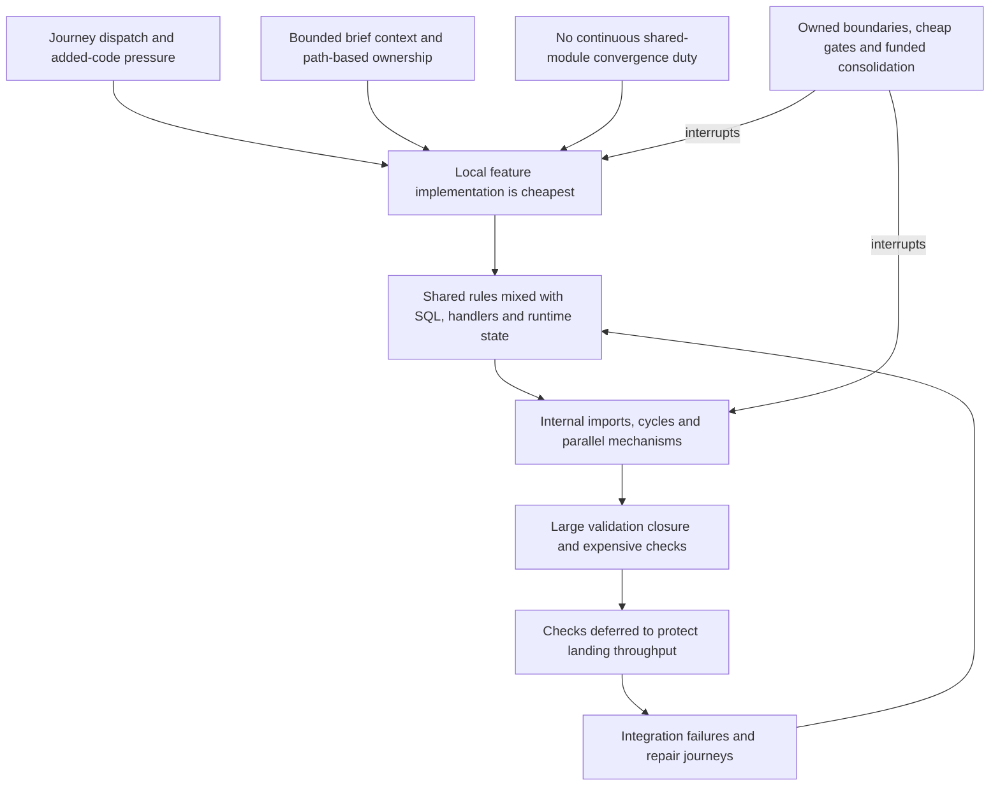

# Engineering modularity under autonomous delivery

Research date: 2026-11-05, Asia/Shanghai. Source revision: `86ed5367a0107dc85d8cfc3a3675918ed5a42cf3`.
This is an independent desk-research recommendation, not an adopted architecture or a runtime acceptance result.

The best-supported root-cause model is a missing feedback loop between **delivering a journey** and **preserving a module**.
REZICS already has abstractions, capable owners, detailed contracts and successful consolidations. However,
the unit of dispatch is a feature outcome, the strongest operational throughput signal is added product code,
and the integration system does not enforce semantic module boundaries. Shared machinery consequently acquires
feature-specific dependencies faster than anyone is required to remove them. Runtime and compiler failures are
late symptoms of that accumulation.

Adopt three changes together:

- Make information-hiding modules, explicit public interfaces and dependency direction executable repository policy.
- Give shared modules continuing ownership and consolidation capacity; measure accepted journeys and repair cost.
- Extract small contracts and pure rules through real callers, beginning with operation declarations and small
  money/progress models. Contain execution coupling immediately with import constraints. Access becomes a policy
  core with native adapters; its entire service folder is not the package scope.

## 1. Evidence and root-cause model

### Measurement method

The census uses tracked files at the revision above. “Code lines” means physical TS/TSX/JS source lines, including
comments and blanks, excluding declaration files and conventionally named tests, stories and fixtures. It is not
a measure of useful work. Development support inside ordinary source files remains included. SQL and generated
declarations are counted separately. A top-level directory is a measurement group, not an assertion of good cohesion.

The import graph covers 3,756 source files across Kernel, Auth, Importer, Web and packages. The preinstalled Bun
1.4.3 parser identified value imports without executing source; a lexical pass retained type dependencies and
locations. Relative paths, workspace exports and declaration-file fallbacks were resolved. Browser/default export
conditions were conservatively combined. There were zero parser errors. The 1,245 unresolved local import occurrences
were 1,242 generated Paraglide imports, one generated route tree and two CSS URL imports. SQL is resolved and counted,
but is not a TypeScript graph vertex. Nonliteral dynamic imports, filesystem reads and untracked generated code are
outside the graph. Thus these are static dependency measurements, not a complete runtime or data-flow graph.

Scripts, full results and evolving confidence are retained in
[the research notes](../../.temp/research/README.md): `scan-imports.ts`, `measure.py`, `history.py`,
`summarize.py`, `duplications.py`, `metrics.json`, `history.json`, `module-counts.tsv` and `hypotheses.md`.
Reproduction commands are in section 5.
The initial lexical-only cycle count was corrected against the parser; all figures below use the corrected graph.

### Size and coupling

Kernel contains **3,337 files: 1,276 code files / 378,564 code lines, 1,979 SQL files / 24,416 SQL lines,
and 79 Markdown files / 40,247 lines**, plus two other files and one declaration file.
Fan-in/out below counts distinct other measured groups with value-import edges, including packages and other
workspaces. SQL imports and external npm dependencies do not contribute to these group degrees.

| Kernel group | All files | Code files / lines | SQL files / lines | Fan-in / out |
| --- | ---: | ---: | ---: | ---: |
| access | 390 | 152 / 41,934 | 232 / 3,106 | 18 / 18 |
| command | 18 | 11 / 2,858 | 6 / 85 | 15 / 10 |
| commerce | 113 | 37 / 9,420 | 73 / 555 | 9 / 12 |
| community | 198 | 66 / 18,477 | 131 / 1,486 | 9 / 16 |
| content | 487 | 216 / 56,433 | 270 / 3,599 | 12 / 21 |
| database | 2 | 2 / 123 | 0 / 0 | 16 / 3 |
| events | 14 | 5 / 824 | 8 / 82 | 9 / 12 |
| history | 39 | 34 / 10,544 | 4 / 28 | 9 / 8 |
| http | 14 | 13 / 2,779 | 1 / 1 | 12 / 19 |
| imports | 1 | 1 / 28 | 0 / 0 | 1 / 1 |
| library | 793 | 303 / 95,428 | 477 / 6,565 | 12 / 19 |
| partition | 3 | 1 / 46 | 2 / 6 | 12 / 0 |
| presentation | 15 | 10 / 3,295 | 4 / 23 | 4 / 15 |
| rating | 189 | 56 / 15,206 | 131 / 1,507 | 10 / 14 |
| request | 2 | 2 / 502 | 0 / 0 | 13 / 4 |
| route | 1 | 1 / 61 | 0 / 0 | 15 / 0 |
| search | 254 | 161 / 49,978 | 71 / 540 | 11 / 21 |
| semantic | 756 | 171 / 65,118 | 558 / 6,737 | 15 / 22 |
| tokens | 4 | 4 / 471 | 0 / 0 | 11 / 0 |
| work | 15 | 13 / 1,880 | 1 / 8 | 13 / 17 |
| zones | 26 | 14 / 2,593 | 10 / 88 | 3 / 14 |
| root entry files | 3 | 3 / 566 | 0 / 0 | 7 / 12 |

The important property is dependency shape, not Access's file count: most Access files are small SQL statements.
Across the measured repository there are **17,930 distinct value-import file edges** and **22,967 including types**.
Kernel has **10 value-import strongly connected components (SCCs), involving 428 files**. Its largest SCC contains
**407 files across 13 directories**. At directory granularity, **19 of 22 groups form one SCC**. These are two
different measurements: aggregating files into directories can create additional apparent cycles. Neither count
enumerates all elementary cycles or proves every cycle fails at startup.

There are **6,088 cross-directory Kernel import/re-export occurrences targeting files other than
`index.ts`, `public.ts` or `api.ts`**. This is an exposure indicator, not 6,088 established policy violations:
some explicitly named leaves, such as `route/route.ts`, are legitimate APIs. Stronger evidence of implementation
coupling is **98 cross-directory SQL imports from 51 files**, and **33 imports of four `store.ts`/`*-store.ts`
files from 30 files**. Examples include Access importing Semantic's
`identity-source-consumer-custody-select.sql`, Commerce importing `semantic/read-context.sql`, and Community
importing `access/bootstrap-governance-read.sql`. These couple consumers to another owner's storage decisions.

| Other measured source | Code files | Code lines | Relevant dependency observation |
| --- | ---: | ---: | --- |
| Web, all source groups | 2,123 | 390,700 | 15 value SCCs; largest 67 files |
| Web `features/catalogue` | 379 | 85,177 | Subset of `features`, which totals 136,719 lines |
| Web `library` | 453 | 79,163 | 11 incoming / 16 outgoing groups |
| Web `threads` | 159 | 30,487 | 14 incoming / 16 outgoing groups |
| Web `kernel` | 125 | 19,962 | 24 incoming / 13 outgoing groups |
| Auth | 72 | 19,574 | Two value SCCs, largest 10 files; one outgoing workspace group |
| Importer | 90 | 45,304 | Two value SCCs, largest nine files; four outgoing package groups |

Full per-Web-group counts are in `module-counts.tsv`. Auth's contract separation and Importer's use of ordinary
APIs are meaningful existing boundaries: see [Auth](../../services/auth/README.md), lines 10–24, and
[Importer](../../services/importer/README.md), opening ownership statement. One process or one database does not
itself explain the Kernel's coupling.

| Package | Source code files / lines | Value fan-in / out | What is shared today |
| --- | ---: | ---: | --- |
| auth-contract | 8 / 1,591 | 4 / 0 | Native Auth/Access workflow ports and values |
| client | 8 / 1,029 | 9 / 0 | Eden transport and compatibility surface; separately 402 declarations / 330,615 lines |
| composition | 11 / 2,416 | 17 / 1 | Inert page model, validation and read planning |
| conversion | 14 / 6,530 | 1 / 2 | Provider-to-command conversion |
| definitions | 19 / 5,078 | 14 / 2 | Released vocabulary, validation, compilation and native file tooling |
| document | 4 / 1,070 | 14 / 0 | Versioned document profiles and validation |
| filter | 5 / 1,534 | 10 / 0 | Closed filter language and validation |
| ui | 126 / 20,073 | 21 / 1 | React components and hooks |

Package location is not a purity guarantee. `conversion/src/cross-media-entities.ts:163–175` lazily reads sibling
Definitions YAML through `node:fs` and `Bun.YAML`, despite the conversion README's pure-converter contract.
Definitions deliberately exposes native compiler/filesystem entries alongside browser entries.
`document/src/index.ts:167` supplies random IDs by default. These are specific seams to separate, not reasons to
discard the packages. Document and Definitions also each have a two-file value SCC.

The official client's declaration volume is generated type expansion, not 330,615 lines of hand-written domain
logic. Nevertheless, its manifest depends on DBOS, `pg` and Elysia, and two Web files import generated internals
through four relative type imports: `community/realm-presentation.ts:1–5` and
`threads/board-community-source.ts:2–3`. This is compile-time coupling and an exports bypass; it does not establish
that database libraries enter the browser bundle. The client README records temporary compatibility seams pending
declaration emission. An inferred service type is not automatically a deliberately published domain language.

### Growth and the failures

First-parent snapshots show that this is a very young rewrite, not a long-term maintenance trend. The October 22
snapshot has none of these rebuilt directories; Access starts on October 25. Midnight snapshot dates below use
Asia/Shanghai and committer chronology.

| Code lines | October 29 | November 2 | Research revision |
| --- | ---: | ---: | ---: |
| Access | 19,150 | 34,541 | 41,934 |
| Library | 11,652 | 40,643 | 95,428 |
| Semantic | 13,007 | 51,322 | 65,118 |
| Content | 16,843 | 29,782 | 56,433 |
| History | 0 | 6,834 | 10,544 |
| Work | 417 | 928 | 1,880 |
| Web Library | 7,504 | 25,358 | 79,163 |

Over the requested two-week window, first-parent non-merge commits touching Access code number 420, with
47,193 added and 6,406 deleted lines; Library has 702, with 118,775 added and 23,385 deleted. These include formatting
and omit merge-only diffs. They measure edit volume, not agent effort, avoidable duplication or short-lived-line churn.

History gives stronger causal examples than growth alone:

- `481944af5d` introduced Access work accounting and changed permission/request interfaces on October 31;
  `48f1874c09` expanded metering; `4790f5d73d` repaired dispatch-charge versus envelope distinctions. The first two
  together added 1,497 lines including tests/docs and deleted 126. A cross-cutting performance concern was becoming
  a protocol embedded in Access, not just a query bound.
- The original-commit list in `c9935f3a05` records successive publication, funding, reservation, repair and reversal
  changes. This supports repair-driven protocol growth; it does not establish the motives of individual workers.
- `81c1b27439` then replaced selected Members → History → Work dispatch accounting with static bounds: 272 additions,
  1,084 deletions across code, tests, declarations and docs. Consolidation can produce substantial useful negative churn.
- `2a5d8ce63b` moved header constants into `http/headers.ts` and corrected structure-history operation IDs after the
  startup failure. The earlier journal-operation repair is `8aa096bd75`. At the research revision, a value dependency
  path still runs from `http/request.ts` through command/history/identity/search and feed schemas to
  `library/progress-routes.ts`, which imports `http/request.ts` back. The extracted constant avoids that particular
  temporal dead zone; the architectural cycle remains.
- `d7f0d9efb0` restored `projectNativeSQL`, deleted by `a540ac01` while its call remained in
  `library/identity-native-planner-projection.ts`. The retained call is in the same file; this incident is not evidence
  of a remote consumer escaping an exports boundary. A real typecheck would catch the missing name.
- The reported conflicting route-security declarations have a concrete enforcement point:
  `http/request.ts:155–159` rejects different anonymous policies for the same action, and
  `test/request.test.ts:117` covers that conflict. I did not independently recover the exact reported cross-module
  incident. The current mechanism validates during composition, after owners have separately authored declarations.

The original Access library has six non-test source files / **1,186 lines**, plus three test files / 378 lines.
It is a vocabulary/rules package with no production dependencies. Comparing it directly with today's whole
authentication, account, governance, workflow and persistence folder would overstate bloat. Its useful lesson is the
scope of a logical package, not an expected size for the current service. No legacy source was copied.

### Rechecking the eight duplication findings

The [existing audit](architecture-duplication-audit.md) has an explicit older source boundary. Treating all eight
findings as current would prescribe work that has already landed.

| Audit finding | Current source observation |
| --- | --- |
| 1. Collection / History / Work accounting | Partially repaired by `81c1b27439`. Library still has held balances, reservations and transfers in `collection-source-work.ts:73–409`; 49 source files import that file. History and selected Work now document static totals. Source eight-axis vocabulary still appears separately in Library and History; Work extends it with `engineRequests`. |
| 2. Browser session/lifetime observation | Shared `session/observation.ts` exists; candidate lifetime and viewer exposure consume it. There are distinct adapter policies, not evidence of three remaining independent session registries. |
| 3. Three catalogue creation lifecycles | All three session components use `creation-host/use-creation-host.ts`. |
| 4. Four retained-list metadata coordinators | All four providers call the same 435-line `list-import-metadata-coordinator.ts`; provider wrappers are not four copies of its algorithm. |
| 5. Three statement summaries | All three reviews consume `statement-summary.tsx`. |
| 6. Ratings depending on Library infrastructure | `ratings/own-votes/current-origin.tsx` now imports `reader/` infrastructure and explicit operation/context descriptors. |
| 7. Two mobile hooks | `use-is-mobile.tsx` is now a re-export of `use-mobile`. |
| 8. Obsolete dialog helper | The file is absent. |

These are source observations, not fresh native acceptance. They materially weaken a claim that owners cannot
consolidate. The unresolved question is whether later work is prevented from recreating the mechanisms.
An additional current duplication is the money-unit/rule vocabulary and validation in
`services/kernel/src/commerce/money.ts` and `apps/web/src/checkout/money-schema.ts`. Their envelope and strictness
differ, so centralize the value contract while preserving boundary-specific decoding.

### Competing hypotheses

| Hypothesis | Verdict and confidence | Evidence and limitation |
| --- | --- | --- |
| H1: Conway/ownership | **Qualified support; medium-high** | Access is explicitly Accounts-owned, money Commerce-owned and Document Web-owned. Literal “no Goal owns them” is false. However, the foundation is declared complete with no active Goal, while request/command/work machinery remains a dependency of every area. Feature path ownership does not assign continuing responsibility for convergence of shared abstractions. |
| H2: locality bias | **Strong support; high** | Workers read only brief-linked material; interfaces may be handled with a minimal local seam. Efficiency specifies 2,000–3,000-line journeys and 20,000/40,000 landed-code targets. Delivery requires only sampled manager review. These policies make a local addition cheaper to complete than a multi-owner consolidation. Histories are consistent with this mechanism, not a controlled causal experiment. |
| H3: unenforced boundaries | **Strong support; high** | The workspace checker exempts relative imports (`scripts/workspace-imports.ts:232`); Oxlint has six general rules, no architectural rule. Kernel has the measured cycles and storage imports. Existing browser/server, manifest and boot checks are useful but do not enforce semantic module boundaries. |
| H4: missing abstraction step | **Partial support; medium** | Architecture, feature design and package contracts already require generic capabilities. Model-first packages are counterexamples. What is missing is a required, reviewable decomposition into public contracts, hidden decisions and adapter obligations before a shared mechanism becomes a feature-local implementation. More prose alone will not fix this. |
| H5: framework entanglement | **Support at specific seams; medium-high** | 113/152 Access files reference SQL/pg/reylo, including type references; only nine import Elysia. The chief coupling is storage, evidence and orchestration, not just handlers. `content/feed-contract.ts:16` imports a schema from `library/continue-routes.ts`; `collection-source.ts` mixes shared types with native construction. |
| H6: inferred contracts spread implementation | **High observation; medium causal confidence** | The 402-file client declaration closure, temporary client seams and Web internal type imports propagate service structure into consumers. No evidence here quantifies compiler cost attributable specifically to that closure. |
| H7: repairs generate new mechanisms | **High for bounded-work machinery** | Accounting introduction/repair history and the later 812-line net deletion are direct evidence. The surviving Library ledger conflicts with the architecture's static-ceiling direction. This is not a mandate to invent a shared accounting engine. |

The ownership enforcement gap is particularly concrete. [Risk areas](../../tools/goal/risk-areas.json) name
`auth`, `authorization` and `permissions` path segments but omit `access`. **None of the 390 concrete Access paths
matches any risk-area glob.** A narrow Access brief can therefore avoid even authorization risk routing, although
the Accounts Goal owns the area in prose.
Access's README alone is 4,996 lines. A short generated boundary summary lets a brief-only worker receive the
applicable constraints without needing to reconstruct the architecture from that contract's entire history of additions.

The causal model is:



The tradeoff behind deferring checks is real. The [check-cost audit](check-cost.md) measured 33.919 root-typecheck
slice-hours in its October 28–29 cohort; a small Kernel test still prepared databases and compiled the service.
Current defaults set `devPrelandingTypecheck: false` (`tools/goal/defaults.json:154`, introduced by `ea073339ff`).
November 4 also added a prelanding native boot guard (`963b6b2c42`), with baseline-failure handling. Therefore
“dev has no prelanding checks” is no longer accurate. The report's missing-helper repair records a 320-second boot
run; the existing boot test is not a cheap database-free import check.

## 2. Architecture rules to adopt

### The decomposition

A module owns a decision that should change in one place: permission combination, money meaning, continuation
semantics, identity resolution or an atomic storage operation. A package is a distribution/build boundary for a
module, not a synonym for a folder or a requirement for every helper.

Use these kinds, recorded in a small machine-readable module manifest:

| Kind | Placement | Permitted dependencies |
| --- | --- | --- |
| Contract | `packages/<capability>/src/contracts/` or a declared local contract entry | Explicit lower-level contracts and approved schema/value libraries |
| Core | `packages/<capability>/src/core/`, or `services/kernel/src/<capability>/core/` until extraction | Own contracts, explicitly allowed core/contract public entries, approved deterministic libraries |
| Application | `services/kernel/src/<capability>/application/` | Core and declared port contracts; supplied implementations through constructor parameters |
| Adapter | `services/kernel/src/<capability>/adapters/{elysia,postgres,dbos}/`; Web equivalents under its module | Declared contracts, application entry, relevant runtime library and explicitly allowed platform APIs |
| Composition root | `services/kernel/src/composition/`, server/worker entrypoints, Web entrypoints | Concrete applications and adapters required to assemble that process |
| UI/transport library | Existing `packages/ui`, `packages/client`; future `<capability>-<technology>` only when reused | Explicit runtime/framework dependencies; never labelled a portable core |

Runtime-independent **meaning** is the objective. TypeScript code does not become executable in every language
because it moved into `packages/`. Publish versioned values/schemas, transition semantics and conformance vectors
when another language needs the capability. Keep TypeScript implementations now; add another implementation only
with an actual consumer. A standalone pure function can be a deep module. Neither classes nor an effect framework
are required.

The following eight rules are proposed checks, not tools already installed. “Prevent” describes the counterfactual
after the relevant boundary has been declared. Mechanical checks prove structural properties and registered
contracts; they cannot decide whether two arbitrarily written algorithms mean the same thing.
The Kernel can remain one deployment. Port inversion must also preserve native call bounds and transaction
semantics; removing an import cycle is insufficient if the new ports hide recursive or chatty runtime coordination.

1. **Every production file belongs to one declared module and kind; every registered capability has one owner.**
   The manifest records paths, owner/backup role, public entries, allowed dependencies, capabilities, schema/table
   ownership and contract-test paths. A schema/path-coverage check rejects unknown or overlapping ownership,
   duplicate capability keys and missing contracts. Generate risk routing and the worker's boundary summary from
   this source. This would reject a second registered cost-accounting authority and the unclassified Access risk
   surface. An adapter's `implements` reference points to the existing contract; it does not register a second
   capability authority. Responsibility persists when a Goal closes.

2. **Cross-module imports use declared public entries, including type-only imports and generated artifacts.**
   A dependency-cruiser graph plus manifest validator rejects private targets, workspace-relative export bypasses,
   aliases that bypass exports, and undeclared package dependencies. Public re-exports must not expose private
   adapter types through their declaration closure. Standalone package typechecking checks that closure.
   This would reject Web's generated-internal imports and foreign SQL/store imports, forcing a deliberate port.
   Public entries can be several explicit subpaths; avoid a barrel that eagerly imports every adapter.

3. **The declared module graph is acyclic; dependency direction follows the kind table.**
   Check value and type edges separately, enforcing the module DAG for both. Additionally reject new value-file
   cycles, even inside a module; existing intra-module cycles may be explicitly grandfathered during migration.
   The graph check must examine the complete cached graph after changed files are reparsed, not just changed-file
   edges. This catches the request → feature routes → request cycle. Type-only cycles have no temporal dead zone,
   but cross-module type cycles still prevent independent contracts/builds.

4. **Core and contract entry closures have no ambient effects or runtime types.**
   Allowlist their external dependencies; reject Elysia, `pg`, SQL, DBOS, React, Bun/Node runtime modules,
   process environment, network/filesystem access and ambient clock/random calls. Check exported declarations for
   runtime types as well as value imports. Pure rules receive time, IDs and facts as values; application ports
   own asynchronous effects. AST restrictions and deterministic conformance tests enforce the supported subset,
   not mathematical purity of arbitrary JavaScript. This blocks the converter's hidden YAML loader and schemas
   importing route handlers, and makes the header vocabulary a true leaf.

5. **Adapters own effects; applications own use cases; only composition roots select implementations.**
   Register adapter directories and permitted external effect packages. Reject application → adapter imports,
   adapter → unrelated adapter imports, foreign `.sql` imports and SQL outside owned Postgres adapters.
   Static SQL table references must match the adapter's declared storage ownership; new unanalysable dynamic SQL
   requires an explicit reviewed exception. Factories may return implementations without global registration.
   This would prevent generic request/command code acquiring concrete identity/discovery wiring. Preserve atomic
   single-partition commands and repeatable-read guarantees in meaningful ports; a generic CRUD repository is not
   an adequate substitute for transaction, revocation or concurrency semantics.

6. **One declarative source produces each operation's wire and security metadata.**
   Owners export inert operation descriptors referencing canonical action definitions. A pure composition check
   validates unique operation IDs and method/path pairs, action/security agreement, resource types and exposure
   references. Routes and discovery consume these descriptors; mounted-route reconciliation remains a second check.
   AST rules forbid fresh handwritten security/action metadata outside declared descriptor producers.
   This catches the conflicting declarations and invalid journal/structure-history operation IDs before constructing
   the whole service. Multiple derived registries are allowed; independently authored competing authority is not.

7. **A package exposes a complete usable contract and passes an isolated consumer check.**
   Require explicit exports, declared dependencies, owner documentation, conformance tests and at least one real
   consumer journey. A new shared package needs two production consumer modules, or one recorded standalone
   consumer requirement; count consumers mechanically rather than demanding speculative reuse. Check that no
   service/app source, private sibling asset or runtime adapter leaks into a portable entry's dependency closure.
   For public contract changes, compile affected reverse consumers and compare generated/API outputs on the merged
   candidate. This catches the conversion sibling-file dependency and stale client seams. The accompanying
   candidate compiler check also catches the deleted helper; packaging alone would not have caught that incident.

8. **Migrations shrink an explicit exception set; cost declarations never become a new dispatch protocol.**
   Record legacy exceptions as exact edges/API names with owner, reason and expiry. Reject additions without a
   reviewed migration change, expired entries, newly cyclic edges, and new consumers of deprecated ledger APIs.
   Cost-contract exports are restricted to immutable dimensions/bounds and pure arithmetic; the import policy
   prevents execution admission from depending on a new accounting implementation. Retire the existing Library
   ledger caller by caller, preserving deadlines, concurrency limits and bounded retries. This would have prevented
   the observed funding protocol from spreading without an explicit architecture change. Semantic reimplementation
   under new names remains a review/clone-detection concern, not something an import linter can prove absent.

An initial manifest can be small; this illustrative shape is not a new configuration file delivered by the research:

```json
{
  "name": "money",
  "owner": "commerce",
  "kind": "core",
  "paths": ["packages/money/src/**"],
  "public": ["packages/money/src/index.ts"],
  "dependsOn": [],
  "provides": ["recorded-money-values"],
  "contractTests": ["packages/money/test/recorded-money.test.ts"]
}
```

Do not enforce file/line ceilings or a maximum number of exports as architecture. Large coherent implementations
can have simple interfaces; small files can form an enormous cycle. Interface breadth, dependency degree and
change spread are review signals. Enforcement must follow the hidden decision, not reward cosmetic file splitting.

### Tool choice and literature

Use **dependency-cruiser plus one small manifest/check integration** first. It fits an existing Bun/TypeScript
repository without changing its workspace orchestration. Its documented rules cover cycles, dependency kinds and
group matching. Preserve Oxlint for ordinary linting. This is a recommendation from documentation, not a benchmark
or an installation performed here. [Dependency-cruiser rules](https://github.com/sverweij/dependency-cruiser/blob/main/doc/rules-reference.md).
Before adoption, a resolver fixture must cover Reylo `.sql` imports, workspace links, conditional exports,
generated modules, type-only edges and nonliteral dynamic imports. Unknown dynamic targets require declaration
or an exception. Compatibility with this repository's compiler/toolchain remains to be verified; silent omitted
edges would disqualify the gate.

| Alternative | Useful enforcement | Decision for REZICS |
| --- | --- | --- |
| Nx | Tagged project constraints and public project boundaries | Strong option if Nx is separately adopted for build orchestration; not required to obtain boundaries. [Official guidance](https://nx.dev/docs/features/enforce-module-boundaries). |
| eslint-plugin-boundaries | Classified elements, allowed dependencies and entry paths | Viable editor/CI alternative if ESLint is adopted. Current v7 uses `boundaries/dependencies`; legacy `entry-point` is deprecated. Configure unknown/external/internal checks deliberately; defaults do not check everything. [Rule](https://www.jsboundaries.dev/docs/rules/dependencies/), [migration notice](https://www.jsboundaries.dev/docs/rules/entry-point/). |
| Bazel | Default-private target/source visibility and declared build dependencies | Borrow explicit visibility; a build-system migration is unnecessary for this repair. [Visibility](https://bazel.build/concepts/visibility). |
| TypeScript references | Composite projects, declaration consumption and incremental build ordering | Add for extracted cores/contracts to reduce compiler closure. They supplement import visibility and runtime checks; they do not replace either. [Project references](https://www.typescriptlang.org/docs/handbook/project-references.html). |

The principles support these particular choices:

- **Parnas:** decomposition should hide changeable decisions, rather than follow processing stages or assignment
  boundaries. Here that means money semantics and identity rules, not a package per Goal or a wrapper per SQL file.
  [1972 paper](https://john.cs.olemiss.edu/~hcc/csci555/notes/localcopy/Parnas_Criteria_Decomposing.pdf).
- **Ousterhout:** a simple interface should hide substantial complexity. Preserve deep operations such as atomic
  confirmation/reconciliation; avoid exporting every intermediate reservation and proof-maintenance step.
  [Author's design guidance](https://ramcloud.atlassian.net/wiki/spaces/RAM/pages/6848550),
  [A Philosophy of Software Design, chapter 6 extract](https://web.stanford.edu/~ouster/cgi-bin/aposd2ndEdExtract.pdf).
- **Conway and the inverse manoeuvre:** adjust communication and ownership alongside code. A continuing module
  owner plus a consumer reviewer creates the communication path that isolated journey briefs currently lack.
  [Conway's original paper](https://www.melconway.com/Home/Committees_Paper.html),
  [Fowler's account](https://www.martinfowler.com/bliki/ConwaysLaw.html).
- **DDD:** retain bounded meanings and translate across them through published language and anti-corruption
  adapters. Auth identity, canonical subject identity and a browser observation are different concepts even when
  they contain similar IDs. Shared storage is not permission to merge their authority.
  [Evans, DDD Reference, bounded context and strategic-design patterns](https://www.domainlanguage.com/wp-content/uploads/2016/05/DDD_Reference_2015-03.pdf).
- **Ports/adapters and functional core:** isolate technology-specific effects while keeping use cases expressible
  through values and meaningful ports. Native adapter tests remain essential; pure rules cannot prove transaction
  isolation or current authorization.
  [Cockburn](https://alistair.cockburn.us/hexagonal-architecture),
  [Bernhardt](https://www.destroyallsoftware.com/screencasts/catalog/functional-core-imperative-shell).
- **Martin:** use ADP as the module-DAG rule, SDP as dependency direction toward stable contracts, and SAP as a
  warning against widely depended-on implementation details.
  [Package coupling principles](https://objectmentor.com/resources/articles/Principles_and_Patterns.pdf), pages 18–26.
  His primary metrics paper gives
  `I = Ce / (Ca + Ce)` and class-based abstractness. With groups as our explicitly different counting unit,
  Access's degree-based `I` is 18/36 = 0.50, HTTP's 19/31 ≈ 0.61, and Filter's 0/10 = 0.
  Do not require an abstractness score for function/data modules: a module with no classes has no meaningful
  class-based denominator. High interface counts can reward empty abstractions. Use exported runtime-type leakage
  and consumer change spread instead. [Martin's metrics paper](https://condor.depaul.edu/dmumaugh/OOT/Design-Principles/oodmetrc.pdf).

## 3. Change how work is produced

### Briefs and acceptance

Keep bounded reading and one useful journey per assignment. Supply the missing architectural context automatically.
Extend the existing brief parser/template, rather than establishing another planning system:

| Change | Precise requirement | Throughput effect |
| --- | --- | --- |
| Boundary context | `modules`, `usesCapabilities`, `publicApiChange`, `replaces`, and applicable exception IDs in parsed brief metadata. Inject the current module manifest slice, public-entry links and one existing usage example into the worker prompt. Validate references against the base. | Small deterministic preflight; avoids every worker searching the whole repository. |
| Abstraction decision | For a new capability or public boundary change, owner states the hidden decision, inputs/results, invariants, effect ports and why existing capability entries do not fit. Link one short adopted contract section. Ordinary implementation changes reuse it. | Cost paid once per boundary, not once per worker. |
| Complete change scope | An exported change includes its real caller, binding, affected reverse consumers and deletion/deprecation plan. A temporary seam has an owner and expiry, initially seven days. It cannot silently become a second authority. | Larger coherent changes where necessary; less repeated repair. No line minimum. |
| Acceptance | Preserve one native user journey plus the smallest core/adapter conformance cases that distinguish invariants. Add structural acceptance: no new forbidden edges/cycles, no duplicate capability registration, declared replacements removed. | Cheap structure checks on every change; expensive evidence only where affected. |
| Cross-owner contracts | Producer and one affected consumer agree on the contract before dependent dispatch. The check records their review against the interface diff; relevant rebase changes invalidate it. | Avoids repeated negotiation and speculative local compatibility APIs. |

For example, a money brief should name “edit an offer and read the same recorded amount in purchase history,”
the shared money contract, the Commerce/Postgres and Web/Intl adapters, and unknown-unit behavior. It should not
independently ask two workers to invent backend and frontend money types.

The changes belong in [delivery](../development/delivery.md), [efficiency](../development/efficiency.md),
[verification](../development/verification.md), the workflow briefing/review references, and the controller's
`briefs.ts`, prompt construction, `risk-areas.json` integration and landing policy. Remove the conflicting
2,000–3,000-line prescription and added-code alarm targets from their authoritative documents and generated prompts.
Retain size as a routing estimate. A 100-line consolidation should compete on user/maintenance value without padding.

### Continuing ownership and review

Give the supermanager a **continuing modularity steward** responsible for the module map, exception retirement,
cross-cutting design arbitration and a funded consolidation backlog. This is a responsibility, not another service
or a gatekeeper for every edit. Add a permanent **Kernel foundations owner** for operation composition,
command/execution contracts and shared infrastructure; a completed foundation Goal does not retire that ownership.
An existing manager may carry this responsibility with reserved capacity; a new resident agent process is optional.

Keep domain meaning with existing managers:

| Capability | Accountable owner | Required consumer input for public changes |
| --- | --- | --- |
| Access policy and Auth boundary | Accounts | One affected resource owner; Web for public advice |
| Money, progress and private import adoption | Commerce | Web; Imports only where its own contract is affected |
| Canonical subject identity, definitions and filter language | Semantic | Search or Commerce, selected by affected use |
| Discovery composition | Search | Relevant source owner, including Content |
| Document and browser reader infrastructure | Web | Content for document semantics; Accounts for session meaning |
| Execution/operation infrastructure | Kernel foundations | Relevant producer; Performance for bound derivations |
| Architecture checks and controller release | Control-plane | Modularity steward; Performance for check capacity |

The steward owns convergence; the domain owner owns semantics; the landing train enforces both mechanically.
Review every new module, public entry, dependency direction, registration authority and exception. Use a distinct
reviewer from the implementing worker, with an affected consumer for public contracts. Review implementation-only
changes by risk/sample as today. Make review latency visible; use a backup owner after a short service target
(initially 15 minutes), without treating timeout as approval. Independent work continues against the accepted API.

Do not serialize all edits to a shared file. Serialize incompatible public-contract changes; permit concurrent
implementation behind a stable contract. Emit a specific counterexample when a proposed abstraction is rejected,
so a worker can repair it without a broad architecture rediscovery.

### Landing and verification

1. **Before dispatch:** schema-check brief/module references, provide public interfaces and existing implementations,
   and validate risk ownership from actual paths. This is read-only and cacheable.
2. **Before advancing dev, on the combined rebased and formatted candidate:** run the complete architecture graph
   check, exports/dependency closure checks, descriptor uniqueness/security checks and changed deterministic contract
   tests. A test from the worker's old head is not evidence for a changed merged tree.
3. **Restore compiler validation for code landings, once per batch.** Enable the existing prelanding switch while
   the Kernel remains one compilation unit. Compare known baseline product failures explicitly; reject newly
   introduced diagnostics. Infrastructure failure is unverified, not success. Keep the current boot guard until a
   smaller pure operation-catalogue/entrypoint check demonstrably covers its structural failures. Preserve native
   boot for affected runtime/SQL wiring. Never replace it with a source-text assertion that a function name exists.
4. **After integration and at promotion:** retain native integration, growth, browser/persona and full release gates.
   Cache results by source closure, compiler/dependency/configuration identity and relevant generated inputs.
   As core projects become independent, typecheck their reverse consumer closure without preparing unrelated SQL.

A deleted helper should fail step 3; an illegal import/cycle should fail step 2; a conflicting operation descriptor
should fail the pure composition check. These checks address different failure classes.

Budget the new static checks to a **provisional p95 of 30 seconds per combined candidate**; benchmark before treating
that as achieved. Keep the existing landing p90 target below 30 minutes. Batch compilation and reuse unchanged
dependency installations; do not add a full service/database test to each small worker. If compilation dominates,
prioritize isolated contracts and compiler-cache correctness. Removing the check without reducing coupling makes
the next incident more likely. The earlier cost audit supports this tradeoff, but does not predict current savings.

The initial baseline must be exact, reviewable violations—not a wildcard exemption for Kernel or Access. For an
existing SCC, reject a new edge when its target already reaches its source, even if the SCC's size stays unchanged.
Otherwise “no larger SCC” permits unlimited new cycles inside the existing giant component. Expired exceptions and
missing checks must remain visible and non-green; unrelated work can use the verified baseline and independent lane.

### Consolidation capacity and incentives

Reserve **15% of implementation capacity for an initial four-week trial** for module convergence, with one
cross-cutting extraction in progress at a time plus small domain-local repairs. This percentage is a proposal to
measure, not a result established by research. Owners can spend that capacity on deletions, consumer migrations,
shrinking public surfaces and removing exceptions. Each extraction includes an existing user journey so native
behavior remains the acceptance anchor.

Use accepted journeys per worker/check-hour and time lost to integration repair as primary flow measures.
Display added/deleted product lines as diagnostics. Count a successful consolidation as an accepted maintenance
outcome, even when net product lines are negative. On a second independently discovered implementation of a named
mechanism, require a consolidation or explicitly bounded separate-context decision before a third consumer adopts it.
The controller can enforce the recorded capability/exception decision; code similarity remains a review input.

After four weeks, lower the allocation if exception backlog and repair spread are falling and new duplication stays
flat. Raise it or narrow feature concurrency if new debt persistently exceeds removal. Avoid universal “cleanup every
N lines” rules: they create more incentive to game line counts.

### What agent research does and does not establish

GitClear's 2025 report examined 211 million changed lines. Its table reports within-commit copy/paste rising from
8.86% in 2020 to 12.32% in 2024, while moved code falls from 24.17% to 9.47%. This is vendor observational evidence
with changing repository populations and no controlled attribution of every line to an agent. Its 2025 column is
a projection; it is not an observed year. It supports watching duplication/refactoring, not declaring AI the proven
cause of REZICS's architecture. [Primary report, appendix A1](https://gitclear-public.s3.us-west-2.amazonaws.com/GitClear-AI-Copilot-Code-Quality-2025.pdf).

Huang et al. report greater agent redundancy and comparatively positive review sentiment. Their broader Python
dataset has 3,858 PRs, but expensive redundancy analysis uses 617 crewAI PRs and an embedding-based proxy with a
small manual validation sample. This is relevant evidence of plausible-looking local additions escaping review,
not a measured effect size for TypeScript or hundreds of concurrent workers.
[MSR 2026 paper](https://arxiv.org/html/2601.21276v1).

A contrary caution comes from Kraishan's observational study of 37,623 agent PRs across 2,807 repositories: outcomes
vary by vendor and metric, including lower reported revert rates for Codex than its human baseline. This does not
establish architectural quality either. The appropriate intervention is a model-independent production system,
then measurement by comparable task cohorts. [Primary preprint](https://arxiv.org/abs/2609.17598).

Vendor instructions converge on concise repository context and explicit verification. OpenAI documents scoped
`AGENTS.md` guidance and preserving material interface/ownership decisions; Cursor recommends concrete scoped
rules and references; GitHub supports repository and path-specific instructions. Anthropic explicitly distinguishes
instructions from hooks that enforce required checks. Use these mechanisms to present the same module policy,
with the authoritative gate in the Goal controller so Codex, Grok and Cursor all receive the same outcome.
[OpenAI instructions](https://learn.chatgpt.com/docs/agent-configuration/agents-md),
[OpenAI workflow guidance](https://developers.openai.com/cookbook/examples/codex/iterating-development-workflows-with-codex),
[Cursor rules](https://cursor.com/docs/rules),
[GitHub instructions](https://docs.github.com/en/copilot/how-tos/copilot-on-github/customize-copilot/add-custom-instructions/add-repository-instructions),
[Claude Code guidance](https://code.claude.com/docs/en/best-practices).

## 4. Extraction order and first journeys

Install the manifest/graph baseline and review path first. The following is an ordered portfolio, not eight
simultaneous rewrites. A package move is complete only when consumers use its public API and the superseded path
or exception is removed. Preserve current data, routes and permission behavior through each journey.

### 1. Operation declarations and transport contracts

**Scope:** leaf header/protocol values, action/operation descriptors and reusable response schemas. Domain DTOs stay
with their owning capability; the foundation owns composition/validation. Move schema exports out of route-handler
files, starting with Progress → Continue → Feed. Use a narrow `packages/operations` core and service-owned Elysia
adapters; keep the Eden client a transport adapter.

**Interface sketch:** `validateCatalogue(descriptors): Result<OperationCatalogue, DeclarationError[]>`;
`OperationDescriptor { id, method, path, action, audience, resourceTypes, requestSchema, responseSchema }`.
Descriptor fields are data and public contract references, not handler functions or Elysia instances.

**Payoff:** removes an observed route/schema initialization path, catches security/ID conflicts cheaply, and begins
shrinking the client's inferred implementation closure. **First journey:** kernel API, worker and persona entry
compose the same progress-journal/continue/feed declarations; anonymous and signed-in reads preserve policy, and
duplicate or conflicting fixture descriptors fail without a database. Keep the native boot regression as integration proof.

### 2. Recorded money values

**Scope:** `packages/money` owns amount/unit/meaning-version values, exact arithmetic and value validation.
Commerce owns accepted sale currencies and provider facts; its Stripe adapter translates those facts. Web's Intl
adapter owns display. A recorded unknown unit remains unknown; no default exponent or currency table backfills it.

**Interface sketch:** `parseRecordedMoney(value): Result<Money, MoneyError>`;
`Money { currency, amountMinor, unit: { system, exponent, factsVersion } }`; explicit unit-compatible comparison.

**Payoff:** small, already evidenced backend/Web duplication; a useful early test of package isolation without
reorganizing a large subsystem. **First journey:** create/edit an offer and read its checkout/history amount using
the same contract, including unknown historical metadata, negative adjustments and exponent-zero records.
Keep decoder-envelope strictness intentional rather than silently choosing one existing implementation.

### 3. Progress and journal rules

**Scope:** the already mostly pure `library/progress.ts` (390 lines), `progress-journal.ts` (92), and necessary
value types from `progress-model.ts` (143). Separate routed-reference validation from rules; keep profile policy
as explicit input and persistence/admission in Library. Use `packages/progress` only for the shared rules.

**Interface sketch:** `validateProgressIntent(state, profile, intent): Result<Transition, ProgressError>`;
`parseJournalPatch(input): Result<JournalPatch, FieldError>`. Partial dates retain their precision; totals and units
do not acquire meaning merely from their representation.

**Payoff:** a small logical model can serve backend and Web without importing session commands or route schemas.
This is a portability opportunity, not a claim that all current progress logic is duplicated.
**First journey:** record/correct one session and its partial-date journal in Web, with identical rule fixtures in
the native command, including invalid dates, clear versus absence and a stale revision.

### 4. Bounded execution and History/Work ports

**Scope:** separate static bound vocabulary from execution identity/deadline/retry semantics and from History's
records. Keep History and Work distinct authorities. Extract a small execution contract where needed; bind it to
DBOS/Postgres in service adapters. Extend the existing selected-path cleanup to a surviving Collection source caller.

**Interface sketch:** `WorkIntent { kind, key, payloadVersion, payload }`;
`enqueueCommitted(intent, commitEvidence): EnqueueResult`; `Bound = Readonly<Dimensions>` and pure `sumBounds`.
The native adapter verifies commit evidence; serializable input cannot manufacture it.

**Payoff:** contains the most expensive duplicated mechanism and stops Library's observer becoming infrastructure
for every owner. **First journey:** prepare and resume one Collection page through History and Work, including
expiry, rollback, uncertain enqueue and terminal cleanup. Dispatch uses admitted static limits and native authority;
remove that caller's mutable reservation/funding path. Performance verifies unchanged growth bounds. Do not publish
`NativeCollectionWork` as a reusable package.

### 5. Access policy core

**Scope:** action/resource vocabulary, permission combination, role expansion, explicit-denial precedence and
decision explanation over trusted facts. Accounts, credential validation, current fact acquisition, temporal SQL,
opaque evidence and revocation remain native adapters/applications. `request/access.ts` becomes a consumer of
contracts rather than a mutual dependency of the concrete permission implementation.

**Interface sketch:** `evaluate(policy, facts, request): Decision`; `compileRoles(definitions): RoleCatalogue`.
Separate authoritative server evaluation from public Web advice; the latter never grants access.

**Payoff:** stabilizes a widely consumed policy contract while reducing the 18-outgoing-group Access dependency
surface. **First journey:** one collection read with each permission operand independently denying, plus anonymous,
revoked and suspended callers. Compare core conformance cases with the current native evaluator on exactly those
semantics. Extract vocabulary and operand contracts first; move authoritative evaluation only after native
equivalence and work bounds are proven. If optimized SQL remains an implementation, it must implement the same
versioned semantics, not own a second policy. Use separate Access research for the detailed formula; this report
does not redesign it.

### 6. Canonical subject identity

**Scope:** a Semantic-owned module for original/canonical references, identity versions, bounded resolution results
and transition semantics. Keep database epochs, source custody and repair scheduling behind ports. Account identity
and browser reader identity remain separate. A small identity contract may become a package; the full epoch store does not.

**Interface sketch:** `resolveBatch(originals, observedVersion): ResolutionPage`;
`Resolution { original, canonical, version, state }`; application ports for atomic identity change and bounded effects.

**Payoff:** replaces foreign imports of Semantic SQL/store internals with a stable published language, reducing the
Access/Library/Search/History cycle. **First journey:** merge and reverse two subjects while preserving original
Library references and updating one Search projection; concurrent revocation, pending identity and retry remain
observable. This has higher semantic risk than money/progress, so extract after those pilots prove the workflow.

### 7. Discovery source protocol and composition

**Scope:** preserve `packages/filter` for language and `packages/composition` for inert page planning. Extract the
shared source/result/continuation contract currently mixed into `library/collection-source.ts`; move concrete
assembly from `search/default-discovery.ts` to a composition root. Search, Library, Content and Semantic keep their
physical readers and disclosure authority.

**Interface sketch:** `Source.read(admittedPlan, continuation): SourcePage`;
`SourcePage { items, next, coverage, freshness }`. Policy validity and native evidence remain distinct from the
serializable continuation. Selection order, deduplication and exhaustion semantics have conformance vectors.

**Payoff:** removes feature-local ownership of generic source contracts and makes another source an adapter rather
than another planner/accounting engine. **First journey:** one mixed home page with a Collection, review and subject
source; prove stable pagination, sparse-page progress and current visibility. Do not merge public Search index plans
with private owner-local Library queries merely because both accept the filter language.

### 8. Retained import confirmation lifecycle

**Scope:** retain the newly shared coordinator and extract its state-transition/value model behind explicit command,
receipt and persistence ports. It currently imports `ProblemError`, random UUID generation and the concrete
`createEntryPersonalCommands` type. Private Library adoption belongs to Commerce, separately from catalogue conversion.

**Interface sketch:** `advanceConfirmation(state, event): Transition`;
ports `loadReview`, `compareAndSetConfirmation`, `applyAnnotation`, `applyProvenance`, `readReceipt`.

**Payoff:** protects a successful four-provider consolidation and permits focused core tests without native
initialization. Savings are now mainly coupling/test cost, not removal of four whole implementations.
**First journey:** replay an expired or uncertain Bangumi metadata confirmation through the existing coordinator,
then run the same transition cases for MAL's document-backed adapter. No fifth coordinator is introduced.

Separately, classify and protect the **already consolidated** browser observation/reader and catalogue creation
modules; package React/TanStack adapters only when another app actually needs them. Keep Document as a successful
shared contract, with explicit random-ID injection at its effect boundary. Repair Conversion's native inventory
loader under the package-isolation rule using released data inputs or an importer adapter. These are boundary
repairs to existing modules, not reasons to commission another general-purpose framework.

## 5. What would prove the model wrong

Adoption should make future changes more local while preserving delivery. A smaller source tree or more packages
alone is insufficient. Establish the manifest-aware baseline before rollout; the directory census above is an
initial diagnostic baseline, not a permanent architecture taxonomy.

| Weekly measure | Current observation / proposed target | Interpretation and response |
| --- | --- | --- |
| New forbidden dependency edges and cyclic edges | Current Kernel largest value SCC 407 files; declared-module target zero new violations, exceptions strictly owned | A stable SCC size with more internal cyclic edges is regression. If edges fall only through public barrels, inspect public type closure and change spread. |
| Remaining exceptions and age | Baseline not yet classified; all new exceptions expire, initially within 14 days | If additions exceed removals for two weeks, the migration budget or boundary is failing. Do not hide failures by enlarging allowlists. |
| Foreign storage and generated-internal access | 98 cross-directory SQL imports; 33 store imports; four Web generated-internal type imports | Expect removal on migrated journeys. These are audit candidates until classified; do not call all historical edges forbidden retroactively. |
| Core portability | Existing package effects and type leakage identified above; every newly extracted core passes isolation/conformance checks | If “cores” still need DB setup, server bootstrap or SDK types, extraction only moved files. |
| Mechanism multiplicity | Audit findings 2–8 have source consolidations; cost apparatus partly remains; money values have two implementations | Track named policies and clone candidates. Repeated independent algorithms after a canonical module exists support H2/H3; intentional context differences should remain separate. |
| Change spread | Measure median/p90 distinct module owners touched per accepted invariant change and cross-owner repair within 14 days | Should fall in migrated capability cohorts. If it rises despite passing boundaries, interfaces are too shallow, too chatty or incorrectly grouped. |
| Integration health | Weekly new boot/type/descriptor failures per 100 landings; verified-ref lag; repair hours | Expect fewer failures and less lag. Persisting failures outside these classes mean the proposed cause model is incomplete. |
| Delivery cost | Accepted journeys per implementation/check-hour; landing/review p90; static-check p95 | Provisional guardrail: no sustained >10% throughput reduction after the first two rollout weeks without offsetting repair savings. Investigate tooling cost or excessive review before expanding rollout. |
| Reuse and churn | Track second real consumers, removed superseded APIs, 14-day changed-line survival, and generated declaration closure | A new package count or line deletion is not success by itself. Distinguish useful feature evolution from incident repair and formatting. |

Use a staggered rollout: operation contracts, then money/progress pilots, then execution/Access and identity/discovery.
Compare similar journey classes and pre/post windows within each capability; architecture risk differs too much
to compare raw module averages. Record feature scope and concurrency changes. This is a quasi-experiment, not
randomized evidence.

Specific disconfirmations matter:

- If calibrated ownership/rules/budget are followed but workers keep inventing equivalent mechanisms, H2/H3 alone
  are insufficient; improve capability discovery or reconsider the proposed abstraction.
- If consumer repair spread rises while core tests stay green, the contracts are hiding the wrong decisions.
  Collapse an over-split boundary rather than adding more ports.
- If scope growth explains the large directories and their changes remain local after normalization, their size is
  not a defect. Keep them large where they are coherent.
- If pure-core extraction increases native permission/cost defects, the shell contract has omitted essential
  atomicity/currentness semantics. Restore those guarantees before further extraction.
- If restoring batched compiler checks consumes more time than it saves in repair, measure its phases and narrow
  validated closures. That would challenge the check placement proposal, not justify silently treating unverified
  candidates as correct.

Reproduce the read-only census from the retained worktree:

```sh
bun .temp/research/scan-imports.ts
python .temp/research/measure.py > .temp/research/metrics-summary.json
python .temp/research/history.py > .temp/research/history-summary.txt
python .temp/research/summarize.py
python .temp/research/duplications.py
git log --since='2026-10-22' --stat -- services/kernel/src/access
```

The scripts read the checked-out revision; use the recorded revision for comparison. No packages were installed,
no product code was executed or changed, and no native tests/services or compiler checks were run for this report.
The remaining uncertainties are current native acceptance, the exact route-security incident, the causal share of
agent versus workflow effects, and the measured latency of the proposed gates. The weekly comparisons above are
designed to settle those uncertainties rather than assume them away.
