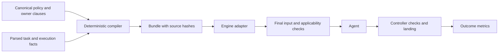

# Instruction and documentation architecture

Independent GPT-6 Astra desk research, 2026-11-05, Asia/Shanghai.

**Recommendation:** compile assignments from versioned authorities, replace prose execution rules with controller
checks, remove mandatory history reads, and enforce documentation ownership, size and research disposition.

Proposals only. Existing code, prompts, documents, configuration and memory are unchanged. No agents/evals launched
or commits made; the parallel researcher's report was not consulted.

## 1. Measured inventory

Repository counts use tracked files at `ba9999f3fb6ffb83b4539654b5a9a0cba0cb1933`. Local reads began at 18:54 UTC
on November 4. The main-checkout comparison recorded `eb28b757deb84f60c6b00228532341a9bea4f4c9`. Local queues
remain live; measurements at different times are not an atomic snapshot. Bytes are UTF-8; MB is decimal;
characters are Unicode code points. The English prompt samples also have identical JavaScript UTF-16 lengths.

Read-only measurement scripts and evidence are in [`.temp/research/`](../../.temp/research/): `inventory.py` and
`inventory.json` hold per-file sizes/hashes, source inventories, references and overlap; `runtime_inventory.py`
queries SQLite read-only; `reconstruct.ts` calls existing pure parsers/renderers/adapters without launching agents;
`details.py` measures distributions and formatting; `sources.py` saves vendor pages with retrieval times and hashes.
Their JSON outputs, complete reconstructed prompts and hypothesis-confidence `notes.md` remain local. The
`checkout-comparison.json` records source availability across branches.

| Tracked surface | Files | Bytes |
| --- | ---: | ---: |
| `docs/` | 417 | 16,848,501 |
| `docs/research/` | 312 | 13,365,370 |
| Other `docs/` | 105 | 3,483,131 |
| All `.md` | 698 | 26,528,827 |
| All `.md` plus `.mdx` | 719 | 26,574,538 |
| `README.md` files | 94 | 5,007,813 |
| `docs/development/` | 16 | 389,074 |
| `docs/goals/` | 19 | 875,594 |
| Workflow skill tree | 6 | 19,904 |
| `tools/goal/reports/` | 7 | 2,072,485 |
| `tools/goal/research/` | 3 | 355,837 |

Research is 79.3% of `docs/` bytes. Its largest files are
`growth-uncertainty-calibration.md` (1,168,020 bytes), `performance-cost-audit.md` (515,498) and
`home-and-list-items.md` (468,663). They include real datasets, inventories and appendices, not just prose.

A read-only calculation compacting repeated spaces and separator dashes on pipe-table lines finds **3,514,952
removable characters in research**, 26.34% of its characters; across Markdown, 4,686,168. This is a syntax-naive
formatting opportunity, not a verified rewrite or token-saving estimate. A formatter could recreate it. Large
inventories should use compact records/generated views, with formatter idempotence tested before migration.

### Instruction sources by role

This distinguishes automatically loaded text, compulsory linked reads and merely available material.

| Source | Roles/loading | Size and issue |
| --- | --- | --- |
| Provider/system harness, tool schemas, plugins | All; runtime injected | Not fully observable here; repository size is not total model input. |
| Root `AGENTS.md` | Codex native loading; other engines depend on adapter | 1,977 characters here, 1,397 on main. No tracked nested AGENTS, CLAUDE or Cursor rules found. |
| `agent-conduct.md` | All by root link | 9,111 characters; common, worker, manager, supermanager and research rules mixed together. |
| Development README / delivery / supermanager / efficiency / verification | Managers and relevant linked tasks | 5,784 / 8,590 / 3,538 / 7,219 / 38,833 characters; duties, commands and operational history overlap. |
| Workflow skill | Managers/designers; workers only when linked | Router 2,767 plus 17,137 characters in five references. Some policy repetition. This checkout's Claude skill link shares the same tree. |
| Product owners, architecture, scope, module READMEs | Selected task context | Architecture 6,646; scope 11,941; Subject pages 229,474 characters. Access README is 596,935 bytes. Not universal instructions. |
| Tracked Goal definitions/capability files | Managers; selected clauses for workers | 874,769 characters; Web definition alone 99,871. Intended to link product owners. |
| Stored manager specs and local manager files | Mandatory session-start reads | Specs usually 403–419 characters, requiring complete local-file reads. Twelve files total 544,842; nine current files 495,107 characters. |
| Continuations and inbox | Renewal/events | Nine current continuations total 71,581 characters. Retained inbox: 38,447 events / 20,870,092 summary characters, not one session's input. |
| Private owner/road/operating decisions | Through briefs and manager links | Accounts current decisions 32,299 bytes; linked recovery 4,663; shared road decisions 34,505; worker-autonomy decision 3,439. Current rules still outside Git. |
| Task brief front matter and Markdown | Workers/researchers | Historical store: 11,441 files / 84,200,417 bytes; backlog tree: 2,989 / 13,839,439, including parked/history material. |
| `launch.ts` plus verification flag | Controller workers | 873 lines / 47,456 characters of code; sample wrapper adds 5,954 characters. Local verification flag was `minimal`. |
| `managers.ts` openings/wakes | Managers | 1,311 lines / 53,740 characters of code; rendered openings about 1.4–1.6 KB before linked reads. |
| Launch context, retry manifest, owner decisions, consultation, Storybook text | Applicable worker boundaries | Context budget 12,000 bytes; partial owner-decision fitting check 20,000 characters. Additional instructions after the brief. |
| Defaults, routing, local config, adapters, result schema | Controller policy | Defaults 19,612 characters; local config 11,393 bytes; result schema 999 characters. These determine actual limits, tools and behavior. |
| Claude project memory | Supermanager; topic files on demand | 130 files / 431,626 bytes; index 25,387 bytes in 129 lines; standing asks 155,347 bytes in 293 lines. |
| Personal config/skills | Engine/account dependent | Codex configs 31,187 and 6,384 bytes; Claude settings 804; Cursor 2,537; Grok 515. Direct personal skill bodies: Codex/Claude each 187,168 bytes, Cursor 192,939; mostly shared installations, not all loaded. |
| Personal hooks | Claude/Codex | Codex hook config 3,520 bytes: GitKraken integration/process reaper. Claude Stop calls `goal-manager-stop.sh`. No repository authority/size hook found. |

No nonempty additional global AGENTS/CLAUDE instruction body was found in inspected homes/config keys. Cursor
team/user dashboard rules, managed organization settings, remote plugins and hidden harness text remain unverified.
Grok's passthrough adapter does not prove its instruction-file discovery behavior. Certifying *every effective
source* requires a resolved-load manifest per installed engine; a filesystem inventory alone cannot do that.

Local trees include history/snapshots: Web 3,765 Markdown files / 50.19 MB; control-plane 7,472 / 307.18 MB.
These are not all instructions; per-role totals are in `details.json`.

### What agents actually receive

| Local manager file | Characters |
| --- | ---: |
| Accounts | 181,053 |
| Commerce | 103,341 |
| Semantic | 83,121 |
| Imports | 44,000 |
| Content | 36,703 |
| Performance | 26,042 |
| Web | 8,077 |
| Search | 6,696 |
| Control-plane | 6,074 |
| Catalogue / interop / kernel, legacy/noncurrent | 22,313 / 22,079 / 5,343 |

Accounts starts with a supersession note and retains many receipt/history sections. Commerce starts with successive
operational receipts. Semantic explicitly places current decisions above contradictory historical instructions.
Web has a much shorter replacement brief but still calls research authoritative.

The stored Accounts spec declares its local file authoritative and demands a complete read. Its reconstructed
opening is **1,583 characters**; plus file and continuation, the mandatory set is **190,599**, before AGENTS or
linked decisions. Web's corresponding set is 17,533. Indirection does not make an effective prompt small.

Nine current continuations are 7,913–7,995 characters: they comply with the existing 8,000 limit. One archived Web
continuation is 63,119; counting it as current would be misleading. Their near-ceiling clustering suggests agents
fill a container rather than retain only useful state.

`reconstruct.ts` parses two real Accounts browser-return briefs, invokes `workerPrompt`, then the actual Codex argv
builder. No agent runs:

| Sample | Brief | Minimal payload | With root AGENTS |
| --- | ---: | ---: | ---: |
| Password-change return | 10,136 | 16,090 | 18,067 |
| Security-revocation return | 12,849 | 18,803 | 20,780 |

Normal payloads are 15,978 and 18,691. This assumes a first attempt, substituted worktree path, no existing changed
paths/shared workspace, retry evidence, consultation, dependency records or new owner decision. Reading conduct as
root requests adds 9,111. Hidden runtime, skills and history are excluded; these are reconstructions, not original
transcripts.

The minimal footer prohibits acceptance/native/browser checks, then overrides contract and saved-session check
instructions. Registered proof branches have narrow exceptions. Main has identical launch code and the sampled
flag is minimal. Separately `storybook.ts` disables local Storybook and its interactive-worker test is skipped;
browser MCP availability alone proves neither permission nor a usable Storybook path.

Historical briefs: median 5,155, p90 14,408, maximum 126,845 characters; 1,558 exceed 12,000. This does not prove the
current parser accepted every historical file. The backlog tree has 79 over 12,000; a top-level snapshot had twelve
files, one oversized. Filenames alone do not prove dispatchability.

### Contradictions, overlap and staleness

| Evidence | Finding |
| --- | --- |
| Conduct: 12,000-character brief cap; defaults/parser: 65,536 bytes | Direct unit/value mismatch. |
| Conduct: 20,000-character total prompt; `owner-decisions.ts:255` only checks additions | No universal final-input enforcement. |
| Verification: acceptance plus root typing; normal launch delegates root regression; minimal launch bars acceptance/browser checks | Execution phase is not represented once. Preserve deferred acceptance explicitly. |
| Conduct: two researchers for complex designs; efficiency: one report by default | Could be a scoped exception, but scope must be explicit in one authority. |
| Conduct bans receipts; large manager files require reading them | Supersession paragraphs leave old constraints in active input. |
| Repository owns decisions; stored manager spec declares local file authoritative | Competing authority. |
| Web manager and `docs/goals/web.md:437` depend on research migration contracts | A “supporting evidence” disclaimer does not remove normative dependencies. |
| Main lacks conduct, efficiency and workflow skill; launch/managers/defaults match this checkout | Code release does not establish instruction availability. |
| Existing pool/train reload tests | Some configuration already reloads and records revisions. The reported lost hour was not independently reconstructed. |
| Claude Stop hook uses local process/watcher detection | Real enforcement, but a different wake mechanism from Codex; applicability must be engine/role specific. |

There are 19 research suffix families totaling 2,090,442 bytes, but **no byte-identical research files**. Backend
architecture and Subject-page IA pairs explicitly preserve independent investigations. Do not delete by suffix.
There are 224 links into research from nonresearch Markdown: many are proper citations; the Web examples above
establish actual authority leakage. Filesystem mtime is not a freshness test: use observed revision, supersession
and effective loading.

## 2. Findings and external evidence

Confidence is judgment, not a statistical posterior; `notes.md` records updates.

| Hypothesis | Finding / confidence | Remaining evidence needed |
| --- | --- | --- |
| H1: history dilutes rules | 0.90 for large sampled manager files/asks, 0.55 for the literal all-role majority claim. Conduct is mostly current rules; research includes data/padding. | Stratified paragraph coding, actual-load traces and causal task ablation. |
| H2: layers drift | 0.98; competing local authority, check instructions and caps. | Final-input/source coverage. |
| H3: prose substitutes for checks | 0.95 for aggregate size/lifecycle/renewal gaps; existing parser, inbox, result and reload checks are counterevidence to universal absence. | Boundary refusal tests. |
| H4: accumulation creates authority | 0.95 for accumulation/leakage; 0.70 for missing deletion/caps as dominant cause. | Four-week creation/deletion/adoption ledger. |
| Added H5: freshness is distribution | 0.98; main/worktree availability differs. | New and resident sessions acknowledge a controlled update. |
| Added H6: indirection hides input | 0.90; 1.6 KB opening requires >190 KB reading. | Installed-engine traces including truncation/imports. |
| Added H7: bytes overstate prose | 0.99; padding is 26.34% of research characters. | Token measurements and compact-representation evals. |

### Vendor guidance

**Codex** selects global instructions from its configured home, then one eligible project file per directory from
root to current directory. Overrides take precedence; concatenation is root-to-leaf, with nearer guidance overriding
earlier text. Default project-document ceiling: 32 KiB (`project_doc_max_bytes`), assembled at run/session start.
This is a loader limit, not a recommended budget. Links do not recursively load by this mechanism; splitting by
directory does not make accumulated text free.
[AGENTS.md](https://learn.chatgpt.com/docs/agent-configuration/agents-md)

**GPT-6** guidance describes Astra's sensitivity to file/skill instructions, clarification tendency and sometimes
excessive verification. Define autonomy, completion and verification boundaries; evaluate on each chosen model.
The Astra article recommends short skill triggers, progressive disclosure and task-dependent reading, noting
that guidance for Sol/Luna can overconstrain Astra.
[GPT-6 guide](https://developers.openai.com/api/docs/guides/latest-model.md),
[Astra skills/prompts](https://learn.chatgpt.com/blog/rethinking-skills-and-prompts-for-gpt-6-astra)

Codex separates durable rules, reusable procedures and assignments. Descriptions load before skill bodies.
OpenAI recommends evaluations/version control; caching means repeated context is not necessarily billed at
uncached rates. Record cached and uncached tokens separately.
[Codex practices](https://learn.chatgpt.com/docs/learn/best-practices),
[skills](https://learn.chatgpt.com/docs/build-skills),
[prompt engineering](https://developers.openai.com/api/docs/guides/prompt-engineering)

**Claude Code** distinguishes CLAUDE instructions from auto memory. Imports do not reduce context cost. Current
docs recommend instruction files around 200 lines and load the first 200 lines or 25 KB of the memory index,
whichever comes first; topics load on demand. REZICS's 129-line index is around the byte threshold. Verify installed
behavior before alleging actual truncation. Skills defer supporting material; command hooks enforce event-level
conditions, while prompt/agent hooks remain model judgments.
[Memory](https://code.claude.com/docs/en/memory), [skills](https://code.claude.com/docs/en/skills),
[hooks](https://code.claude.com/docs/en/hooks)

**Opus 5.5** recommends effort calibration (documented starting default: medium), harness-owned completion because
text-only end-of-turn can be progress, bounded continuation and separate enforcement of timeouts. General guidance
separates instructions/context and places long-document data before the final query. These principles do not
authorize changing REZICS routing or embedding every owner document in coding prompts.
[Opus 5.5](https://platform.claude.com/docs/en/build-with-claude/prompt-engineering/prompting-claude-opus-5-5),
[general prompting](https://platform.claude.com/docs/en/build-with-claude/prompt-engineering/claude-prompting-best-practices)

**Cursor** supports project `.mdc`, user/team rules and AGENTS; applied rules enter context. It recommends scoped
rules, canonical references and linters. Its under-500-line advice is not a REZICS character budget. Audit dashboard
rules alongside files. [Cursor rules](https://cursor.com/docs/rules)

### Research limits

- **Lost in the Middle** establishes position sensitivity in document QA/key retrieval, not a safe current-model
  prompt size. [TACL 2024](https://aclanthology.org/2024.tacl-1.9/)
- **IFScale** shows degradation with up to 500 keyword requirements, but explicitly limits generalization beyond
  English business reports. Its percentages cannot forecast coding failures. Full method/limitations retrieved.
  [IFScale](https://arxiv.org/html/2507.11538v1)
- **LIFBench** varies length, wording and variables: useful eval dimensions. Only its publication abstract was used.
  [ACL 2025](https://aclanthology.org/2025.acl-long.803/)
- **Instruction Hierarchy** studies privilege-sensitive training and complementary system controls. Markdown cannot
  create a higher-priority API message or enforce permission. [Paper](https://arxiv.org/html/2404.13208v1)
- **IHEval**, **MIH-Bench**, **ManyIH** report failures under conflicting/accumulating/many-level instructions.
  Remove conflicts before dispatch rather than lengthen precedence ladders. The newer abstracts, not full tables,
  were used; none proves REZICS's optimum budget.
  [IHEval](https://aclanthology.org/2025.naacl-long.425/),
  [MIH-Bench](https://aclanthology.org/2026.emnlp-main.2261/),
  [ManyIH](https://aclanthology.org/2026.findings-emnlp.1420/)

## 3. Target instruction architecture

Use four layers: global, role, Goal and task. Execution facts accompany them without becoming another prose
rulebook. Platform instructions retain their actual priority; within the repository preserve maintainer/repository
precedence. A generated fragment inherits its source's authority, not greater authority because it appears last.

| Layer | Sole authoring location | Received content |
| --- | --- | --- |
| Global | Root `AGENTS.md` | Language, authority, initiative, legacy/scratch discipline and role router; no command catalogue. |
| Role | `docs/development/roles/{worker,manager,supermanager,researcher}.md` | One role's rights, output, completion and escalation. Move old role prose; remove its former copies. |
| Goal | `docs/goals/<domain>.md` and selected owner anchors | Outcomes, scope and acceptance references; workers receive only applicable clauses. Add a tracked control-plane Goal. |
| Task | Parsed local brief | Outcome, concrete premises, owner refs, scope/risks, acceptance and fixed decisions; rewritten on retry. |
| Execution facts | Existing typed configuration/task/check state | Verification phase, command/placement, source revision, pending check and retry delta; prose generated from values. |
| Procedure | Shared workflow skill and stage references | Load the current procedure; no independent policy or copied limits. |
| Local memory/state | Private index and structured continuation | Environment pointers/current work; durable decisions link to repository owners. |

Add `tools/goal/instructions.json` as a source manifest mapping stable policy keys to paths/anchors, roles and
applicability. It contains no parallel prose rules. Numeric policy remains in `defaults.json` with explicitly
permitted overrides; the manifest references those fields. Policy keys name capabilities, never task IDs.

Resolve applicability and emit each rule once. Do not summarize policy with an LLM at dispatch. Store generated
bundles under ignored controller state; version sources/tests in Git. Add their hashes/source map to existing
attempt records, not new receipt documents.

Native loading is adapter-specific: Codex root instructions are counted but not repeated in the task; a tiny
CLAUDE adapter can import AGENTS; Cursor can use AGENTS without a duplicate always-on rule. Test each installed
loader. For Grok, prove native discovery or inject the common fragment explicitly. Say AGENTS is loaded only when
established. Dashboard/plugin/managed instructions must appear in the resolved-load inventory or be marked unknown.

### Budgets as received

Proposed guardrails, not vendor limits: count imports, wrappers, compulsory reads, selected skills/descriptions.
Meter retrieved code/logs/evidence separately; their embedded instructions gain no policy authority.

| Worker component | Target characters | Ceiling |
| --- | ---: | ---: |
| Common, including imports | 2,000 | 2,500 |
| Role | 1,200 | 2,000 |
| Goal clauses | 1,000 | 2,000 |
| Brief including front matter | 6,000 | 8,000 |
| Execution/retry/owner delta | 1,500 | 2,500 |
| Required owner excerpts | 3,000 | 5,000 |
| Selected procedure | 0–1,000 | 2,000 |
| Repository-controlled catalogue/routing | 500 | 1,000 |
| **Aggregate** | **15,200–16,200** | **20,000** |

Ceilings are not additive entitlements. Reject overflow with source sizes/remedy; never truncate acceptance or
owner decisions. Restructure or use a scoped, expiring owner-approved exception, not a global cap increase.

Other aggregate ceilings, including required reads:

- **Manager 24,000:** common 2,500; role 3,000; Goal 5,000; continuation 4,000; event 2,000; selected owners 5,000;
  procedure/catalogue 2,500. The local ≤1,000-character generated locator counts inside this total.
- **Supermanager 24,000:** common/role 5,500; priorities 3,000; working state 4,000; memory index 2,000; event 2,000;
  selected owners/procedure 7,500. Count private topics when actually loaded.
- **Researcher 32,000:** task ≤12,000; common/role ≤5,000; decision requirements ≤10,000; execution/procedure ≤5,000.
  Read large source evidence in bounded selections and meter it separately.

Track visible context and cached/uncached tokens; these caps do not bound whole conversations or hidden runtime.
Renew with preserved state when obsolete context causes errors, not merely to improve a size metric.

### Versioning and freshness

Record source commit/hashes, manifest version, effective policy hash, adapter version, model/effort/tier and final
prompt hash/size. Exclude secrets from exported provenance. Resolve required references against the actual worker
checkout. When controller code runs on main and product documents on dev, deploy an immutable generated source
bundle with provenance; never maintain an editable second policy. A missing source rejects only affected work.

At resume compare desired and session revisions: send a bounded compatible delta, or renew from current state.
Frozen task/check contracts retain their binding until an authorized amendment. A newer blanket policy cannot
silently weaken an existing task's acceptance.

Extend existing pool/train reload mechanisms with desired/observed revision and `applied`, `restart-required` or
`rejected` state. Test a changed value in a long-lived process at its next boundary, including same-timestamp edits;
invalid edits preserve the last valid state and expose the error. A file write alone never proves rollout.

### Evaluation and rollback

1. Test final rendered inputs for fresh/retry/wake/proof/research/shared-workspace/manager renewal across adapters.
   Include excessive size, Unicode, missing owner, stale policy, unavailable tools and unknown check results.
2. Build a small behavior set from real failures: browser verification under an incompatible plan; answer present
   in owner context; old continuation versus current rule; permitted adjacent fix; source completion with deferred
   acceptance; changed behavior versus frozen acceptance. Vary wording and position; grade actions/outcomes.
3. Replay matched tasks on isolated retained bases. Hold model, effort, tools and allowance fixed; remove one
   instruction group at a time. Cover each engine and major class without live credentials/mutations.
4. Canary one manager/small worker cohort. Review at least 30 comparable completed assignments before expansion;
   report uncertainty and strata, not only a pooled mean. Keep research independence intact.

Reject lost requirements or weakened acceptance. Roll back a bundle on a severe authority failure, or an initial
alarm of >5 percentage points lower accepted-attempt success or >10% lower accepted outcomes per allowance on
comparable work. These are operating alarms, not statistical significance claims. Restore the previous compatible
bundle and observed runtime revision; preserve commits. Do not roll back by appending old history to sessions.

### Deterministic replacements for prose

| Problem | Enforcement boundary | Judgment/prose retained |
| --- | --- | --- |
| Brief/aggregate size | Parser, final adapter, renewal ingestion | Coherent outcome and explicit exception reason |
| Conflicting check instructions | Typed command/phase/placement plan before launch | Purpose of checks |
| Deferred evidence counted complete | Existing outcome/promotion state machine | Difference between source-complete, integrated and verified |
| Frozen files/risk ownership | Existing diff and authorization checks | Contract intent |
| Missing/stale instruction source | Manifest/hash/checkout validation | Resolving real contract conflicts |
| Unobserved config update | Revision acknowledgement/release checks | Recovery procedure |
| Repeated equivalent failed attempts | Existing retry/progress logic | Manager selects a different approach |
| Excess messages/polling | Existing inbox caps and event wake path | Decision/question/handoff relevance |
| Oversized/stale continuation | Structured schema and ingestion limit | Current objective and next action |
| Competing authority/history growth | Registry, size ratchet, links and disposition | Semantic ownership review |
| Style/generated data/dependency rules | Linters/generators/architecture checks | Design rationale |

Move a rule to a check when inputs, violation and recovery can be specified without judgment. Use the boundary
closest to the effect. Hooks offer early feedback; they cannot be the only enforcement because other engines and
arbitrary shell paths can bypass them. Static checks cannot replace product judgment or evidence assessment.

## 4. Documentation ownership and lifecycle

Keep sound existing topic boundaries; do not replace hundreds of files with one manual. Register one owner for
each claim. Product behavior and implementation mechanics are distinct topics, not competing copies.

| Topic | Canonical owner set |
| --- | --- |
| Conduct / role rights | AGENTS and four role files |
| Architecture / public scope | `docs/architecture.md`, `docs/scope.md` |
| Delivery / verification / efficiency / maintenance | Matching development files; README only routes |
| Documentation/research lifecycle | New `docs/development/documentation.md`; researcher role links it |
| Accounts/disclosure/erasure | `docs/accounts.md`, `docs/deletion.md`; Auth/Access READMEs own implementation contracts |
| Semantic catalogue/Zones | `docs/catalogue-editing.md`, `docs/zones.md`, `docs/zone-membership.md`; semantic technical contracts |
| Search/lists | `docs/search-conditions.md`, `docs/search-facets.md`, `docs/filtered-lists.md`; search README owns runtime/indexing |
| Library/Collections/commerce | `docs/library-and-collections.md`, `docs/commerce.md`, `docs/commerce-modules.md`, `docs/collection-source.md`, `docs/collection-presentation.md`; bounded library leaves for unique topics |
| Content/community | Existing module-owner sections; extract a product owner only while removing its old authority |
| Imports | `docs/import-review.md`, provider/import leaves, importer README; distinguish behavior from adapter mechanics |
| Web | `docs/subject-pages.md`, `docs/viewer-actions.md`, `docs/feeds.md`, `docs/seo.md`, shared presentation owners; Web README owns commands |
| Performance/operations | Cost clauses beside contracts; detailed check/host/toolchain procedures in scripts README or bounded runbook leaves |
| Controller | Goal README index plus reference pages; schemas/config own exact fields/defaults |
| Goal outcomes | `docs/goals/<domain>.md` links owners; no behavior hidden in acceptance history |
| Evidence status | Structured capability/story manifests and generated views; observations cannot introduce requirements |

Classify existing `search-*-plan.md`, library leaves and technical contracts individually. A filename does not prove
obsolescence. Preserve unique behavior until it has an owner. Moving a topic from rezics-next-discussion still
requires replacing its old page with a pointer in the same adoption change.

A small `docs/authority.json` records path, kind (`owner`, `reference`, `research`, `generated`), unique topic keys,
owner domain/role, generator source and research disposition. Links distinguish normative references from evidence.
One file may own related topics; two files cannot independently own the same topic. Landing must not infer this
reliably from English prose.

### Research and task notes

Commission research for a named decision, owner and consumer. Preserve independent reports for complex designs
until synthesis; a routine answer may fit directly in an owner amendment with source citations.

Use **open / adopted / rejected / superseded** states. Open research records revision/date, sources,
confidence and reversal conditions. Within seven days, record an owner decision or a specific
pending condition and next review date. A date does not decide a product question automatically.

Adoption updates the owner, redirects normative links, records disposition and removes superseded owner text in
one change. Keep reports for useful independent evidence, methods, unresolved counterarguments or costly
experiments. Put large raw results outside active documentation with immutable location/revision; verify an archive
before deleting its only copy. Already tracked reports remain recoverable from Git history. Deletion reduces active
reading material, not historical Git object size.

Delete superseded active reports after repairing links and preserving needed evidence. Do not create a default
`docs/archive/` search corpus. Review retained research after 90 days; extension requires a demonstrated use.
For current/deep/independent families, compare findings and dissent first: retain both while open, then either,
both or neither according to evidence value. Do not erase independence by manufacturing consensus. Future names
should avoid timeless `current`; metadata records researcher and observed revision.

Task state belongs in the controller. Retain brief snapshots/structured results for reproduction; replace current
continuations. Initially expire raw local logs 30 days after closure unless an incident/decision needs them; retain
weekly aggregates. Historical briefs may remain cold archives without active prompt pointers. Never delete live
queues, retries or the sole evidence of unfinished work during cleanup.

### Proposed size policy

Budgets count Unicode characters, metadata and tables, including descendants. They apply to logical topics so
file splitting cannot evade them. Put legacy violations in a shrink-only baseline; never truncate meaning.

| Class | Ceiling / end-state target |
| --- | --- |
| Global / roles | 2,500 global; 3,000 each role, 12,000 total |
| Workflow entry / skill | 2,000 entry; 1,500 skill router; 8,000 skill tree; 30,000 workflow policy core |
| Goal definition | 5,000 each; 50,000 for ten scope documents including control-plane and Library under commerce |
| Owner/reference | 24,000 per file; a complex logical topic may have a reviewed 48,000 exception |
| Module README | 12,000 entry; bounded contract leaves; README aggregate ≤2 million |
| Research | 32,000/report; 48,000 for an explicitly bounded inventory study; ≤2 million retained/active, ≤1 million open |
| Generated evidence view | 12,000; large rows remain in bounded structured data/artifacts |
| `docs/` excluding research | ≤1.5 million, from 3,477,264 |
| `docs/development/` | ≤120,000, from 384,570 |
| `docs/goals/` including views | ≤200,000, from 874,769 |
| All tracked Markdown | Initial target ≤8 million, from 26,496,124 |

Moving Markdown is not reduction. Bound structured data by schema, size and retention too. Reassess aggregate
budgets after the first contract-preserving migration; increase justified budgets instead of fragmenting topics.

### Landing check in seconds

One deterministic checker runs locally and on the **final merged/rebased candidate**:

1. Inventory changed/renamed/deleted tracked documents and validate registry coverage.
2. Validate unique owner keys and source/generator references. Research cannot own normative topics.
3. Count characters/bytes per file, topic and directory; enforce new limits and shrinking legacy baselines. Explicit
   expiring exceptions cannot be hidden baseline increases.
4. Check local files/headings, including inbound links to deleted content; verify generated-source hashes.
5. Check research disposition and policy-source/adapter drift. Superseded reports cannot remain active instruction
   targets.

Cache parsing by Git blob hash with a reverse-link index. No model, network, `.temp`, private-home or history scan
belongs in this gate. Output path, violation and remedy. Existing development-doc tests supply useful fixtures.
Target p95 <5 seconds full and <2 seconds incremental on the landing host. One full Markdown spacing scan took
3.52 seconds; that supports feasibility, not an unbuilt checker's benchmark. Measure cold/warm performance under
representative load before refusal.

Static checks establish declared authority; owner review/behavior fixtures establish preserved meaning.
Warn on legacy debt, refuse new violations, then shrink the baseline.

## 5. Supermanager memory

Apply existing `repo-over-memory.md`: durable rules belong in repository owners; memory points to them. Reconcile
public policy in standing asks, token-efficiency, context-length, dual-research, decisions-live-in-docs and related
notes. Move only missing current decisions; remove duplicates/obsolete directions. Do not export personal quotations,
chronology or who decided something.

Keep account aliases, allowance/reset facts, hosts, contacts, people and private environment troubleshooting local.
Credentials stay in their secret/config store; memory points to access mechanisms rather than copying values.
Track public procedures with placeholders, keeping private mappings local.

Replace `MEMORY.md` (25,098 characters) with a **≤2,000-character index**: role entry, current-state pointer and a few
private-topic links. Replace standing asks (153,655) with **≤4,000 current unfulfilled asks**, each carrying scope,
next action and owner link. Completed items leave active memory. Target active memory ≤30,000 total and private
topics ≤4,000 each; cold history outside auto-memory has the same initial 30-day retention, except unresolved cases.

At renewal, check sizes and pointer validity; weekly, review fulfillment/expiry. Do not erase the only continuation
when validation fails. Workers/researchers receive adopted public decisions and necessary environment capabilities,
not the supermanager's whole memory.

## 6. Ordered migrations and first three briefs

After sizes are proposed character ceilings. Rows overlap; savings are not additive. Adopt before implementation;
preserve requirements/evidence before retirement.

| Order | Cut / merge / move / delete | Before → after |
| --- | --- | --- |
| 1 | Compile launch/manager prose from authorities; replace minimal-mode overrides with an effective check plan. | Sample wrapper 5,954 → ≤2,500; complete controlled worker input ≤20,000. No arbitrary code-line target. |
| 2 | Split conduct by common/role authority; merge duplicate delivery/supermanager duties; move commands/host/toolchain history out of verification/development README. | Seven core files 75,052 → ≤30,000 including role replacements; conduct 9,111 → 0 after links move; verification 38,833 → ≤8,000. |
| 2 | Make skill/references procedural routers. | Tree 19,904 → ≤8,000; entry 2,767 → ≤1,500. |
| 2 | Replace current local manager files with generated locators; current scope to owners, operating state to continuations, history to cold storage. Retire legacy catalogue/interop/kernel locators after live-reference checks. | Nine files 495,107 → ≤9,000; legacy three 49,735 → 0 active; continuations 71,581 → ≤36,000. |
| 2 | Reconcile public memory rules and current asks. | Active memory 423,265 → ≤30,000; index 25,098 → ≤2,000; asks 153,655 → ≤4,000. |
| 3 | Add authority registry, size ratchet and final-candidate checker. | New mechanism; zero new undeclared authorities/unbounded documents. |
| 4 | Repair Web: move product rules from Goal/research into real owners; divide Subject reader/editor/presentation contracts by topic. | Web Goal 99,871 → ≤5,000; Subject pages 229,474 → ≤72,000 across bounded topics/index; home/list report 466,912 → ≤24,000; quality-round report 147,880 → ≤24,000 evidence or delete. |
| 5 | Extract raw growth-calibration, performance-cost and home/list appendix data; retain conclusions/method/source references. | Three reports 2,143,019 → ≤72,000 active research; raw data recoverable from committed revision/verified archive. |
| 6 | Compare all 19 suffix families, preserve dissent, retire superseded reports. Start backend architecture and Subject IA. | Families 2,088,951 → ≤608,000 average allocation; backend pair 224,402 → ≤32,000; Subject pair 250,767 → ≤32,000. Open pairs may retain both through an explicit exception. |
| 7 | Structured capability/story manifests with bounded generated views. Requirements remain in owners. | Goal tree 874,769 → ≤200,000; page-stories 205,139 → ≤12,000 view; data counted separately. |
| 8 | Retire committed daily operational ledgers after adopting any remaining decision. | Goal reports 2,072,303 → 0 active; two daily audits alone 1,911,885. Efficiency owner ≤6,000. |
| 9 | Trim Access, Content, Library, importer and Web READMEs first; separate real contract leaves from run histories. | All READMEs 5,003,599 → ≤2 million; entries ≤12,000. Leaves count toward repository total. |
| 10 | Complete baseline ratchet, formatter checks and evidence expiry. | Research 13,344,249 → ≤2 million; Markdown 26,496,124 → ≤8 million, subject to preserved-contract review. |

The following are complete journey briefs for adoption. Existing delivery rules separate `tools/goal` work on main
from companion repository documents on dev. No journey authorizes live-queue deletion or overwriting another agent.

### Brief 1: one observable assignment at every boundary

**Owner/outcome:** Control-plane. Workers/managers start and resume with one versioned assignment. Required checks
are executable in their declared phase or explicitly deferred, never silently converted to success.

**Scope/read:** main, under `tools/goal`: launch, managers, policy, owner-decisions, launch-context, adapters,
defaults/task/result schemas and tests. Read the adopted architecture above, Goal README's briefs/managers/integration
sections, worker-prompt/launch-brief-policy tests and existing pool/train reload tests. Use sanitized reconstruction
samples. Exclude product acceptance/routing/allowance changes and scheduler replacement. Journey 2 supplies canonical
source documents; compiler tests can begin with fixtures.

**Decisions/work:** compile deterministically from one source per policy key; resolve against the actual checkout,
count native/compulsory input, capture final adapter text and reject overflow/conflict before an attempt. A typed plan
binds command, phase, placement, source and required/deferred status. Translate current minimal mode visibly.
Persist hashes in existing records; expose desired/observed and restart-required/rejected revisions. Resume uses a
compatible delta or state-preserving renewal; frozen acceptance requires an authorized amendment.

**Acceptance:** fixtures cover four adapters, both samples, fresh/retry/wake, proof/research/shared workspace,
manager renewal, stale instructions, missing owners, Unicode/overflow, unavailable browser and unknown check results.
Exactly one plan reaches the adapter; deferred evidence stays non-green. A long-lived process must adopt a changed
value, including a same-timestamp edit, and retain last-valid state on invalid input. Tests use no real agents/live
state. Run changed focused tests and the required control-plane gate after final edits.

**Done/rollback:** canary one manager and representative workers; require observed revision acknowledgement and
correct check behavior, not merely generated files. Handoff revision and unrun/failed checks normally. Restore the
previous compatible bundle/config on failure, preserving commits and running compatible work.

### Brief 2: current rules replace resident history

**Owner/outcome:** Supermanager adopts; a documentation worker prepares dev changes; the supermanager performs
private-state rollout. A new resident finds scope, current asks and next action without reconstructing history.

**Scope/read:** AGENTS, development core/new roles, skill/references and affected Goal/product owners; private phase
covers manager locators, continuations, policy memories and the Claude entry adapter. Read existing delivery,
verification, efficiency and role rules, then selected local current decisions once in ranges. Start memory at its
index/repo-over-memory; do not copy credential bodies. Exclude product changes, new scope, allowance changes, live
queue deletion and bulk research deletion.

**Decisions/work:** classify each instruction as owner rule, duplicate, current state, private fact or obsolete.
Adopt missing rules in the correct owner and remove conflicts. Global rules stay at root, rights in role owners,
procedures link policy; complex designs retain independent research. Use Brief 1's typed check plan and source bundle.
Generate local locators, replace continuations/index/asks and preserve cold recovery copies. Workers make no private
edits outside their workspace.

**Acceptance:** links/drift checks pass; core including roles ≤30,000, skill tree ≤8,000, Goals ≤5,000 or explicit
shrinking exception. Locator ≤1,000, continuation ≤4,000, index ≤2,000, asks ≤4,000. No requirement exists only in a
removed note. Role scenario questions identify one available authority for adjacent fixes, completion, research,
checks and unavailable evidence. Run applicable documentation checks; no native product tests for prose-only changes.

**Done/rollback:** renew one manager at a safe checkpoint with revision acknowledgement; inspect its first decision
and pending work, then proceed by domain. Renew the supermanager only with recoverable state. Restore prior role
bundle/state on lost requirements and repair ownership rather than reappend history. Done requires observed correct
loading/decisions as well as size reduction.

### Brief 3: landing enforces authority and size

**Owner/outcome:** Control-plane enforces; supermanager classifies. Valid documents land quickly; authority/size
violations produce actionable refusal in seconds. Legacy debt shrinks without blocking unrelated work.

**Scope/read:** checker/schema/fixtures and final-candidate integration under `tools/goal` on main; companion dev
registry, lifecycle policy and baseline. Read adopted documentation policy, `scripts/development-docs.test.ts`,
existing final-candidate/generation checks and integration runbook. Use Web/shared-family links as the initial
classification example. Bulk rewriting is later work.

**Decisions/work:** unique declared topic owners; research is evidence. Count files/topics/directories and Unicode
characters/bytes; baselines only shrink, exceptions have owner/reason/expiry. Check links/headings, inbound deletions,
generated hashes and research disposition. Cache by blob hash/reverse links. Check the final merged candidate to
catch combined growth/duplicate authority. No model, network, private-home or `.temp` scans. Preserve sole evidence
before deletion. Warn on baseline debt, refuse new violations, tighten after migration.

**Acceptance:** fixtures reject duplicate owners, normative research references, missing headings, broken inbound
links, generated drift, expired disposition, renamed oversize material, splitting to evade caps, baseline increases
and combined-candidate growth. Valid owner amendments/adopted evidence pass. Measure cold/warm p95 <5 seconds full,
<2 incremental on current corpus/landing host. Run focused tests and controller gate; no product/native/browser suite.

**Done/rollback:** deploy versioned compatible checker then companion registry/policy; canary real documentation
landings and demonstrate both refusal and valid pass within budget. Restore prior checker or disable only the faulty
class through an expiring setting on defects, retaining telemetry/existing gates. Historical cleanup is not a
prerequisite for declaring this enforcement journey complete.

## 7. Weekly success measures

Generate one view from existing records, stratified by Goal, task class, engine/model/effort, bundle and infrastructure.
Establish a week of baseline; this study measured text/mechanisms, not outcome gains. Hold routing changes separate.

| Metric | Definition / signal |
| --- | --- |
| Accepted attempt success | Accepted promised outcomes / all attempts, including failures/replacements. Separate source completion/deferred acceptance; no decline. |
| Outcomes per allowance | Integrated, verified outcomes / measured allowance delta per pool; include lost attempts and resumed deltas once. Unlike pool percentages are not interchangeable. |
| Product lines per allowance | Existing qualifying added lines / allowance, beside quality/journeys; diagnostic, not a target that penalizes deletion. |
| Avoidable questions | Questions answered in supplied current context / assignments, manually sampled. Aim for 50% reduction over two comparable weeks; preserve necessary escalation. |
| Policy failures | Wrong/stale authority, incompatible check plan, lost requirement or false completion / 100 attempts; zero severe cases. |
| Effective input/freshness | Layer p50/p90/max including required reads; cached/uncached tokens separately; desired/observed revisions and acknowledgement delay. Zero silent mismatch. |
| Verification debt and quality | Outstanding required checks and age; attempts/integration, landing p90, queue age, reverts/escaped defects. Debt must not rise behind better success figures. |
| Documentation/adoption | Added/deleted/total characters, baseline debt, dispositions and normative research links. Debt declines; new leaks zero; disposition within seven days or explicit pending condition. |
| State/gate health | Memory/continuation limits, successful renewal without lost work, check p95, catches and false refusals. |

Retain a specific repeated rule if matched evals show benefit; raise a budget when preserved contracts and retrieval
results justify it; retain independent evidence with unresolved counterarguments. None justifies unversioned local
policy, hidden verification overrides or claiming an unobserved configuration edit is deployed.
