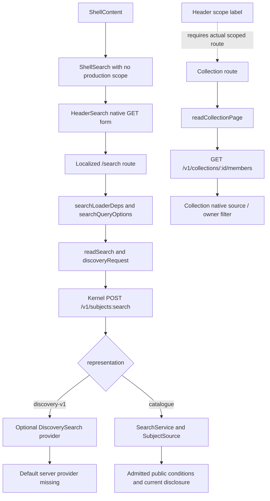

# Header search, filters and scope delivery

Research date: 31 October 2026. This is evidence and a proposed delivery plan, not an adopted contract or a completion certificate.

## Findings that change the delivery plan

The three reported header defects have direct source causes. The shell allocates search the remaining space after unequal navigation controls rather than centring it in the viewport. The composer explicitly applies the shared blue ring whenever anything inside it has focus. Its expanded inner surface uses `card`/`popover` while its enclosing panel uses `background`, which are different colours in both themes. The public Collection story reproduces these mechanisms.

The Collection filter defect is also reproducible in the public story: a 128-pixel dialog contains a desktop form requesting up to 512 pixels. The form overflows the painted dialog and overlaps results. Moving its launcher alone would leave that defect intact.

The intended replacement is one header composer with a scope chip and a trailing Filters shortcut. The current reusable header has much of the panel interaction, including a phone sheet, but puts Filters on a second row at the left after expansion. Only SearchPage registers its actual filters with the header; Collection still owns a separate launcher and form. Rendering the shell on a Collection story does not connect that page's search or filters to the shell.

Scoped search is not one missing CSS patch. There are distinct missing connections at the route, request grammar, native producer and default assembly boundaries. Collection browsing and owner filtering have substantial real implementations. Zone resource/page composition also has real implementation. Neither establishes a functioning header-to-scoped-text-search journey. Conversely, a scope chip story and a fake filtered Collection response establish no native search capability.

The adopted universal conditions are more complete than the current request parser: Collection, Realm and Zone resource operands are specified but absent from `parseFilter`. Library owner operands exist, but the public discovery compiler refuses them. Agent search is specified as an admitted literal expansion of actual credit properties, not a new Agent operand. The current production shell supplies none of these scopes.

Public mixed discovery has another independent break: Web requests `discovery-v1`, and Kernel has a callable discovery service and route branch, but the inspected default server does not provide that branch's `discovery` dependency. It returns readiness failure rather than silently falling back to catalogue search. Supplying the dependency still requires real public projection/currentness producers; Semantic's default public-filter projection and privacy-reduction readers explicitly return unready.

## Inspection basis and limits

- Worktree and development revision: `6d3f767467c85dbb9d3bb561d12af784407bd92c`; both local `HEAD` and `dev` resolved to it when inspected. Commit time: `2026-10-31T22:03:21+08:00`.
- Old REZICS checkout, read only: `/home/edge/projects/rezics/rezics`, revision `95167ceab7173dc1c5fb0ee70568c5c95f1dba8d`.
- Old rezics-next reference: `legacy-final`, revision `1ac6ed6e0668f04e30025c41e59ceaf3bdee5061`, read with `git show`; it was not merged or copied.
- Authority read: `.temp/goal/web/research-20261031.md`, including its backend addendum and the maintainer's supplied critique.
- Design basis: [development workflow](../development/README.md), [feature design](../development/feature-design.md), [architecture](../architecture.md), [scope](../scope.md), and the relevant Goal definitions.
- Topic authorities: [universal conditions](../search-conditions.md), [filtered lists](../filtered-lists.md), [Library and Collections](../library-and-collections.md), [owner queries](../library-owner-queries.md), [Collection source](../collection-source.md), [Zones](../zones.md), [Zone membership](../zone-membership.md), and the Search, Community, Content, Library, Semantic, Access, Filter and Web owner documentation.
- Inventory/status cross-check: [system inventory](system-inventory.md) and applicable [Search](design-status-search.md), [Semantic](design-status-semantic.md), [Accounts](design-status-accounts.md), [Content](design-status-content.md), [Commerce](design-status-commerce.md) and [Web](design-status-web.md) design-status sections. Their implementation descriptions were checked against development source; they are not execution evidence.
- No backend runtime measurements, builds, installs, stack startup, test runs, gates, promotion or deployment were performed. This report changes no product operation. No workspace compiler applies to this documentation-only change.

The bounded public observation below is research-only browser observation, explicitly permitted by the research authority. It is one Collection story at two widths, not a Pages/Patterns campaign. The exhaustive public capture remains owned by the separate completeness audit. No existing publishers or captures were changed.

### Evidence levels used here

| Level                        | What it establishes                                                              | What it does not establish                                                             |
| ---------------------------- | -------------------------------------------------------------------------------- | -------------------------------------------------------------------------------------- |
| Adopted specification        | Required meaning and owner obligations                                           | An executable producer or passing journey                                              |
| Development source           | A particular function, parser, adapter or assembly exists at the pinned revision | Its deployment, native readiness, measured cost or passing tests                       |
| Public Storybook observation | Served DOM, styles and visible interactions at a stated URL/time/viewport        | Production application/API wiring, authenticated authority or the served source commit |
| Recording                    | A captured response shape and its provenance where recorded                      | Current native behaviour or all states surrounding it                                  |
| Illustrative fake            | A deliberately constructed scenario and component behaviour over it              | Backend correctness, completeness or qualification                                     |
| Test source                  | The assertion exists and protects its actual boundary                            | That it ran, passed, or protects another boundary                                      |

### Public observation manifest

Observed at `2026-10-31T14:15:00.505Z`, anonymous browser, English/light, Chromium through the already available Playwright installation. The browser visited the public iframe, without starting a local service. Screenshots are 1280×900 and 390×900 CSS viewport observations; these sizes are not claims about the maintainer's devices.

Story: [`pages-library-collection--signed-in`](https://storybook.rezics.com/?path=/story/pages-library-collection--signed-in), iframe `https://storybook.rezics.com/iframe.html?id=pages-library-collection--signed-in&viewMode=story&globals=locale:en;theme:light` (the server normalizes the iframe URL).

Artifacts under `.temp/goal/web/research-shots/search-header-and-scopes/`:

| Artifact                             | Observation and limitation                                                                     |
| ------------------------------------ | ---------------------------------------------------------------------------------------------- |
| `public-index.json`                  | Served story index, not a deployment manifest                                                  |
| `public-observations.json`           | URL, timestamp, viewport width, selected DOM/geometry/styles and visible text                  |
| `collection-1280-rest.png`           | Search at x=225.203125, width=640, centre x=545.203125; viewport centre=640                    |
| `collection-1280-search-focused.png` | Composer ring is `rgb(47,99,173)`, inner surface `rgb(254,252,249)`, parent `rgb(249,246,242)` |
| `collection-1280-filters.png`        | Filter dialog x=280, width=128; overflowing child form and controls overlap member cards       |
| `collection-390-rest.png`            | Phone trigger x=56, width=322; whole phone search is not inferred from this resting image      |

The public JavaScript included `assets/iframe-vybtSiCc.js` and `vite-inject-mocker-entry.js`. No trustworthy publisher revision was exposed by this observation. Matching source mechanisms support the causal diagnosis, but do not pin this asset to the inspected development commit. The story name “signed-in” describes its fixture scenario; this visit did not authenticate a real account.

The focused public panel showed history offline/unavailable messaging, pending trending searches and unavailable trending Realms. Those are observed fixture/transport states, not proof that each production service is down. No signed-in production backend or private scope was exercised.

## Supplied visual references

All six supplied images were opened with `view_image`. Dimensions below are intrinsic image pixels, not inferred CSS viewport or physical device specifications. Their supplied directory dates establish their research provenance, not a public product version.

| Actual local path                                                                | Observed structure                                                                                                                                                                | Consequence for this topic                                                                                                                     |
| -------------------------------------------------------------------------------- | --------------------------------------------------------------------------------------------------------------------------------------------------------------------------------- | ---------------------------------------------------------------------------------------------------------------------------------------------- |
| `.temp/goal/web/refs/maintainer-20261031/reddit-search-panel.png` (596×983)      | Rounded composer above a separated Recent section; mixed query/community recent entries, per-entry removal, trending queries and communities; Ask and submit occupy an action row | Treat search as a coherent panel with a clear hierarchy. The screenshot does not require REZICS to implement Ask or reproduce its branding     |
| `.temp/goal/web/refs/maintainer-20261031/rezics-filter-panel-bug.png` (678×615)  | Narrow painted popup with author/genre/keywords/series/contributor/word-count controls extending far beyond it over books                                                         | A container/child sizing failure, not absent facet data; the public Collection observation confirms the same class                             |
| `.temp/goal/supermanager/refs/mobile-search-open-reference.jpg` (922×2048)       | Back action, top composer and full-height search experience; recents and discovery fill the phone surface                                                                         | Use the settled full-screen phone search, safe areas, one input, explicit dismissal and keyboard-aware scrolling                               |
| `.temp/goal/supermanager/refs/mobile-home-reference.jpg` (922×2048)              | Compact home header search trigger and persistent bottom navigation in the resting feed                                                                                           | Resting navigation and active full-screen search are separate states; no demand to centre an isolated search icon                              |
| `.temp/goal/web/refs/maintainer-20261031/goodreads-subject-top.webp` (1897×1312) | Bounded global navigation search, portrait cover, main details and expandable edition/details regions                                                                             | A global search entry need not expand every page's content controls permanently                                                                |
| `.temp/goal/web/refs/maintainer-20261031/goodreads-subject-full.webp` (662×2048) | Reviews have their own local search and Filters, with page content above                                                                                                          | A local review population differs from the global catalogue. Show context explicitly instead of silently changing what a shared field searches |

The independent home and subject investigations retain their own conclusions. These images are used here only for search hierarchy, context and responsive behaviour. Portrait defaults for all kinds, preservation of landscape assets and removal of marketing taglines are settled inputs, not questions reopened by this report.

## Why the header looks wrong

### Geometry: remaining flex space is not viewport centring

[`AppShell` / `ShellContent`](../../apps/web/src/shell/shell.tsx) renders a single sticky header row. The row contains navigation, the desktop logo, then:

`min-w-0 flex-1 md:ms-6 md:max-w-[40rem]`

for search, followed by right controls with `ms-auto`. The left and right groups have different widths. The 40rem cap stops search growing, and right auto margin consumes the remaining slack. Nothing constrains the search midpoint to half the viewport. Main-content/sidebar alignment is a separate coordinate system.

This predicts the public result: at 1280 pixels, the field midpoint is about 95 pixels left of the viewport midpoint. It can move as language, account, navigation and viewport widths change. The defect class is **layout invariant absent**; the enabling cause is that shell reuse proved presence of a search region without an explicit geometric criterion for the actual shell states.

Correction: a symmetric desktop header allocation, with the search track centred on the viewport and bounded against both control groups. When space is insufficient, intentionally switch to the supported compact presentation. Do not centre by guessing a fixed left margin, and do not let a side panel determine global-header centring. Web owns this seam; no backend dependency blocks it.

### Focus: deliberate token and selector, not a browser default

[`HeaderSearchView`](../../apps/web/src/search/header-search/header-search.tsx) puts `focus-within:ring-2 focus-within:ring-ring` on `data-search-composer`. The input itself has `outline-none`, `border-0` and a transparent background. Pointer focusing the input activates the ancestor's ring just as keyboard focus does.

[`packages/ui/src/styles.css`](../../packages/ui/src/styles.css) defines the light `--ring` as `#2f63ad` and dark as `#86aee8`. The measured public shadow uses the light token exactly. The cause class is **shared token applied without component intent**. Static markup tests accept the class and cannot judge the unwanted appearance.

Correction: define the composer's intended resting, editing and keyboard-focus states together. Remove the unwanted all-focus blue halo while preserving a clearly visible keyboard indicator, including on chip removal, Filters, submit and Back. This does not authorize deleting focus indication globally. Web/UI own this seam.

### Colour: nested surfaces select different tokens

The form/panel has `header-search-surface bg-background`. The expanded composer gains `bg-card`, and desktop expanded styling selects `md:bg-popover`. Light `background` is `#f9f6f2`, while `card`/`popover` are `#fefcf9`; dark equivalents are `#0d1218` and `#151b21`.

These choices produce two surfaces by design in code. A screenshot comparison of only a resting input would miss the expanded state. The defect class is **unresolved component state composition**. The user sees an inset block that appears accidental rather than one search surface.

Correction: choose one coherent panel surface and intentional boundaries for composer, suggestion sections and footer. Keep semantic theme tokens; decide their component application once across desktop and phone. It need not make every page card the same colour. Web/UI own the change.

### Filters: an integration seam exists, but it is not connected everywhere

[`filter-region.tsx`](../../apps/web/src/search/header-search/filter-region.tsx) supplies `HeaderSearchFilterProvider`, `useRegisterHeaderSearchFilters` and `useHeaderSearchFilterRegion`. Registrations carry `activeCount` and `open()`, with an owner identity and cleanup that cannot remove a newer owner's registration. This is useful existing infrastructure.

[`SearchPage`](../../apps/web/src/search/search.tsx) registers its real controls when data is available. `openFilters` opens/focuses the desktop region at width ≥1024 or opens the mobile sheet. However:

- Header Filters is below the input, on the left, only after expansion; it is not the required trailing shortcut in the field.
- The desktop filter form remains rendered as a page region; pre-hydration `!hydrated` opens it, while its hydrated open state is separate.
- A page-level mobile Filters launcher also exists. Merely adding the header launcher does not remove the redundant entry/surface.
- Collection's [`CollectionFilters`](../../apps/web/src/library/collection-filters.tsx) does not register with this provider. Its launcher remains in [`collection-page.tsx`](../../apps/web/src/library/collection-page.tsx).
- The public Collection header accordingly has no active Collection filter region; its expanded Filters control is disabled even though the separate Collection launcher opens a form.

The class is **component completion substituted for page integration**. The cause is an additive generic header API without migrating its actual route owners. The correction is one route-owned filter state/editor and one trailing header shortcut, retaining active-condition summary and accessible no-JavaScript access where required. A small active-filter summary is not the permanently expanded duplicate editor the critique rejects.

### Popup overflow: the anchor's width was used as the form's width

[`Menu`](../../packages/ui/src/components/menu.tsx) calculates custom content width as `Math.max(triggerRect.width,128)` and positions/clamps using that width. The fixed portal dialog is painted at that width. `CollectionFilters` supplies a form with `sm:w-[min(32rem,calc(100vw-2rem))]`, which can exceed its parent by hundreds of pixels.

The public dialog width is exactly 128 pixels; the supplied bug image shows the same narrow painted surface. A right-edge clamp based on 128 pixels cannot constrain a 512-pixel descendant. This is **overlay contract mismatch**, enabled by treating an arbitrary form like a short action menu without an actual wide-content/viewport check.

Correction: give the filter surface one explicit responsive width owner, collision-aware positioning, bounded height and internal scrolling. Use the existing mature overlay primitives appropriate for a form/dialog; do not globally inflate every action menu. The trailing header action should open this corrected surface, or the phone filter view inside full-screen search. Web and UI own the seam.

## The actual request path

The names below identify current source, not promised routes.

### Header and Web transport

| Boundary           | Exact files/functions/DTOs                                                                                                                 | Actual behaviour and missing connection                                                                                                                                                                                                    |
| ------------------ | ------------------------------------------------------------------------------------------------------------------------------------------ | ------------------------------------------------------------------------------------------------------------------------------------------------------------------------------------------------------------------------------------------ |
| Shell caller       | `shell/shell.tsx`: `ShellContent`; `search/header-search/shell-search.tsx`: `ShellSearch`                                                  | The default shell calls `<ShellSearch />`. Production callsite inspection found no route supplying Collection/Library/Realm/Zone/Agent scope here                                                                                          |
| Display scope      | `search/header-search/types.ts`: `SearchScopeKind`, `SearchScope`                                                                          | Kinds are Library, Collection, Realm, Zone, Agent; `{kind,id,name,image?,searchAction?}`. No Space kind. This is display/navigation data, not a kernel operand                                                                             |
| Submission         | `search/header-search/authority.ts`: `headerSearchAction`, `removesHeaderScope`                                                            | Global action is `/{locale}/search`; scoped action must be supplied as a local path. Rejects protocol-relative paths, backslash and CR/LF. Without an action, scoped submission is unavailable; X/empty Backspace explicitly removes scope |
| Panel              | `header-search.tsx`: `HeaderSearchView`, `HeaderSearchController`, `HeaderSearch`                                                          | Same native form/input across presentations, local query state, suggestion cancellation, keyboard navigation/dismissal and phone dialog. These are real UI mechanics, not a scope resolver                                                 |
| Global route       | `routes/search.tsx`; `search/search-params.ts`: `searchParams`, `searchLoaderDeps`, `searchFormFields`                                     | URL carries q/type/facets/ranges/condition/kinds/languages/filter/cursor. No route scope field is converted into a Collection/Realm/Zone request operand                                                                                   |
| Fetch/cache        | `search/search-queries.ts`: `searchQueryOptions`; `search/search.tsx`: `readSearch`                                                        | Public anonymous read key includes `discovery-v1`, `anonymous`, `public-global`, locale and params; it cannot be reused as a private scoped cache without changing authority/key partitioning                                              |
| DTO builder        | `search/search-request.ts`: `discoveryRequest`, `readSearchPage`                                                                           | `representation:'discovery-v1'`, limit 100, text, condition/type/facet/range/kind conjunction and kind-page limit 8. No automatic scope expansion. Typed failures/restart handling do not fill that gap                                    |
| Client             | `kernel/client.ts`, `search/discovery.ts`                                                                                                  | Typed Kernel client call to `subjects.$search.post`; discovery response validation distinguishes semantic subject and account hits. A generated client member proves transport shape, not a configured provider                            |
| Header suggestions | `header-search/suggestions.ts`: `readHeaderSuggestions`, `loadGlobalHeaderSuggestions`; `/api/search/suggestions`; `search/suggestions.ts` | Browser caps at eight and abort-checks before/after load. Global loader throws if given a scope. Optional scoped loader must enforce it, but no production route binding was found                                                         |

The header's native input `maxLength=256` counts JavaScript/HTML code units. URL validation and Kernel text admission use 512 UTF-8 bytes. A 256-character CJK input can exceed 512 bytes; the mismatch is not a measured failing request here. Proposed correction: one byte-aware admission/help policy preserving composition input and native semantics, with a retained draft and meaningful pointer on refusal.

### Kernel transport and authority

[`searchRoutes`](../../services/kernel/src/search/http/routes.ts) mounts `POST /v1/subjects:search`. Its body accepts text, filter, sort, limit, cursor, display options and the `discovery-v1` representation/kind controls. There is no `scope: SearchScope` DTO. `filter` being JSON-shaped does not make arbitrary new leaf names valid.

The route retains public/optional-bearer admission, ordinary subject read eligibility and `search_advanced` group admission for advanced conditions. Invalid credentials must not become an anonymous fallback. Catalogue hydration uses current read checks; discovery receives the actual actor/owner-access context rather than trusting a string supplied by the browser.

[`createKernel`](../../services/kernel/src/http/kernel.ts) passes dependencies into `searchRoutes`. [`server.ts`](../../services/kernel/src/server.ts) constructs the rated Semantic SubjectSource, SearchService and default public-filter runtime when search is configured. It does not instantiate `createDiscoverySearch` or supply `discovery`. The route's mixed branch explicitly throws `index_not_ready` if that optional provider is absent.

[`createDiscoverySearch`](../../services/kernel/src/search/discovery-service.ts) is real source: it admits a configured registry/release, binds request/principal, captures/query-refills a retained consumer, checks current candidates, and issues opaque continuation. It is a callable capability whose default assembly is missing, not a fake implementation. It requires actual `PublicDiscoveryConsumerOperations`, `PublicFilterSource`, keys and release/registry resolution.

[`publicFilterSource`](../../services/kernel/src/semantic/public-filter-source.ts) validates native dependencies and can resolve registered definitions. But `readPublicFilterProjectionPage`, `readPrivacyReductionHeads` and `readPrivacyReductionPage` return `unready/metadata_missing`; `recordPrivacyReduction` throws unavailable. Thus “wire the provider” is necessary but insufficient. A complete privacy-safe capture/currentness source is an owner dependency, not something Web can simulate with catalogue results.

## Scope-by-scope trace and capability matrix

Legend: **required** = adopted meaning; **partial** = concrete pieces but not the whole capability; **absent** = inspected boundary lacks it; **fixture** = scenario only. Test columns mean source inspected, not an executed pass.

| Capability                            | Specified/designed                                                                  | Backend implemented                                                                                                                      | API exposed                                                                | Interface exposed                                                      | Tested/evidence boundary                                                                                  |
| ------------------------------------- | ----------------------------------------------------------------------------------- | ---------------------------------------------------------------------------------------------------------------------------------------- | -------------------------------------------------------------------------- | ---------------------------------------------------------------------- | --------------------------------------------------------------------------------------------------------- |
| Global catalogue text/type/statements | Required, shared text/filter contracts                                              | Real SearchService, parser/compiler, OpenSearch query and current hydration; readiness depends on owners                                 | `subjects:search`, facets and suggest exist                                | Header and SearchPage exist                                            | Text/query/API/native suites exist; no execution in this research                                         |
| Mixed global discovery                | Required one mixed sequence, configured kinds                                       | Callable registry/compiler/service/current adapters; default projection/privacy source unfinished                                        | `discovery-v1` branch exists but default `discovery` provider absent       | Web defaults to this representation, validates generic hits            | Mixed/discovery/current suites and fake stories exist; not default-world proof                            |
| Header scope chip                     | Required visible/removable context                                                  | Not a backend capability                                                                                                                 | No scope DTO implied                                                       | Reusable chip and explicit unavailable state                           | Static/header-panel tests; illustrative scope story                                                       |
| Collection member filtering           | Required shared released predicates over actual membership                          | Real Collection/owner admission, canonical source and keyed readers; authority/readiness restrictions remain                             | `GET /v1/collections/:id/members?filter=…`                                 | Separate Collection Filters form, no header registration               | Web filter tests/fakes plus Kernel owner-filter tests; not scoped text proof                              |
| Header Collection text search         | Required combined text + scope + conditions                                         | Universal resource operand absent from parser; members DTO has no text; complete native text plan not established                        | No connected header scoped search route                                    | No production scope/action; chip fixture alone                         | Header unavailable assertions and fake members cannot cover it                                            |
| Library viewer-self search            | Required `owner.presence` over qualifying union, optional own facts                 | Native owner leaves/admission/source pieces exist; public compiler rejects owner predicates; combined text/native preparation incomplete | Owner filtering through eligible members; no header end-to-end request     | Library exists but shell is global                                     | Owner-filter, Library discovery and panel source tests are distinct boundaries                            |
| Realm discussed-subject scope         | Required current readable discussion/review population with ban checks              | Realm/Space resources, boards and disclosure exist; universal Realm enumeration/operand integration absent                               | Resource/board/discovery APIs do not equal subject search operand          | Realm pages/discovery exist; no header scope binding                   | Realm discovery tests exercise ranked Realm resources, not scoped catalogue search                        |
| Space scope                           | Space identity/carrying Realm is designed; not a separate universal subject operand | Space current point reads and authorized `realmId` exist                                                                                 | Space/address APIs exist                                                   | Space pages exist; SearchScopeKind has no Space                        | Resource tests do not establish a generic “everything in Space” population                                |
| Zone page composition                 | Required bounded source union, current authority and common pages                   | Real `zone.read_page` composition, Collection/Scope factories, retained progress; native dependencies can refuse                         | POST `zones/:id:readPage` exists; 200/202/unavailable distinctions         | Zone reader/editor are separate from header                            | Static-page-runtime source includes source-dependent cases; filename is misleading evidence if read alone |
| Zone as search condition              | Required actual page-list predicate union at current head/release                   | Parser lacks `{zone:{id}}`; page union is not this operand; complete compiled resource adapter absent                                    | No connected universal operand / arbitrary scoped q on readPage            | No header route or real scope action                                   | Zone page tests cannot certify a search-condition journey                                                 |
| Agent credited works                  | Required literal OR across pinned release's actual credit roster                    | Statement/in predicates exist; no family leaf needed. Complete release-pinned expansion + route binding not found in this path           | Can express admitted literal statements, not a magic Agent scope parameter | Agent label supported; production header binding missing               | Chip/subject-credit presentation tests do not prove all-role search                                       |
| Scoped suggestions                    | Required truthful population/authority where exposed                                | Global suggest exists; no production scope loader found                                                                                  | Global q/limit suggest only in inspected route                             | Optional loader seam; unavailable without it                           | Loader cap/cancel tests do not prove scoped enumeration                                                   |
| Filters at field right                | Settled requirement                                                                 | No backend change needed for relocation                                                                                                  | Existing condition requests must be retained                               | Present second-row action; Collection still separate                   | Current style/geometry and Collection integration escape static assertions                                |
| Full-screen phone search              | Settled requirement                                                                 | Same transport/authority as desktop                                                                                                      | No phone-only backend needed                                               | Fixed `inset-0`, `h-dvh`, safe-area panel and dialog/focus logic exist | Pattern plays exist, visual matrix pending; resting public image only in this audit                       |

### Collection: filtering members is not searching them by text

The concrete path is:

1. `routes/collections/$id.tsx` loads the Collection page.
2. [`collection-queries.ts`](../../apps/web/src/library/collection-queries.ts), `readCollectionPage`, validates a bounded subset of `type`, `f.*`, `r.*`, `l.*`; unknown `q` is not forwarded as member text.
3. Its `COLLECTION_FILTERS` switch defaults to `import.meta.env.DEV` when unset. Production enablement is not established by a development story. An active filter when disabled is represented as failed, not intentionally broadened.
4. [`readCollectionFilterParams`](../../apps/web/src/library/collection-filter-params.ts) selects up to eight released facet properties. It constructs type/item/range predicates and ignored-field information; `collectionFilterQuery` serializes the filter.
5. [`collection-load.ts`](../../apps/web/src/library/collection-load.ts), `loadCollectionMembers` and the editable page loader, call `client.collections({collectionId}).members.get` with list cursor/limit and serialized filter.
6. [`collection-reads.ts`](../../services/kernel/src/library/collection-reads.ts), `readMembers`, authorizes the Collection and dispatches built-in, curated, dynamic, filtered or unfiltered membership paths.
7. [`owner-filter.ts`](../../services/kernel/src/library/owner-filter.ts), `CollectionMemberQuery`, admits cursor/limit/filter/sort/view, not text. `admitCollectionMemberQuery` allows ID sort, parses strict JSON, admits released conditions and binds actual native authority.

Private leaves require the appropriate current Library entry/progress/copy read scopes and platform admissions. `prepareNativeCollectionMemberAuthority` and the genuine admission WeakMap prevent an arbitrary `{accountId}` or forged admission object becoming owner authority. Current account activity/fences and original/terminal disclosure remain required.

[`createCollectionSource`](../../services/kernel/src/library/collection-source.ts) is not a blanket stub at this revision. It reads native metadata, authorizes current source identity, uses canonical state/seeks and issues opaque prepared handles. Its ordinary `ready` path currently accepts `curated` and `private_builtin`; other authority modes return `dependency_unavailable`. Work-bound paths have additional native definition/custody requirements. This is partial real implementation with explicit unavailable modes.

Dynamic Collection reads distinguish own private working rule from another reader's activated output. Public/unlisted output must not expand the curator's private rule. [`collection-reads.ts`](../../services/kernel/src/library/collection-reads.ts), `readDynamicMembers`, and [`owner-index-members.ts`](../../services/kernel/src/library/owner-index-members.ts), `readCollectionSourceMembers`, preserve that distinction. Existing support for private rule editing is not evidence that every publication, prepared query and mount is ready.

UI-specific limitations also matter: Collection defaults filter presentation to `schema:Book`; released facet selection is capped at eight; quantity controls produce inclusive `gte`/`lte` with a selected unit. The adopted strict `wordCount > 1,000,000` journey cannot be demonstrated by entering “From 1000000” in this form: equality would match. The shared grammar has strict comparisons, but this form does not expose that operator. A boundary-aware shared editor should preserve strictness rather than fudge the numeric threshold.

### Library: viewer-self facts, not any account's curated memberships

[Universal conditions](../search-conditions.md) selects existing `owner.presence`, over the qualifying union owned by [owner queries](../library-owner-queries.md). A curated Collection occurrence alone must not silently redefine Everything. State/session/holding and accepted profile pins retain their independent meaning.

`packages/filter/src/filter.ts` parses owner predicates. `library/owner-filter.ts` can admit and evaluate their actual native facts under viewer-self authorization. `search/discovery-filter.ts`, `compileDiscoveryFilter`, explicitly rejects `owner` and `saved` in public mixed discovery. There is no acceptable fix that sends private state or labels into the public index to make this route work.

The missing header flow therefore needs an actual authorized owner query path carrying the same public text/analyzer/Boolean meaning, plus bounded ordered execution/preparation. [Earlier scoped-title research](library-scoped-title-plan-current.md) is historical evidence; its title-only recommendations do not replace today's labels/aliases/descriptions text contract. A substring filter of the first Library page would silently miss matches among millions of members.

### Space and Realm: resolve identities before choosing a population

[`community/README.md`](../../services/kernel/src/community/README.md) distinguishes stable routed Space from its carried Realm. Current Space reads derive `realmId` only if the carried Realm is active and readable by this viewer. A Space can be readable while that field is null. The Space ETag does not itself certify the derived Realm relation.

The universal Realm condition means subjects discussed by currently readable linked discussion **or review** threads on its boards, including protected boards where authorized. It requires current thread, opening post, board, place, reference and Access evidence; Realm read and ban checks apply even under NOT/independently true OR. A raw subject-thread link or an index of public Realm metadata is not this population.

There is no `realm` case in current `parseFilter`. `GET /v1/realms/discovery` returns ranked Realm resources; it does not enumerate subjects discussed within a chosen Realm. Realm point reads, publications and board APIs likewise do not supply a native sorted universal-search producer by themselves.

For header navigation, resolve Space to its actual carried type using ordinary current reads; retain the explicit Realm population label when applicable. Do not cast Space ID to Realm ID, invent a Space leaf, or interpret null as global search. An unsupported site context should retain a truthful unavailable state with an explicit way to remove scope. This resolves the naming ambiguity from existing contracts; it is not a new maintainer decision.

### Zone: two different meanings must stay distinct

The current resource/page implementation is stronger than an old “static shell only” description:

- [`zones/http.ts`](../../services/kernel/src/zones/http.ts), `zoneRoutes`, mounts create/list/read/configure/publish/delete/restore and `:readPage`.
- [`zones/page-runtime.ts`](../../services/kernel/src/zones/page-runtime.ts) and [`membership.ts`](../../services/kernel/src/zones/membership.ts), `createZoneMembership`, consume real Collection sources and the actual Search service through `createSearchScopeForService`.
- Saved scopes plus readable mounts form a canonical subject union for page membership; a list's memberSource is an essential conjunct. The union uses settled coverage and current witnesses, rather than merging arbitrary rendered samples.
- `page-work.ts` retains bounded preparation locators. The public result is a complete page, progress, or typed unavailability, not a partial page represented as complete.
- Resource/source exposure grants no source permission; source-dependent work requires current Zone authority and the `zone_sources` gate.

But universal `{zone:{id}}` search is specified as the actual configured PAGE-LIST predicate union, not all Zone membership, all mounts or starter scope IDs. `TypeList` and `SubjectList` have their actual predicates; nonrepresentable list unions must refuse. The current common filter parser has no Zone operand, and `readPage` accepts route/subject targets and languages, not an arbitrary free-text scoped search request.

`search/service-scope.ts` keeps runtime registration in a WeakMap keyed by a genuinely constructed SearchService. A test injection or a route's `{id,name}` is not registered native authority. `scope-source.ts` has real ordered execution/capture/currentness logic at this revision; the Zone README's claim that all ordered methods simply return unavailable is stale. Important restrictions remain: owner work can refuse, direct owner populations larger than its proved complete small path require admitted preparation, and the default public-filter Source is unready. Do not translate “real composition exists” into “all Zone searches work”.

### Agent: credited catalogue identity differs from an account

The adopted condition is an OR across the pinned release's actual `relation.group` credit properties, currently twelve roles. Each expanded statement counts against the common leaf limit; there is no family shortcut. A twelve-role Agent expansion plus 21 unrelated leaves exceeds 32 before further expansion and must be rejected, not truncated.

`packages/definitions/src/portable.ts`, `compile.ts` and `extension.ts` carry/validate relation-group metadata. Existing statement/in predicates can express literal credits. The inspected header/request path has no resolver that creates this literal OR from an Agent and pins it across continuation. An Agent chip is therefore display support, not delivered all-credit search.

A catalogue Person/Organisation and its verified account remain different identities/kinds. Account lookup or account discovery is not an author/translator/director Works query. Apply the same explicit context and unavailable behaviour on subject/creator, account and Library surfaces; do not substitute account-authored posts for credited catalogue works.

## Upper-bound work, pagination and lifecycle

These are desk-analysis bounds and failure modes, not benchmark results. The settled product envelope is hundreds of Realms/Spaces, 200,000 kinds, thousands of follows and millions of Collection items.

| Path / population               | Existing bounds or anchor                                                                                                            | Failure that a response cap does not prevent                                                                                                                                     | Proposed closure and owner                                                                                                                                      |
| ------------------------------- | ------------------------------------------------------------------------------------------------------------------------------------ | -------------------------------------------------------------------------------------------------------------------------------------------------------------------------------- | --------------------------------------------------------------------------------------------------------------------------------------------------------------- |
| Header discovery                | Eight suggestions in `readHeaderSuggestions`; abort before/after; recent-history journals are bounded                                | Loading every kind/Realm/follow into a client selector is still O(K+R+F)                                                                                                         | Paged/typeahead pickers and small recent/relevant sets; Web with native resource owners                                                                         |
| Filter grammar                  | 32 leaves, depth 4, OR 16, `in` 64, qualifiers 4 in shared Filter                                                                    | Hundreds of scopes or thousands of follows expanded into one OR exceed admission; truncation changes meaning                                                                     | Resolve one resource operand through its admitted native source; paged selection, explicit refusal of oversize composition; Search/Filter/owners                |
| Catalogue OpenSearch            | `query.ts` compiles indexed predicates, deterministic sort ties and `search_after`; internal size cap 200; total-count cap 10,000    | Engine posting visits, sort, scoring, shard work and negative-result proofs are not bounded by returned size or capped count                                                     | Preserve indexed/prepared selection, deadline/cancellation, native per-step work accounting and measured proof later; Search/Semantic                           |
| Mixed discovery                 | `discovery-service.ts`: at most three query rounds; examined ≤`min(600,6×limit+3)`; query window ≤200; kind page ≤8                  | Registry mapping/hash currently walks `registry.entries` to bind its digest. A literal 200,000-entry in-memory registry causes O(K) request setup even with eight returned kinds | Immutable/versioned registry digest at publication and indexed/paged matching-kind access; do not certify bounds from kind-page size; Search/definitions owners |
| Collection owner members        | `readCollectionSourceMembers`: source-anchored order, three bounded rounds, query/source/release/owner binding                       | Scan-global-and-probe for a rare member; sorting the entire million-item private collection per request; incomplete canonical group treated as end                               | Native selective/ordered plan or durable bounded preparation; canonical/examined-key continuation; Library/Search                                               |
| Direct ordered Scope owner path | `scope-source.ts` requires proved complete native population and refuses >99 candidates in the inspected direct path                 | Treating that small-population escape hatch as million-member support                                                                                                            | Use admitted owner preparation/native namespace path; never silently narrow to first 99; Library/Search                                                         |
| Collection Source               | Canonical source state/seeks/probes and explicit work ledger; ordinary ready authority limited to curated/private builtin            | Public dynamic frozen output cannot be certified by the private canonical producer                                                                                               | Deliver its actual activated-output/source authority and currentness producer; Library                                                                          |
| Zone composition                | At most 16 saved scopes +16 mounts; `ZoneWork` structural allowance 256 per selected read; ordered candidate cap `min(600,6×size+3)` | Multiplying native caps without an aggregate reservation; repeated discovery of all sources; treating not-proven as false                                                        | Existing union/common frontier plus request aggregate ledger/progress; finish owner producers, do not add a second union engine; Search/Library/Zone            |
| Zone preparation                | 32 retained slots per Zone/viewer, row ceiling 1,048,576 bytes; 128 output slots, bounded locators                                   | Unbounded retained cursor vectors or cached permission surviving source deletion                                                                                                 | Keep keyed eviction/expiry, current head/source/actor validation, cleanup in lifecycle changes; Zone/Accounts                                                   |
| Realm scope                     | Current thread/root/board/subject/ban predicates required                                                                            | Full Realm-thread walk or all-Realm fanout per search; known-candidate check cannot discover rare matches                                                                        | Owner-provided selective enumeration/order and current batch disclosure with concealed resource admission; Content/Search                                       |
| Follows                         | Thousands are relationship intent, not authority                                                                                     | One search per followed entity, one OR per follow, or per-result membership reads                                                                                                | Native bounded relationship source/paged context picker; no client federation; owning relationship service/Search                                               |
| UI at 200,000 kinds             | Existing Web request asks for eight kind refinements                                                                                 | 200,000 tabs/chips or downloading all definitions to render each picker                                                                                                          | A mixed result sequence and bounded searchable kind selector; generic summary/card contract; Web/Search                                                         |

The registry-digest observation above is a concrete source-level upper-bound concern: `createDiscoverySearch` maps the full configured registry on each call before querying. Whether its eventual production registry materializes all 200,000 kinds is not established; the default provider is absent. The proposed closure must state that representation and cost rather than assume the loop is free.

### Continuation must bind meaning, not just an offset

- Web preserves q and supported conditions on submit while dropping old hit cursors for changed meaning. It must also preserve an actual resolved scope, release-pinned Agent expansion and result languages once scope is connected.
- Catalogue uses total-order ties and opaque continuation. [OpenSearch pagination documentation](https://docs.opensearch.org/latest/search-plugins/searching-data/paginate/) distinguishes `search_after` from deep offsets and recommends PIT for consistency; neither alone proves current authorization or bounded engine work.
- Mixed discovery binds principal/request/release/registry and retained capture. It requires restart on incompatible meaning/version, and validates examined-key windows rather than trusting a short hit array.
- Owner members bind actual owner, Collection/source identity, query/release, order and native versions/epochs. A Collection ID or old cursor is not continuing permission.
- Zone POST uses the existing encrypted Search-profile continuation and request/Zone/viewer binding. `202 {next}` progress differs from Collection members' `202 {preparing:true}`; the UI must not parse either as an empty successful result page.
- Source expiry, configuration/release changes, merge/retraction, membership/ban/grant changes and account deletion need current validation and typed restart/unavailable outcomes. Display metadata, suggestion caches, query history, exports and counts are disclosure surfaces too.
- Public dynamic output may lag private edits only under its explicit complete published-output contract. It must not reveal whether an unpublished private predicate matched a candidate.

### Security and disclosure requirements for the eventual connection

Resolve every resource operand before enumeration, including operands under NOT and independently true OR. Preserve concealed 404 for unreadable/unknown resources, real credential failures, platform closure and source unavailability. Unknown/incomplete/native-not-proven evidence cannot turn into false and then match under NOT.

Private owner state, labels, progress, holdings and private scoring statistics stay owner-local. Public catalogue labels/aliases/descriptions provide the shared text semantics; public and private producers need a comparable, natively seekable total order. Raw BM25 and owner-local rank cannot simply be mixed. No request-time client-side intersection of two first pages is correct.

The recent-history implementation is a useful narrower example: `search/recent-sync.ts`, `nativeRecentEntry`, accepts native references only for Library, UUID Collection and UUID Realm; it does not upload browser labels/avatars/links as authority. Zone and Agent display scopes do not thereby acquire server-history support. `localRecentEntry` hydrates current native display/destination. This reference support is separate from executing the referenced query.

On logout/account change, private caches and history buckets must not bleed across viewers. Route filter registration must be removed on transition so a stale Collection's Filters action cannot operate on a new page. The existing owner-token cleanup is useful; future scope resolution and asynchronous suggestions need equivalent cancellation/currentness checks.

## What the existing stories and tests actually cover

[`stories/header-search/README.md`](../../apps/web/src/stories/header-search/README.md) is unusually explicit: its visual matrix is pending, its fixtures are illustrative/recording-based, native authority is not represented, and only local typing was recorded for that delivery. This report does not convert that note into a test pass.

| Evidence                                                                                                       | Actual protected boundary                                                                                     | Escape relevant to this incident                                                                                                                                           |
| -------------------------------------------------------------------------------------------------------------- | ------------------------------------------------------------------------------------------------------------- | -------------------------------------------------------------------------------------------------------------------------------------------------------------------------- |
| `apps/web/tests/header-search.test.ts`                                                                         | Rendered form/chip contract, safe action selection, unsupported scopes cannot submit as global                | All five scope kinds are exercised as dummy display scopes. A supplied example Library action verifies a local form path, not a native scoped route or returned membership |
| `apps/web/tests/header-search-panel.test.ts`                                                                   | Reducer transitions, static presenter states, bounded/cancelled suggestions and preserved route fields        | No computed shell centre, theme surface relationship, popup painted width or real private backend journey                                                                  |
| `apps/web/tests/collection-filters.test.ts`                                                                    | Parameter/filter construction and UI contract over controlled data                                            | No guarantee that the parent portal contains its wide child, or that a header opens Collection filters                                                                     |
| `apps/web/src/kernel/fake/collection-filters.ts`                                                               | Explicit synthetic five-member scenario, harem tag and word-count boundaries, unsupported/preparing responses | It locally filters arrays and returns synthetic responses. Its success is not execution of canonical native membership or public/current privacy repair                    |
| `apps/web/src/kernel/fake/search.ts`, `search-discovery.ts`                                                    | Search story response scenarios                                                                               | A native-looking response union does not instantiate the missing default provider                                                                                          |
| `stories/header-search/header-search.stories.tsx`                                                              | Recorded search suggestions plus illustrative recents/error/loading; play-driven states                       | Its Collection scope is `{kind:'Collection',id:'reading',name:'Reading list'}` without `searchAction`; intentionally unavailable, not scoped delivery                      |
| `patterns-header-search--filters-open`                                                                         | Opens SearchPage's ordinary fake-boundary filters                                                             | It does not show Collection's unregistered filter owner                                                                                                                    |
| `pages-library-collection--signed-in`                                                                          | Whole Collection page over the PageStory/memory-router and recording/fake boundary                            | The visible shell is real presentation, but its search has no Collection scope. The fake signed-in label does not provide a real session                                   |
| `services/kernel/test/search/{mixed-discovery,discovery-consumer,scope-ordered,scope-source-contract}.test.ts` | Their callable service/producer/ABI scenarios                                                                 | Provider-injected tests cannot prove default `server.ts` assembly; declarations cannot prove missing producers                                                             |
| `services/kernel/test/library/owner-filter-{http,plan,native-closure,leaves,growth}.test.ts`                   | Specific owner admission/evaluation/currentness/cost contracts                                                | Neither test existence nor a historical passing subset proves the current Web text + scope + filters journey                                                               |
| `services/kernel/test/zones/static-page-runtime.test.ts`                                                       | Includes actual source-dependent composition cases, beyond static rendering                                   | Its name understates current source. Native/growth/public proof still must be read from actual recorded results, not assumed                                               |

The header story IDs are `patterns-header-search--rest`, `--scope-chip`, `--expanded`, `--typing`, `--scope-removed`, `--filters-open`, `--suggestions`, `--no-results`, `--loading`, `--error`, `--phone-sheet`. Their README requires phone390/desktop1280 × en/zh-Hans × light/dark and records those visual cells as pending. No additional comprehensive capture was performed here.

The enabling cause is a **boundary mismatch in completion claims**: tests protect reusable presenters, parsing, controlled producer calls and unavailable states, while the maintainer evaluates a deployed page's whole search task. Large test volume cannot bridge that mismatch. This is a sampled topic diagnosis, not a verdict on the repository's entire test suite.

Proposed later evidence should be deliberately small and consequential: a public shell geometry/state observation; a real trailing Filters→Collection control interaction; and a native ordinary API journey per scope family with denied/currentness/continuation cases. A useful assertion must fail if scope is dropped, the provider is absent, a child overflows, or one-million equality incorrectly matches a strict threshold. Do not add assertions merely restating CSS class names. Writing or running those product tests is outside this research-only task.

## Historical REZICS: reuse the lessons, not the implementation

### Old REZICS checkout

Read-only source paths below are relative to `/home/edge/projects/rezics/rezics` at the revision recorded above.

| Source                                                                                             | Actual behaviour                                                                                                                                                             | Lesson and upper-bound limitation                                                                                                                                       |
| -------------------------------------------------------------------------------------------------- | ---------------------------------------------------------------------------------------------------------------------------------------------------------------------------- | ----------------------------------------------------------------------------------------------------------------------------------------------------------------------- |
| `apps/web/features/zones/zone-search-page.tsx`; `app/(app)/z/[slug]/search/page.tsx`               | Explicit Zone search route resolves the slug, keeps the canonical base and passes `{kind:'zone',zoneId}` to `SearchSurface`/`ScopedSearchPage`                               | A concrete routed source is clearer than an unsupported display chip; its old Zone semantics cannot replace current page-list semantics                                 |
| `apps/web/features/profiles/profile-search-page.tsx`                                               | `ScopedSearchPage` receives explicit profile context and filter source                                                                                                       | Profile/context injection is not current Agent-credit meaning                                                                                                           |
| `apps/web/features/collections/data/collection-content.ts`                                         | `fetchCollectionContentPage` requests Collection items with limit 50, cursor, language boundary and AbortSignal; infinite-query key includes Collection/languages            | Real paged membership transport, but this reader has no q/filter and cannot prove scoped search by itself                                                               |
| `services/main/src/services/search/execution.ts`, `resolveScope`                                   | Global passthrough, Realm control predicate, Unit scope and Zone filter-document lookup                                                                                      | There was real scope→condition code. Do not copy its permissive meanings into the new owner contracts                                                                   |
| `services/main/src/services/search/service.ts`, `resolveSparseCandidateSet`, `searchCandidatePage` | Reads at most cap+1 sparse seeds; keeps a large seed as an unmaterialized relation where selected; bounded candidate scan with keyset continuation                           | Adaptive selective/order plans avoid sorting a million-member seed in the application, but seed SQL/internal engine work also needs bounds                              |
| `services/main/src/services/performance/policy.ts`                                                 | maxContexts=4, maxCategories=10, maxCandidatesScanned=4096, maxEstimatedPostings=50000, page≤100, bounded statement timeout                                                  | This is a concrete upper-bound failure for a 20-Realm context request: it exceeds the old admission ceiling. It is not evidence of arbitrary many-Realm product support |
| `services/main/src/services/search/service.ts` candidate functions and its README                  | Calls privileged `public.search_text_candidates`/catalog-name candidate functions using estimated-postings admission; dense fallback preserves bounded examined-key progress | Estimated postings are not a hard proof of actual postings/sort work. Preserve that distinction instead of importing the old 50,000 threshold as a new guarantee        |

The older UI had explicit source/context objects and native paging, which is useful behavioural precedent for this critique. It was not a complete implementation of today's mixed, current, upper-bound contract. There is no evidence here that copying its UI or engine wholesale would fix authorization, all-kind scale or privacy reduction.

### `legacy-final` rezics-next

`apps/web/features/shell/search-field.tsx` has one native GET form, keyboard shortcut handling and IME-aware Enter handling. It preserves `browseSearchFields` only on Discover and otherwise routes to localized Discover. It does not establish universal header scope delivery.

`apps/web/features/search/read.ts`, `searchRequest`, emits a typed `ResourceQuery`: Realm context or global, all scope, text, released type/concept/language conditions and page size 10. `readSearchPage` calls `v1.query.post` and batches summaries. This is an actual typed route/request connection worth preserving conceptually; it is not the current Kernel DTO.

`apps/web/features/discover/scope.ts` explicitly distinguishes Global, one Realm and Mine, rejects malformed/repeated scope fields and never silently broadens an unavailable Realm. `realm-search-fixtures.ts` describes itself as contract-only, with no recorded closure answer. Its empty/global/error/closed responses are constructed examples. Historical stories therefore also require provenance distinctions.

These sources show continuity of the intended “one field, explicit context, explicit broaden” principle, but not hundreds of Realm contexts or today's Collection/Library/Agent/Zone coverage. No historical runtime was executed, and no source was ported.

## Comparative product evidence

All URLs below were consulted on 31 October 2026. Official documentation establishes documented behaviour, not a pixel-perfect current authenticated UI. Except for the supplied Reddit/Goodreads/mobile images and the bounded REZICS observation, no authenticated product session or exhaustive screenshot capture was performed. Product prose/screenshots remain their owners' copyrighted material; recommendations below describe patterns, not copied assets or text.

| Product / primary evidence                                                                                                                                    | Observed/documented pattern                                                                                                                   | Applicability and limitation                                                                                                                                                                    |
| ------------------------------------------------------------------------------------------------------------------------------------------------------------- | --------------------------------------------------------------------------------------------------------------------------------------------- | ----------------------------------------------------------------------------------------------------------------------------------------------------------------------------------------------- |
| Reddit — [available search features](https://support.reddithelp.com/hc/en-us/articles/19696541895316-Available-search-features), supplied panel/phone images  | Community pill identifies local search; broadening to all Reddit is explicit; manual operators and separate comment search exist              | Strong scope visibility and removable-context precedent. Community content is not REZICS's discussed-subject relation; Ask is not required                                                      |
| X — [advanced search](https://help.x.com/en/using-x/x-advanced-search), [search](https://help.x.com/en/using-x/x-search)                                      | Advanced criteria reached from search filters/options; mobile help describes a filter icon in the search bar and mixed result categories      | Supports progressive disclosure/trailing action. Advanced desktop access requires login; do not claim a directly observed anonymous advanced panel                                              |
| YouTube — [advanced filters](https://support.google.com/youtube/answer/111997?hl=en-AU)                                                                       | Search first, then Filter refines the result population                                                                                       | Good separation of text entry and optional refinement. The retrieved 2026 change announcement rendered only a shell; no exact current filter inventory is inferred from it                      |
| GitHub — [issue/PR filtering](https://docs.github.com/en/issues/tracking-your-work-with-issues/using-issues/filtering-and-searching-issues-and-pull-requests) | Filter menu, structured qualifiers, suggestions/warnings and Boolean grouping over an identified issue population                             | One editable query with meaningful validation; its five-level nesting limit is not REZICS's depth-four contract                                                                                 |
| Discord — [search guide](https://support.discord.com/hc/en-us/articles/115000468588-How-to-Use-Search-on-Discord)                                             | Current server/DM context, desktop channel shortcut, author/channel/data filters; mobile has dedicated entry                                  | Context and phone adaptation matter. More filters and sorting are documented desktop-only; cross-DM desktop is experimental, so parity is not assumed                                           |
| Slack — [search help](https://slack.com/help/articles/202528808-Search-in-Slack-Search-in-Slack-)                                                             | Central search with suggestions/history, refinements and modifiers for result kinds and sources                                               | Keep context, text and refinement together. Workspace permissions and plan-specific histories are not a licence for REZICS to leak hidden results                                               |
| Notion — [workspace search](https://www.notion.com/en-gb/help/search)                                                                                         | Workspace search and database search intentionally cover different content; subpage/teamspace refinements and recent items                    | Explicitly label population/content coverage. A narrower local search should never pretend it is the universal engine                                                                           |
| Steam — [public search](https://store.steampowered.com/search/)                                                                                               | Catalogue text, sort and extensive category/platform/language/accessibility refinements                                                       | A mature large catalogue can expose deep refinement without making every control part of the header. Store/list art ratios do not reopen portrait-default decisions                             |
| Goodreads — supplied subject screenshots; [search entry](https://www.goodreads.com/search)                                                                    | Global catalogue entry and a separate review-local search/Filters in supplied images                                                          | Useful population distinction. Live search returned robot/JavaScript verification, so current search-panel behaviour is unverified                                                              |
| Bangumi — [official API schema](https://github.com/bangumi/api/blob/65d29cff2331e08c0110d30d515f7f1b6488f845/open-api/v0.yaml)                                | `POST /v0/search/subjects` has keyword, match/heat/rank/score, typed/tag/date/rating/rank conditions, limit/offset                            | Domain-rich filters belong in admitted metadata, not hardcoded Book-only UI. Schema marks endpoint experimental; its NSFW prose/schema disagree, so no access-policy recommendation is imported |
| Douban — [official Book help](https://help.douban.com/tiaomu?app=4)                                                                                           | Book search names title/author/ISBN; separate Book/Movie/Music/community navigation and edition distinctions                                  | Clear field expectations and Chinese catalogue precedent. Its vertical silos disagree with REZICS's settled one-graph mixed search                                                              |
| Gmail — [search operators](https://support.google.com/mail/answer/7190?co=GENIE.Platform%3DDesktop&hl=en)                                                     | Composable typed operators and reusable query meaning; help warns about negative matching in conversations                                    | UI names must explain the unit searched. Message/thread disagreement illustrates why NOT and aggregate membership require exact semantics                                                       |
| Google Drive — [search/filter help](https://support.google.com/drive/answer/2375114?co=GENIE.Platform%3DDesktop&hl=en)                                        | Filter chips combine with text inside the search dropdown, explicit chip removal and clear-all                                                | Closest documented precedent for one composer with visible constraints and progressive refinement; device examples can differ                                                                   |
| Spotify — [search help](https://support.spotify.com/us/article/search/)                                                                                       | Mixed music/audiobook/podcast/profile discovery and composable advanced tags                                                                  | Mixed kinds do not require a header tab for every kind. Its fixed entertainment categories are far smaller than 200,000 configured kinds                                                        |
| Zotero — [searching](https://www.zotero.org/support/searching), [current changelog](https://www.zotero.org/support/changelog)                                 | Quick search and deeper structured search; current version history records newer search UI than old guidance                                  | Library context and deeper conditions fit one workflow. Documentation/version differences must be reconciled; no old title-only limitation is adopted                                           |
| GitLab — [search documentation](https://docs.gitlab.com/user/search/)                                                                                         | Global/group/project scope, context-dependent scope availability, explicit search engines and authorized autocomplete                         | Availability is a real capability boundary, not merely a chip. Its engine fallback rules are product-specific and do not authorize silently broadening REZICS                                   |
| Telegram — [official filter announcement](https://telegram.org/blog/filters-anonymous-admins-comments)                                                        | Type, time and source filters combine                                                                                                         | Compact composable refinements rather than a permanently expanded form. This is a dated 2020 announcement, not a verified 2026 mobile layout                                                    |
| Discourse — [official guide](https://meta.discourse.org/t/searching-for-content-effectively/273328), pinned source below                                      | Advanced form writes query syntax; topic/category/personal-message scope and visibility-aware native query                                    | One query authority behind simple/advanced entry. Staff-only options emphasize authorization differences; PostgreSQL implementation is not proposed for copying                                 |
| Open Library — [Search API](https://openlibrary.org/dev/docs/api/search), pinned source below                                                                 | Query/filter/sort, requested response fields, language preference distinct from language exclusion; removable selected-facet chips            | Distinguish ranking/display preference from hard conditions. Its offset pagination and expensive wildcard response are not templates for million-item REZICS scope plans                        |
| Bilibili — [public search entry](https://search.bilibili.com/all?keyword=%E6%90%9C%E7%B4%A2)                                                                  | Observation was redirected to an official browser-upgrade page                                                                                | Chinese video reference considered, but no current filter layout could be established. No secondary how-to was substituted as primary evidence                                                  |
| Linear — [search](https://linear.app/docs/search), [filters](https://linear.app/docs/filters)                                                                 | Recent issues/queries, filter creation through mentions/menu; current-view search differs from full search and documents a 500-result ceiling | Explain local scope and limits. Its title-only temporary view filter and result ceiling would weaken REZICS's settled full-text/million-member contract                                         |

This survey has 21 products, including all specifically requested products. It distinguishes documented/source/supplied-image patterns from the limited Goodreads live access and inaccessible Bilibili live UI. No inference about inaccessible authenticated screens is presented as observation.

### Established source inspected and licence custody

Reference clones were read as untrusted data. Nothing was installed, built or run from them. Reused clones and the new shallow Bangumi schema clone are indexed under the permitted main-checkout `.reference/INDEX.md` with this topic, URL, commit, licence and date. No external source was copied into product code.

| Project / retained clone relative to main `.reference/` | Pinned source, URL and licence                                                                                                                                                                                                                                                                                                                                                | Pattern learned                                                                                                                                                                                       |
| ------------------------------------------------------- | ----------------------------------------------------------------------------------------------------------------------------------------------------------------------------------------------------------------------------------------------------------------------------------------------------------------------------------------------------------------------------- | ----------------------------------------------------------------------------------------------------------------------------------------------------------------------------------------------------- |
| `storybook-practice/primer-react`                       | `packages/react/src/SelectPanel/SelectPanel.tsx`, [source at f733dcb2b086c6da7902bfecfcf68cd61c7daab3](https://github.com/primer/react/blob/f733dcb2b086c6da7902bfecfcf68cd61c7daab3/packages/react/src/SelectPanel/SelectPanel.tsx); MIT, `LICENSE`                                                                                                                          | Separates selection, filtering, anchored overlay sizing and modal cancellation; narrow fullscreen behaviour is explicit/configurable. Use existing REZICS primitives with equivalent responsibilities |
| `partitioned-sitemap-feeds/discourse`                   | `lib/search.rb`, `app/assets/stylesheets/common/base/search-menu.scss`; [source at 589325e2b8466178ee83acac9ec411de555a0093](https://github.com/discourse/discourse/blob/589325e2b8466178ee83acac9ec411de555a0093/lib/search.rb); GPL-2.0-or-later per README/`LICENSE.txt`                                                                                                   | Header/full-page limits and Guardian/current-user context are query concerns; private-message/staff filters have actual permission checks rather than trusting UI visibility                          |
| `partitioned-sitemap-feeds/openlibrary`                 | `openlibrary/templates/search/work_search_selected_facets.html.jinja`, `openlibrary/plugins/worksearch/search.py`; [selected-facet source at 37e446827465be2febad416de1bc18753b66997d](https://github.com/internetarchive/openlibrary/blob/37e446827465be2febad416de1bc18753b66997d/openlibrary/templates/search/work_search_selected_facets.html.jinja); AGPL-3.0, `LICENSE` | Selected facets are precomputed chips with removal URLs and accessible labels; an applied summary is distinct from an always-open editor                                                              |
| `search-header-and-scopes/bangumi-api`                  | `open-api/v0.yaml`, `README.md`; [source at 65d29cff2331e08c0110d30d515f7f1b6488f845](https://github.com/bangumi/api/blob/65d29cff2331e08c0110d30d515f7f1b6488f845/open-api/v0.yaml); no repository licence file found                                                                                                                                                        | Read-only API evidence. README identifies synchronization from bangumi/server. No code/schema reuse is recommended; ambiguous NSFW prose is excluded from recommendations                             |

### Shared patterns and disagreements

The strongest shared pattern is explicit population plus progressively disclosed constraints: Reddit's community pill, GitLab's project/group, Discord's server/channel, Drive's chips and Linear's view scope all explain where a query runs. Recents/suggestions reduce navigation without pretending they are complete results. Advanced controls refine the same identifiable task and preserve query state.

Another common pattern is that simple text and a structured editor can share one meaning: Gmail operators, GitHub qualifiers, Discourse's form-generated syntax and Drive chips. REZICS should use its existing typed Filter tree and released metadata, not add a parallel hand-parsed social-search language.

Products disagree about default scope, searchable fields, login gates, result limits and mobile parity. Notion/Linear deliberately narrower local search and Douban's vertical silos are informative counterexamples, not suitable defaults for REZICS's settled universal contract. Steam's persistent results refinement also shows that a mature product need not place its entire editor inside an input; the settled REZICS shortcut can open a proper responsive editor.

No surveyed UI proves a hard bound on its own backend work. Borrow visible interaction principles, then implement them in REZICS's TypeScript/Web, shared composition/filter definitions, Kernel Access, PostgreSQL/OpenSearch and existing durable preparation stack.

## Accessibility and cross-surface requirements

The [WAI-ARIA combobox pattern](https://www.w3.org/WAI/ARIA/apg/patterns/combobox/) distinguishes the input, popup, expanded state, active descendant and keyboard interaction. The [modal dialog pattern](https://www.w3.org/WAI/ARIA/apg/patterns/dialog-modal/) adds contained focus, dismissal and return. These are standards guidance for the existing combobox and phone dialog, not reasons to add another input.

The existing controller contains useful keyboard/focus/abort mechanics. The correction should preserve them and examine composition input, keyboard-only Filters/chip removal, Escape precedence between suggestion popup/filter/dialog, outside dismissal, focus return after navigation/error, and screen-reader announcements for loading, unavailable scopes and result changes. A static `role=combobox` assertion cannot establish those behaviours.

[WCAG focus-visible guidance](https://www.w3.org/WAI/WCAG22/Understanding/focus-visible.html) requires a visible keyboard indicator; it does not prescribe the reported blue all-focus halo. [Target-size minimum](https://www.w3.org/WAI/WCAG22/Understanding/target-size-minimum.html) provides minimum/spacing rules. Prefer a generous phone hit area for Back, Filters and chip removal; do not confuse a 16-pixel icon with its clickable target.

At phone width, the search state should own the full-screen surface, safe-area padding, scroll region and keyboard transitions. Opening Filters must remain within one understandable search flow, preserve q/scope/conditions, and return to the same input/result state. At desktop width, the same query and constraints should appear in one centred composer and a coherent anchored/editor region. On either surface a long localized scope label truncates visually but retains an accessible name and removable target.

Apply the same scope/condition state to home, search, Collection, Library, Space/Realm, Zone and creator entry points, including shared links and back navigation. The same summary/card component must preserve portrait defaults and actual landscape asset metadata. Do not create Book-only header/filter behaviours to conceal missing generic released metadata. No marketing tagline is needed to explain search.

## Defect classes, escape causes and owner corrections

Each row names a user-visible or architectural finding, its evidence, why it escaped, and a correction. “Cause” is an inference from code/evidence boundaries, not an attribution to a person.

| Finding / class                                    | Exact evidence                                                                                | Cause that let it through                                                      | User impact                                                                      | Owner seam / proposed correction                                                                      |
| -------------------------------------------------- | --------------------------------------------------------------------------------------------- | ------------------------------------------------------------------------------ | -------------------------------------------------------------------------------- | ----------------------------------------------------------------------------------------------------- |
| Header off-centre / layout invariant               | `shell/shell.tsx`, remaining flex width; public x/width manifest                              | Presence/static presenter checks omit actual shell geometry                    | Field shifts with controls and fails settled desktop layout                      | Web shell: symmetric allocation, explicit compact transition and later visual state evidence          |
| Blue focus halo / token application                | `HeaderSearchView` focus-within ring; shared `--ring`; measured shadow                        | Shared focus utility accepted without state appearance review                  | Pointer editing appears as an unwanted blue border                               | Web/UI: intended composer focus states with visible keyboard treatment                                |
| Two colours / surface composition                  | Outer background vs card/popover, both themes                                                 | Rest/expanded styling composed without a unified surface contract              | Expanded search looks like mismatched blocks                                     | Web/UI: coherent surface hierarchy across phone/desktop                                               |
| Broken filter paint / overlay sizing               | `Menu` 128px width vs Collection form 32rem; supplied/public image                            | Trigger-sized action popup accepted arbitrary form content                     | Controls overlap results and may leave viewport                                  | UI/Web: one width owner, collision/height constraints, proper form overlay                            |
| Wrong Filters position / incomplete integration    | Second-row left button; Collection lacks registration                                         | Reusable seam delivered without migrating page callers                         | Disabled header shortcut and duplicate page controls                             | Web: trailing shortcut connected to actual route-owned editor                                         |
| Scope label without execution / missing route      | No production `<ShellSearch scope>`; `searchAction` optional                                  | Fixture demonstrates truthful unavailable state, mistaken for feature coverage | User cannot search current Collection/Library/community                          | Web + scope owners: real resolved route/request contract, explicit unavailable until ready            |
| Resource conditions absent / design–parser gap     | `search-conditions.md` vs `packages/filter/src/filter.ts`                                     | JSON-shaped HTTP filter and specification mistaken for implemented grammar     | Required Collection/Realm/Zone requests cannot be admitted                       | Filter/Search/resource owners: closed operands, preauthorization and native producers together        |
| Mixed request default unavailable / assembly gap   | Web `discovery-v1`; server no `discovery`; route ready error                                  | Injected service tests/fakes bypass production composition                     | Ordinary search can be unavailable despite convincing stories                    | Search/Kernel: actual default consumer/source/registry integration                                    |
| Public capture unfinished / native producer gap    | `semantic/public-filter-source.ts` unready readers                                            | Interfaces/consumer machinery are broader than producer delivery               | Privacy-safe complete result selection is unavailable                            | Semantic/Search: native projection/reduction producers and currentness closure                        |
| Scoped text absent / cross-owner gap               | Member DTO has no text; public compiler rejects owner                                         | Filtering members confused with text+scope execution                           | Matching a later member or description cannot work via header                    | Library/Search: admitted native text/order/preparation preserving public semantics                    |
| Strict range hidden / UI semantics                 | Collection range parser uses gte/lte; fake includes exact-million row                         | Inclusive form shown as generic quantity filtering                             | “Over one million” can include equality                                          | Web/definitions: expose actual comparison operator/unit and retain absent-value semantics             |
| Book-biased Collection filters / genericity gap    | `readCollectionPage` default `schema:Book`, first-eight facets                                | One released fixture becomes implicit product default                          | Other kinds show irrelevant/missing controls                                     | Library/Web/definitions: actual scope kind metadata and paged released choices                        |
| Space/Realm conflation / identity-population gap   | authorized derived realmId vs no Space scope kind                                             | Related resource names treated as interchangeable                              | Wrong scope, accidental global fallback or disclosure                            | Content/Web/Search: current identity resolution and explicit population semantics                     |
| Zone membership vs page-list search / semantic gap | Actual page union runtime vs adopted Zone operand                                             | Shared word “scope” hides different populations                                | Results could include things no configured list shows                            | Search/Semantic/Zone: head/release compiled page predicates, refuse nonrepresentable lists            |
| Agent/account confusion / expansion gap            | Display Agent kind; definitions credit groups; no route expander                              | Subject/account lookup and credit rendering look like search support           | Translator/director/other-role works omitted or wrong population                 | Definitions/Search/Web: pinned literal credit expansion with full admission                           |
| Scale hidden by small fixtures / work-bound gap    | 4-member story, five fake rows, >99 direct Scope refusal, registry full map                   | Page caps/limited fixtures stand in for upper-bound analysis                   | Million-member query stalls/refuses/misses matches; 200k kinds overload setup/UI | Native owners/Search/Web: keyed plans, bounded preparation, publication-time digest and paged pickers |
| Tests conflated with outcomes / evidence gap       | Pending visual README; static tests and fake server                                           | Test volume and shell rendering used as broad completion signal                | Broken deployed interaction survives many passing local boundaries               | Web/Search/owners: named whole journeys and explicit proof/provenance labels                          |
| Stale inventory descriptions / documentation drift | design-status-search blanket Source gap; Zone README all-ordered-unavailable vs actual bodies | Research snapshots read as live runtime inventory                              | Duplicate work or incorrect “backend absent” plan                                | Owning docs updated only after adopted integration evidence; keep revision-qualified status           |

## Proposed coherent delivery slices

These estimates are planning ranges for a manager to refine against current owner work. They are not a new implementation authorization, and no native proof is claimed. Run later acceptance only under the owning integration policy.

| Order / slice                                      | Size and dependencies                                                                                               | Concrete user outcome and acceptance to attach later                                                                                                                                                                                                                       |
| -------------------------------------------------- | ------------------------------------------------------------------------------------------------------------------- | -------------------------------------------------------------------------------------------------------------------------------------------------------------------------------------------------------------------------------------------------------------------------- |
| 1. Finish the existing composer/page integration   | Small–medium, roughly 3–6 focused files plus existing stories; Web/UI; independent of new scope engines             | Centred desktop field, coherent surfaces/focus, right-end Filters, corrected form overlay, full-screen phone state. Collection's actual controls open from the header; no duplicate expanded editor. Geometry, both themes/locales, keyboard and phone evidence            |
| 2. Make default global search honest and callable  | Large cross-owner slice; Search/Semantic/Kernel, coordinated with existing public-filter work                       | Ordinary header query reaches the real default mixed provider and current source, or a truthful typed unavailable state. Same-service capture, current disclosure, zero/NOT/order and continuation evidence; no catalogue fallback disguised as mixed                      |
| 3. Deliver one real Collection scoped text journey | Large, Web/Library/Search/Filter; depends on shared text/currentness and actual native source plans                 | Open a Collection, see chip, query text plus tag/strict quantity, continue beyond first page, remove chip explicitly. Curated duplicate canonicalization, hidden original/terminal, description-only match, equality/absent exclusion, changed source and permission cases |
| 4. Extend through viewer-self Library              | Large, owner preparation/accepted pins/private source; reuses slice 3 request/editor, not a second search component | Same field handles Everything/state/own facts with correct qualifying union and private authority. Million-member selective/negative/ordered plans; current actor and logout isolation; no private public-index mirror                                                     |
| 5. Connect native Realm and Zone resource operands | Large, split by resource owner; Filter/Search/Content/Semantic/Zone. Zone page composition is reused                | Realm discussion+review and protected-board rules; Zone actual page-list meaning at current head/release. Resolve all resources under OR/NOT, refuse nonrepresentable unions, preserve lifecycle/ban/cursor rules                                                          |
| 6. Agent and bounded context discovery             | Medium after shared operands/definitions plumbing; Agent may progress independently of Realm producer               | All released credit roles through literal pinned expansion; distinct account identity; paged scope/kind/follow pickers instead of hundreds of controls or 200k tabs                                                                                                        |
| 7. Cross-surface adoption and evidence cleanup     | Medium, integrates preceding slices; owner docs and existing story organization                                     | Same query/scope/filter state on home/search/Library/Collection/Realm/Zone/creator links, truthful recording/fake labels and current capability matrix. Attach actual whole-journey results without claiming all tests from typing                                         |

Do not wait for all native scopes to correct the visual defects, but do not advertise the corrected chip as completed scoped search. Slices 2–6 must ship with their native dependencies; accepting a fake result or dropping a scope would recreate the present problem. Keep current capabilities that already work, such as owner admission and Zone composition, rather than creating parallel engines.

For later cost qualification, use the same logical query with growing irrelevant populations and fixed selected sources. Separate returned rows from examined keys, engine query/scoring/sort work, authorization/native points, bytes, statements and retained preparation progress. Include sparse/dense/negative/empty cases, privacy reductions between pages and the settled maximum populations. No such measurements were performed in this research window.

### Decisions and ambiguity resolution

- “Centred” means viewport-centred for a desktop field, with a deliberate compact transition when control groups cannot fit. An isolated icon is exempt, matching the supplied critique.
- Filters means a shortcut at the right end of the one field, opening the current route's actual editor. It does not mean a second independent condition store or a miniature action-menu-sized form.
- Space is resolved using its current carried resource; existing contracts supply Realm/Zone meanings. No new generic Space population is invented.
- Zone page membership and a Zone universal condition have different specified semantics; both remain named separately. Current native composition is credited while missing operand/projection connections remain gaps.
- Catalogue Agent credits and account-authored content remain distinct. Current twelve-role expansion consumes twelve leaves and is pinned, rather than recomputed on continuation.
- Strict “over one million” excludes equality and absent values. Inclusive range UI is not equivalent. Definitions own the property/unit, without a Book-only backend branch.
- “Implemented” records callable source; “API exposed” records mounted shape/default assembly; “interface exposed” records a real caller; “tested” records the actual assertion or executed evidence. None is inferred from another.
- No public source commit was inferred from a bundle filename. The public delivery and development revision are reported separately.
- The report does not reopen portrait defaults, preserved landscape assets, full-screen phone search, no taglines or upper-bound requirements. It makes no recommendations to copy external source.

No maintainer-only product decision is needed to correct the reported header/filter defects or implement the already adopted scope meanings. Optional future multi-scope saved queries and unsupported Zone-list search transformations would require explicit product contracts if desired; they should stay unavailable rather than block the required single-scope work. Exact visual dimensions and neutral focus treatment can be settled by Web under the existing design direction.

Only this report is a tracked repository change. Research authority/reference assets and bounded screenshots stay ignored under `.temp`; reference clone/index updates use the explicitly permitted main `.reference/` exception. Original acceptance/native/browser campaigns and product tests remain deferred; this report is desk research plus the bounded public observation documented above.
